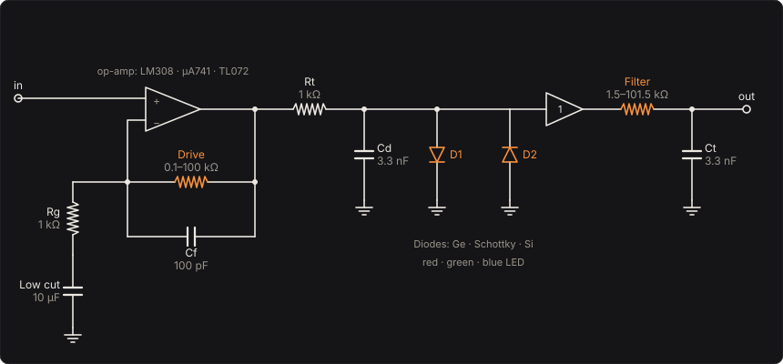

# Bandgap

An overdrive whose clipping you can see. An op-amp multiplies the bass by up to a hundred, then a
pair of diodes to ground holds the result near the voltage they turn on at. That voltage is the
material's **bandgap**: about 0.3 V for germanium, 0.6 V for silicon, and for an LED the energy of
the light it gives out, E = hc/λ, so red LEDs clip at about 1.8 V and blue ones at 2.5 V. Switch
between them and you hear Planck's constant: the bluer the light, the later the clipping, the
louder and more open the sound. The LEDs glow on the page as they conduct.

It is the circuit of the RAT and of a hundred pedals since: a non-inverting op-amp stage with a
pot in its feedback, then a resistor into diodes to ground, then a tone filter. The Bandgap solves it as it plays:
the op-amp with its finite gain–bandwidth, its slew rate and its rails, each diode by Shockley's
equation with its temperature, and the capacitors between.

Part of [PhuzzBox](../README.md).

| Input | |
|---|---|
| Your audio interface | pick it in the source menu (then **In 1** or **In 2**) |
| `Z`…`/`, `A`…`;`, `Q`…`P`, `1`…`0` | the test bass's E, A, D and G strings, open to the ninth fret |
| `Space` | the footswitch |

## The circuit



The bass goes straight into the op-amp's + input. Its output feeds back to the − input through
**Drive**, a 100 kΩ audio-taper pot (plus 100 Ω) with 100 pF across it, and the − input goes to
ground through 1 kΩ and the low-cut capacitor (10 µF). An ideal op-amp holds its two inputs
equal, so the gain is

  G = 1 + Z_f / Z_g,  Z_f = R_f ∥ 1/(sC_f),  Z_g = R_g + 1/(sC_g)

which in the middle of the bass's range is 1 + R_f/1 kΩ: from 1.1 with Drive down to 101 (40 dB)
full up, and 16 (24 dB) at its default. Below 1/(2π R_g C_g), 16 Hz with 10 µF, the capacitor's
impedance takes over and the gain falls to 1, so the lowest frequencies are not driven into the
diodes; above 1/(2π R_f C_f), 16 kHz with Drive full, the 100 pF takes the very top off.

From the op-amp's output, 1 kΩ feeds the diodes, with 3.3 nF across them (a pole at 48 kHz,
standing in for their capacitance and the wiring's). The diodes pull that node toward ground, and
the 1 kΩ is what they pull against: with the op-amp at its rail it lets about 2.4 mA through
silicon, and that current is what lights the LEDs.

A buffer follows the diodes, then **Filter**: 1.5 kΩ and a 100 kΩ pot into 3.3 nF, a low-pass at
1/(2π R_ft C_t), from 32 kHz with the knob down to 2.2 kHz at its default and 475 Hz full up. As
in the RAT, it comes after the clipping, so it takes off the highest of the harmonics the diodes
make without changing how hard they clip. Then **Level**, a gain in decibels.

## The diodes

Each diode passes Shockley's current,

  I = I_s (e^(V / n V_T) − 1),  V_T = kT/q (25.7 mV at 25 °C)

with an ideality factor n and a saturation current I_s set by the voltage it shows at 1 mA. Past
its knee the current grows tenfold for every ln 10 · n V_T, about 0.1 V in silicon:

| Diode | V at 1 mA | n | gap (eV) | |
|---|---|---|---|---|
| Germanium | 0.28 V | 1.6 | 0.66 | a point-contact germanium diode |
| Schottky | 0.32 V | 1.05 | 0.60 | a metal–silicon barrier, by thermionic emission |
| Silicon | 0.58 V | 1.75 | 1.12 | a small-signal silicon diode |
| Red LED, 630 nm | 1.77 V | 2.0 | 1.97 | |
| Green LED, 525 nm | 2.16 V | 2.0 | 2.36 | |
| Blue LED, 465 nm | 2.47 V | 2.0 | 2.67 | |

An LED's gap is the energy of its photons, hc/λ: an electron crossing the junction gives that
energy up as light, so it must have at least about that much to cross, and E/q is close to the
voltage it turns on at. Here each LED's voltage at 1 mA is hc/(λq) − 0.2 V, a typical margin for
a small LED; the slope of these voltages against 1/λ is Planck's constant over the electron's
charge, which is how a school laboratory measures h with a handful of LEDs and a voltmeter.

**Diodes each way** puts one or two in series each way (two turn on at twice the voltage), or one
up and two down, which clips the two halves of the wave at different levels and so adds even
harmonics to the odd ones a symmetrical clipper makes.

**Temperature** moves the saturation current as SPICE's diode model does,

  I_s(T) = I_s(T₀) (T/T₀)^(XTI/n) exp( (E_g / n k)(1/T₀ − 1/T) )

with XTI = 3 (2 for the Schottky). So at a fixed current

  dV/dT = (V − E_g/q − XTI kT/q) / T

about −2.1 mV/K for silicon, −1.5 mV/K for germanium, −0.9 mV/K for a red LED: warm diodes clip
lower. Only the diodes feel the temperature.

## The op-amp

The op-amp is a macromodel: its output x moves at

  dx/dt = SR · tanh( (v₊ − v₋) / V_s ),  V_s = SR / (2π · GBW)

For a small difference between the inputs this is an integrator, dx/dt = 2π GBW (v₊ − v₋): the
single dominant pole of a compensated op-amp, its open-loop gain falling to 1 at the gain–bandwidth
product GBW. So the closed loop's bandwidth is about GBW/G, 10 kHz with an LM308 at full drive.
For a large difference the tanh saturates and the output moves at the slew rate SR, the most its
compensation capacitor's charging current allows. And the output can't pass its rails: beyond
supply/2 − 1.5 V a soft clamp, a few millivolts wide, pulls it back.

| Op-amp | GBW | slew rate | |
|---|---|---|---|
| LM308 | 1 MHz | 0.3 V/µs | with 30 pF of compensation, as in the RAT |
| µA741 | 1 MHz | 0.5 V/µs | |
| TL072 | 3 MHz | 13 V/µs | JFET inputs |

The slew rate is the one figure guitarists argue about, and on a bass it matters little: the
LM308 takes 20 µs to swing from rail to rail at 9 V, which is one sample at 48 kHz; full-scale
sines slew-limit only above SR/(2π · 3 V) = 16 kHz. Its bandwidth does a little more at full
drive, a shade off the top of high notes when Filter is down. The tests measure both.

## Solving it

Four states: the op-amp's output, the voltages on C_f and C_g, and the diode node. (The
Filter's capacitor, behind its buffer, follows by the trapezoidal rule.) The equations
are stiff (the diodes' conductance changes by many orders of magnitude within a cycle, and the op-amp
pole is at a megahertz), so they are integrated by TR-BDF2, a trapezoidal step to the middle of
the sample then a second-order backward-difference step to its end, which is A-stable and damps
the high-frequency modes the trapezoidal rule alone leaves ringing. Each stage solves its implicit
equations by Newton's method, with the Jacobian's structure used to reduce each iteration to a
3×3 solve; the diode's voltage step is limited to 0.2 V so the exponential can't overshoot.
Two or three iterations a step is usual. The circuit runs at 4× the sample rate at high quality,
2× at medium and 1× at low, through the same oversampling filters as the other pedals.

## The controls

- **Drive**, **Filter**, **Level** and the **Diodes** switch are on the face.
- **Diodes each way**, **Op-amp**, **Temperature**, **Supply** and **Low-cut capacitor** are the
  parts, under *Diodes and op-amp*.

## The views

- **The diodes**: each family's current against its voltage, the chosen one
  bright, with the load line the 1 kΩ draws from each rail and the operating point's
  trail as you play. The LEDs glow by their current.
- **The response**: the small-signal gain from the bass to the output, from the circuit's complex
  impedances with the op-amp's finite gain–bandwidth: the low cut, the gain, the Filter's corner
  and the op-amp's.
- **Scope**: the input and the output in volts.
- **Spectrum**: the input's and the output's.

## What to listen for

- **Silicon**, **Germanium, soft and low** and **Red LEDs, open and loud**: the same gain into three
  bandgaps. Germanium squashes everything to 0.3 V; red LEDs let the bass's dynamics through until
  1.8 V.
- **Blue LEDs, barely clipping** and **No diodes: the rails**: the diodes clip only the loudest
  notes, at 2.4 V, then nothing does but the op-amp's rails, abruptly, at ±3 V from 9 V and
  ±7.5 V from 18 V.
- **Two each way** and **Lopsided: one up, two down**: twice the turn-on voltage, 1.2 V with silicon,
  then 0.6 V one way and 1.2 V the other, with even harmonics in the **Spectrum**.
- **Flat out, slow op-amp** against **Flat out, fast op-amp**: the LM308 against the TL072 at full
  drive and Filter down, the one place they differ, and only slightly.
- **Bright, guitar-pedal low cut**: 2.2 µF, as many guitar pedals have, moves the low cut to
  72 Hz, so a bass's low notes reach the diodes less driven than its higher ones.
- **Cold stage (−5 °C)** and **Hot stage (45 °C)**: silicon clipping at 0.68 V and at 0.58 V,
  1.3 dB apart.

## Plugged in backwards

The Bandgap has no **Reversed** switch. Plugged in backwards, the bass would drive the Level
buffer's output, and an op-amp's output passes nothing back to its input: it would be silent, as
a real one is.

## What is simplified

- The op-amp is the macromodel above: one pole, a tanh slew, a fixed 1.5 V of headroom at each
  rail and no output resistance, input offset or bias current. A real LM308's open-loop gain also
  has a second pole, and its output stage limits its current.
- The diodes have no series resistance, no junction capacitance (the 3.3 nF stands in for it) and
  no reverse breakdown, which back to back they never reach. Their values are typical of their
  kinds, not of a measured part: real LEDs of one colour vary by a tenth of a volt or more, and
  green and blue InGaN LEDs often sit a few tenths higher at their rated current than hc/λ
  suggests.
- The input has no coupling capacitor or bias resistor: the bass sees no load, where a real
  pedal's 1 MΩ bias resistor loads it lightly. The supply is ideal, centred on a half-supply
  reference that doesn't move.
- Only the diodes feel the temperature.

## Files

```
bandgap/index.html, style.css             page
bandgap/src/bandgap-params.js            parameters and presets
bandgap/src/bandgap-pedal.js             the descriptor: everything but the page
bandgap/src/bandgap-main.js              page wiring and views
bandgap/src/bandgap-worklet.js           its AudioWorklet module
bandgap/src/bandgap-tour.js              the guided tour
bandgap/src/bandgap-schematics.js        the circuit diagram
bandgap/wasm/bandgap.wasm                built from the C++
native/pedals/bandgap/                   the circuit, its solver and the engine in C++
test/bandgap-circuit.mjs                 the circuit solved independently, for the tests
test/bandgap-tests.mjs                   node test/bandgap-tests.mjs
```

## Prior art and references

* The circuit is the ProCo RAT's (1978) in outline: an LM308 non-inverting stage, a resistor into
  a pair of diodes to ground, then the Filter. Its values and analysis are in ElectroSmash's
  [RAT analysis](https://electrosmash.com/proco-rat). The Bandgap buffers the diodes from the
  Filter, and its diodes switch among six families.
* Shockley, W. (1949). "The theory of p-n junctions in semiconductors and p-n junction
  transistors." *Bell System Technical Journal* 28(3), 435–489.
* Sze, S. M. & Ng, K. K. (2007). *Physics of Semiconductor Devices*, 3rd ed. Wiley. Band gaps,
  the ideality factor, Schottky barriers.
* Schubert, E. F. (2006). *Light-Emitting Diodes*, 2nd ed. Cambridge University Press. Why an
  LED's forward voltage follows its photon energy.
* Measuring Planck's constant with LEDs, the classroom experiment:
  [Science in School, issue 28 (2014)](https://scienceinschool.org/2014/issue28/planck).
* Yeh, D. T., Abel, J. S. & Smith, J. O. (2007). "Simulation of the diode limiter in guitar
  distortion circuits by numerical solution of ordinary differential equations." *Proc. 10th
  Int. Conf. on Digital Audio Effects (DAFx-07)*, Bordeaux.
  [paper](https://dafx.de/paper-archive/details/pjj7lul37xFyy74-VjhoYw).
* Bank, R. E., Coughran, W. M., Fichtner, W., Grosse, E. H., Rose, D. J. & Smith, R. K. (1985).
  "Transient simulation of silicon devices and circuits." *IEEE Trans. Computer-Aided Design*
  4(4), 436–451. The TR-BDF2 method.
* Vladimirescu, A. et al. (1983). *SPICE Version 2G6 User's Guide*. University of California,
  Berkeley. The diode's temperature law (XTI, EG).
