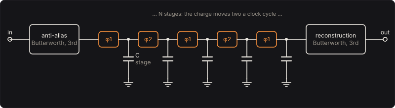

# Bucket Brigade

An analog delay with no tape and no digits: a chain of capacitors on a chip, joined by switches
that a clock opens and closes, passing the signal along as packets of charge like a line of people
passing buckets. The bass is sampled onto the first capacitor once a clock cycle and comes out the
far end N/2 cycles later, so the delay is

  τ = N / (2 fclk),

5.12 ms through 1024 stages at 100 kHz, 102 ms at 5 kHz. Swing the clock and the delay swings with
it, bending the pitch: the chorus, flanger and vibrato pedals of the late 1970s were made this way.
And because it samples, it obeys the sampling theorem: nothing above half the clock survives as
itself. Slow the clock, open the filters, and the bass's upper harmonics fold back as tones it never
played.

The same idea, packets of charge moved along by clocked electrodes, became the charge-coupled
device, for decades the sensor of digital cameras.

Part of [PhuzzBox](../README.md).

| Input | |
|---|---|
| Your audio interface | pick it in the source menu (then **In 1** or **In 2**) |
| `Z`…`/`, `A`…`;`, `Q`…`P`, `1`…`0` | the test bass's E, A, D and G strings, open to the ninth fret |
| `Space` | the footswitch |

## The chain



The chip is N capacitors in a row, each joined to the next by a transistor switch. A two-phase
clock closes the odd switches (φ1) and the even ones (φ2) in turn: each half-cycle every charge
moves one stage along, so each full cycle it moves two, and the chain holds N/2 samples at once. At
the input, the bass's voltage at that instant is put on the first capacitor; at the output, the
voltage on the last one is read and held until the next comes, a staircase at the clock's rate.

So the chip samples, and the sampling theorem (Nyquist's and Shannon's) says what survives: a tone
at f, sampled at fclk, gives exactly the same samples as one at its alias, the distance from f to
the nearest multiple of fclk. A 6.5 kHz tone through an 8 kHz clock comes out at 1.5 kHz. Below half
the clock nothing is confused; above it, everything is. Two filters keep it honest: a third-order
Butterworth low-pass before the chip, against aliasing, and a matching one after it, to smooth the
staircase. Their **Filter corner** set below half the clock keeps the aliases down: with the
filters at 3 kHz, the 6.5 kHz tone's 1.5 kHz alias is 20 dB down. Opened past it, a low clock's
aliases come through, the metallic gargle of a cheap delay.

The staircase itself is the sampled signal held for a cycle, whose response is

  sinc(f/fclk) · e^(−iπf/fclk),

a gentle droop to −3.9 dB at half the clock, and half a cycle more delay.

## Charges left behind

No transfer is perfect. At each one a share ε of the charge stays behind and joins the charge
following it, one clock cycle later. A charge makes N transfers, and arrives m cycles late with the
chance that it was left behind m times among them, the negative binomial distribution

  p_m = C(N + m − 1, m) (1 − ε)^N ε^m,

whose sum, as a filter at the clock's rate, is

  C(z) = ((1 − ε) / (1 − ε z⁻¹))^N.

It passes DC whole and takes the highs off: at half the clock it is ((1 − ε)/(1 + ε))^N, about
e^(−2Nε). Through 1024 stages at 100 ppm that is 1.78 dB; through 4096 at 500 ppm, 35.6 dB, and at a
40 kHz clock the same chain loses 0.22 dB at 1 kHz, 0.87 dB at 2 kHz and 5.21 dB at 5 kHz.

## A swinging clock

A triangle wave swings the clock, fclk(1 + depth · tri). The count of stages doesn't change, so a
charge that comes out now went in when the clock had counted N/2 fewer cycles. If the clock is
faster now than it was then, the charges come out faster than they went in: the output's frequency
is the input's times fclk(now)/fclk(then). At 15 % and 0.8 Hz around 100 kHz the pitch wavers
about 6 cents either way, a chorus's drift; the Vibrato preset's 20 % at 5 Hz, half a semitone.
The tests count the clock's cycles to find each output's moment of entry and check the engine's
pitch, measured from its zero crossings, against it: −40.8 to +40.8 cents against −42.4 to +42.4
at 30 % and 2 Hz.

## The comb

**Mix** adds the delayed sound to the dry. Where the delay puts them in step they add; where in
opposition, they cancel: at 50 %, notches at the odd multiples of 1/(2τ), 97.7 Hz, 293 Hz, 488 Hz
… for 5.12 ms. **Feedback** g returns the delayed sound to the input, so the whole is

  (1 − mix) + mix · H / (1 − g H),

H the chip's response, which sharpens the comb's peaks into a flanger's ringing (negative g puts
the peaks where the notches were). With 512 stages at 150 kHz the delay is 1.71 ms and the peaks
come every 586 Hz.

## Solving it

The filters run at the oversampled rate, by the bilinear transform with each section's corner
prewarped. The clock is a phase that runs on at that rate; each time it completes a cycle, at
whatever fraction of a step, the anti-aliased input there is taken by a straight line between the
steps and put on the chain, and the charge N/2 cycles older comes off it through the transfer
loss's taps (as many as it takes for the tail to fall under 10⁻⁹), and is held. The reconstruction
filter is fed each step's average of the held voltage, exact for a staircase whose steps fall
between the steps. The delayed sound returns to the input one step late, 1/192 kHz at high quality.
A third-order filter, a few taps and a buffer of charges: about 1 % of a core.

At high quality the circuit runs at 4× the sample rate, 2× at medium and 1× at low. The engine
follows the chip's response to 0.1 dB up to the filters' corner or 7.6 kHz; above that, the straight
line between steps and the average take a few tenths of a decibel more at 14 kHz.

## The controls

- **Clock**, **Rate**, **Depth**, **Feedback**, **Mix** and **Level** are on the face. An
  expression pedal (MIDI CC 1) sweeps the Clock.
- **Stages**, **Transfer loss** and **Filter corner** are the chip, under *The chip*.

## The views

- **The buckets**: 28 of the chain's capacitors from the input to the output, each filled with its
  charge as you play: the last delay's worth of the bass, laid out along the chip.
- **The response**: the whole pedal's gain against frequency with the clock at rest, and the chip's
  own (dashed); the band above half the clock shaded.
- **Scope**: the input and the output in volts.
- **Spectrum**: the input's and the output's.

## What to listen for

- **Chorus**: 5.12 ms, swinging 15 % at 0.8 Hz, half and half with the dry.
- **Vibrato**: the delayed sound alone, the clock swinging 20 % at 5 Hz: half a semitone.
- **Flanger** and **Negative flanger**: 512 stages at 150 kHz, 1.71 ms swung 45 % slowly, with 70 %
  feedback, then −70 %: the comb's peaks sweeping through the bass, then its notches.
- **Slapback**: 4096 stages at 30 kHz, 68.3 ms, one repeat.
- **Dark echoes**: 4096 stages at 12 kHz, 171 ms, the filters at 4 kHz and 55 % feedback: each
  repeat darker.
- **Aliasing**: 4096 stages at 8 kHz, 256 ms, the filters wide open: upper harmonics fold back below
  4 kHz into tones the bass never played.
- **Leaky chain**: 4096 stages at 40 kHz, 500 ppm left behind at each transfer: 5.21 dB off at 5 kHz.

## What is simplified

- The switches and capacitors are ideal but for the transfer loss: no kT/C noise frozen onto each
  capacitor as it opens, no clock feedthrough, no leakage while a charge waits, and no clipping
  where a real chip runs out of headroom. Real BBD pedals also put a compander around the chip to
  hide its hiss, which has nothing here to hide.
- The two-phase clock is one phase that completes a cycle; the output is read once a cycle rather
  than from the two outputs real chips sum. The filters are ideal Butterworths, not their op-amps.
- The triangle swings the clock's frequency linearly, as a voltage-controlled oscillator would.

## Files

```
bbd/index.html, style.css             page
bbd/src/bbd-params.js                parameters and presets
bbd/src/bbd-pedal.js                 the descriptor: everything but the page
bbd/src/bbd-main.js                  page wiring and views
bbd/src/bbd-worklet.js               its AudioWorklet module
bbd/src/bbd-tour.js                  the guided tour
bbd/src/bbd-schematics.js            the chain's diagram
bbd/wasm/bbd.wasm                    built from the C++
native/pedals/bbd/                   the chain, its filters and the engine in C++
test/bbd-circuit.mjs                 the chain worked out independently, for the tests
test/bbd-tests.mjs                   node test/bbd-tests.mjs
```

## Prior art and references

* Sangster, F. L. J. and Teer, K. (1969). "Bucket-brigade electronics: new possibilities for
  delay, time-axis conversion, and scanning." *IEEE Journal of Solid-State Circuits* 4(3),
  131–136. [doi:10.1109/JSSC.1969.1049975](https://doi.org/10.1109/JSSC.1969.1049975)
* Sangster, F. L. J. (1970). "Integrated bucket-brigade delay line using MOS tetrodes." *Philips
  Technical Review* 31, 266: "the residue per stage in a MOS delay line is about 1/1000 of the
  signal sample", which the tetrode stage cuts "by a factor of between 10 and 20", allowing
  "several thousand stages in cascade": 50 to 100 ppm, the default here.
  [scan](https://pearl-hifi.com/06_Lit_Archive/02_PEARL_Arch/Vol_16/Sec_53/Philips_Tech_Review/PTechReview-31-1970-266.pdf)
* Weckler, G. P. (1977). "Bucket brigade devices circa 1977." Short course notes, Reticon
  Corporation: "at lower rates an efficiency of 0.99995 is not uncommon", and the loss from the
  charges left behind as −17.4 Nε sin²(πf/fclk) dB, the small-ε form of the transfer loss above.
  [scan](https://www.imagesensors.org/Past%20Workshops/Marvin%20White%20Collection/1977%20Short%20Course/1977%203%20Weckler.pdf)
* Boyle, W. S. and Smith, G. E. (1970). "Charge coupled semiconductor devices." *Bell System
  Technical Journal* 49(4), 587–593.
  [doi:10.1002/j.1538-7305.1970.tb01790.x](https://doi.org/10.1002/j.1538-7305.1970.tb01790.x)
  They shared the 2009 Nobel Prize in Physics with Charles Kao, "for the invention of an imaging
  semiconductor circuit – the CCD sensor". [nobelprize.org](https://www.nobelprize.org/prizes/physics/2009/summary/)
* Nyquist, H. (1928). "Certain topics in telegraph transmission theory." *Transactions of the
  AIEE* 47(2), 617–644. [doi:10.1109/T-AIEE.1928.5055024](https://doi.org/10.1109/T-AIEE.1928.5055024)
* Shannon, C. E. (1949). "Communication in the presence of noise." *Proceedings of the IRE* 37(1),
  10–21. [doi:10.1109/JRPROC.1949.232969](https://doi.org/10.1109/JRPROC.1949.232969)
* Panasonic. MN3004 (512 stages), MN3007 (1024), MN3008 (2048) and MN3005 (4096) BBD datasheets,
  the chips of the 1970s and 80s pedals, each with a 10–100 kHz clock and the delays
  N/(2 fclk): 2.56–25.6 ms for the 512, 20.48–204.8 ms for the 4096.
  [MN3004](https://www.radioradar.net/en/files.html?fid=500760),
  [MN3007](https://www.radioradar.net/en/files.html?fid=500757),
  [MN3008](https://www.radioradar.net/en/files.html?fid=500756),
  [MN3005](https://www.radioradar.net/en/files.html?fid=500759)
* Holters, M. and Parker, J. (2018). "A combined model for a bucket brigade device and its input
  and output filters." *Proc. 21st Int. Conf. on Digital Audio Effects (DAFx-18)*, Aveiro.
  [paper](https://dafx.de/paper-archive/2018/papers/DAFx2018_paper_12.pdf)
