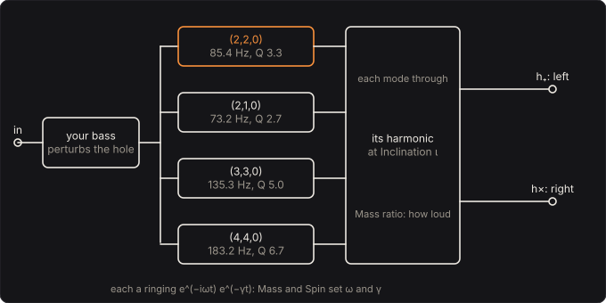

# Black Hole

When two black holes merge, the hole they leave rings like a struck bell, and LIGO hears the
ringing: a wave in spacetime at one frequency, dying away at one rate, the hole's quasinormal
modes. Those two numbers are set by the hole's mass and spin alone. Here your bass is what strikes
it. Every note you play drives the hole's four loudest modes, and you hear the strain they ring
with, h₊ on the left and h× on the right. A hole that does not spin rings for barely two cycles,
a thud; spin it toward the limit and it rings on, a bell tuned to the horizon's spin.

Part of [PhuzzBox](../README.md).

| Input | |
|---|---|
| Your audio interface | pick it in the source menu (then **In 1** or **In 2**) |
| `Z`…`/`, `A`…`;`, `Q`…`P`, `1`…`0` | the test bass's E, A, D and G strings, open to the ninth fret |
| `Space` | the footswitch |

## The path

## The modes

A perturbed Kerr hole of mass M and spin a (a = J/M², from 0 to 1, in units G = c = 1) rings in
modes labelled (l, m, n): l and m as for the harmonics on a sphere, n the overtone. Each rings
as e^(−iωt) with a complex ω whose real part is the frequency and whose imaginary part is the decay
rate, and each scales as one over the mass:

  f = Re(Mω) / 2πM,  γ = −Im(Mω) / M,  Q = πf / γ,

with M in seconds, GM☉/c³ = 4.925 µs a sun. Mω depends on the spin alone. It is found by
Leaver's method: the Teukolsky equation for the hole's perturbations separates into an angular and
a radial equation, each solved as a series whose coefficients obey a three-term recurrence; a
mode is where both continued fractions vanish together.

The Black Hole reads Mω from Forte's table of Leaver solves: the Black Hole instrument of Forte,
PhuzzBox's sibling, computed it, and the table is copied here unchanged. It holds every mode from
l = 2 to 4, with two overtones, at 117 spins from none to a = 1 − 10⁻⁶, and the engine interpolates between them. The
tests solve Leaver's continued fractions afresh at spins between the table's (Forte's solver,
copied into the tests): the engine's modes agree to 1.6 × 10⁻⁶. They also match the literature:
Leaver's Schwarzschild modes, Mω = 0.37367 − 0.08896i for (2,2,0), and Berti, Cardoso and Will's
0.671613 − 0.064869i at a = 0.9.

The four modes it plays are the loudest after a merger: (2,2,0), (2,1,0), (3,3,0) and (4,4,0). At
the defaults, 200 suns at a = 0.69, they ring at 85.4, 73.2, 135.3 and 183.2 Hz, each for about
12 ms (1/γ). The hole's horizon is then 509 km in radius.

## Spin: a thud and a bell

| 200 suns | (2,2,0) | decays at | Q |
|---|---|---|---|
| no spin | 60.4 Hz | 90.3 per second | 2.1 |
| a = 0.69 | 85.4 Hz | 82.4 per second | 3.3 |
| a = 0.99 | 140.7 Hz | 29.8 per second | 14.8 |
| a = 0.9999 | 159.2 Hz | 3.52 per second | 142 |
| a = 0.999999 | | | 1415 |

**Spin** is in nines, a = 1 − 10^(−nines): 2 nines is 0.99, 4 is 0.9999. The tests ring the engine
with a click and measure the frequency and decay of the (2,2,0) mode it rings with; at each of the
first four spins above they are Leaver's to the third decimal.

Near the limit the l = m modes do something simple. Hod showed that as a → 1 they go to

  ω → m Ω_H − 2πi T_H (n + ½),

harmonics of the horizon's angular velocity Ω_H, damped by its Hawking temperature T_H, which
goes to zero. So the modes slide onto 2 : 3 : 4 of the horizon's spin and ring longer and longer.
At 200 suns the limit is 161.6 Hz for (2,2,0), 242.3 Hz for (3,3,0) and 323.1 Hz for (4,4,0). At
six nines the engine's modes are within 0.05 % of Hod's limit, (3,3) / (2,2) is 1.5002 and
(4,4) / (2,2) 2.0004. The (2,1,0) mode does not follow: m = 1 is not l, and it stays short.

## Mass: the pitch

The ringing goes as one over the mass. 65 suns rings the (2,2,0) mode at middle C (262 Hz) at the
default spin, 200 suns at 85 Hz, just above the open E's second harmonic, and 414 suns on the open
E itself, 41.2 Hz. The remnant of GW150914, LIGO's first detection, was 62 suns at a = 0.67 in its
own frame: the GW150914 preset rings at 270.9 Hz, for 3.7 ms. LIGO heard it lower, since the
universe stretched it on the way (redshift 0.09), and its masses are measured to a few suns.

## The merger and the listener

How strongly each mode rings depends on how the hole was made. Kamaretsos and colleagues fitted
the amplitudes of the modes after mergers of non-spinning holes in numerical relativity, as
functions of the mass ratio q; Gossan, Veitch and Sathyaprakash give the fits used here. Relative
to (2,2,0): at q = 3, (2,1,0) rings at 0.194, (3,3,0) at 0.236 and (4,4,0) at 0.046. Equal masses
leave the odd-m modes silent, by symmetry; at 8 : 1 (2,1,0) and (3,3,0) are 0.36 and 0.35 of the
(2,2,0).

Where you hear it from matters too. A mode (l, m) is heard through its spin-weighted spherical
harmonic ₋₂Y_lm at the inclination ι, the angle between the spin axis and you, computed by
Goldberg's formula. For a merger that does not precess, the mode with −m rings as its mirror
image, so for each mode

  h₊ ∝ A (Y_lm + (−1)^l Y_l,−m) cos ωt,  h× ∝ −A (Y_lm − (−1)^l Y_l,−m) sin ωt.

Face-on (ι = 0) only Y₂₂ is left: h₊ and h× are equal and a quarter cycle apart, a circularly
polarised wave. The tests measure 88.6° between them, with h× / h₊ 1.003. Edge-on (ι = 90°)
Y_22 and Y_2,−2 are equal and the (2,2,0) mode's h× vanishes.

## Solving it

Each mode is a complex one-pole at its own ω, ζ ← e^((−γ − 2πif)T) ζ + g x, so a click rings as
e^(−iωt) exactly, sampled. The left channel is Σ plus · Re ζ, the right Σ cross · Im ζ. The tests
compare the engine's whole ringing, all four modes in both channels at q = 6, a = 0.9 and 60°,
against the same modes summed from fresh Leaver solves: they agree to 0.0000 % RMS. Modes at or
above 0.45 of the sample rate are left out, a guard: within the controls' range none gets there. It costs 0.08 %
of a core.

The detector's gain g is set so that white noise in comes out of the two channels, on average, at
its own level, the energy of the four modes summed in pairs, since they overlap. In the tests it
is within 0.08 dB, without spin and at two nines.

## The controls

* **Mass**: 30–3000 suns; the pitch.
* **Spin**: 0–6 nines; from thud to bell.
* **Hole** and **Dry**: the mix.
* **Mass ratio**: 1–10; how loud the (2,1,0), (3,3,0) and (4,4,0) modes are.
* **Inclination**: 0–90°; where you hear the hole from.
* **Level**: gain after the mix.

## The views

* **The modes**: the four modes' frequencies and decay times, with the path each takes as the spin
  goes from none to six nines.
* **The ringing**: what one click does to the hole, h₊ and h×.
* **Spectrum** and **Scope**: the input and the left channel as they play.

## What to listen for

* **Bass hole**: the defaults, 200 suns at a = 0.69; each note gets a short, dark tail.
* **Thud: no spin**: the shortest ringing a hole can make.
* **Bell: nearly extremal**: four nines; the hole rings on after each note.
* **On the open E**: 414 suns, tuned to the open E.
* **GW150914**: LIGO's first hole, at 62 suns in its own frame.
* **Lopsided merger** and **Edge-on**: the merger and the listener.

## What is simplified

* **Your bass is not a physical perturbation.** A hole is rung by what falls into it or by the
  merger that made it; here every mode is driven directly by the bass's voltage, as a click
  drives a resonator. The ringing is the hole's; what strikes it is not.
* **Fundamentals only.** Only the n = 0 modes ring, not the overtones, which die faster but matter
  right after a merger.
* **Spherical, not spheroidal, harmonics.** A spinning hole's modes are heard through spheroidal
  harmonics, which differ from the spherical ones more as aω grows; the Black Hole uses the
  spherical ones.
* **Amplitudes from non-spinning mergers.** The fits for each mode's strength come from mergers of
  holes that did not spin; here they are used at every spin, and the modes all start in phase.
* **No inspiral, no merger.** Only the ringdown.

## Files

* `src/blackhole-params.js`: the controls and the presets (the C++ tables are generated from them).
* `src/blackhole-main.js`: the page's views; `src/blackhole-tour.js`: the tour;
  `src/blackhole-schematics.js`: the diagram above.
* `native/pedals/blackhole/qnm-table.h`: Forte's table of Leaver solves.
* `native/pedals/blackhole/blackhole-model.h`, `blackhole-model.cpp`: the modes, the harmonics and
  the merger's amplitudes.
* `native/pedals/blackhole/blackhole-engine.cpp`: the four resonators and the gain;
  `blackhole-web.cpp`: the page's model calls.
* `test/blackhole-leaver.mjs`: Forte's Leaver solver; `test/blackhole-circuit.mjs`: the
  literature's values, Hod's limit, the harmonics in closed form and the amplitude fits.
* `test/blackhole-tests.mjs`: the engine against those, and each hint.

## Prior art and references

* E. W. Leaver (1985). "An analytic representation for the quasi-normal modes of Kerr black
  holes." *Proc. R. Soc. Lond. A* 402, 285–298.
  [doi:10.1098/rspa.1985.0119](https://doi.org/10.1098/rspa.1985.0119). The continued fractions.
* S. A. Teukolsky (1973). "Perturbations of a rotating black hole. I. Fundamental equations for
  gravitational, electromagnetic, and neutrino-field perturbations." *Astrophys. J.* 185, 635.
  [doi:10.1086/152444](https://doi.org/10.1086/152444)
* E. Berti, V. Cardoso & C. M. Will (2006). "Gravitational-wave spectroscopy of massive black
  holes with the space interferometer LISA." *Phys. Rev. D* 73, 064030.
  [doi:10.1103/PhysRevD.73.064030](https://doi.org/10.1103/PhysRevD.73.064030). The test value at
  a = 0.9.
* S. Hod (2008). "Slow relaxation of rapidly rotating black holes." *Phys. Rev. D* 78, 084035.
  [doi:10.1103/PhysRevD.78.084035](https://doi.org/10.1103/PhysRevD.78.084035). The near-extremal
  limit.
* J. N. Goldberg, A. J. Macfarlane, E. T. Newman, F. Rohrlich & E. C. G. Sudarshan (1967).
  "Spin-s spherical harmonics and ð." *J. Math. Phys.* 8, 2155–2161.
  [doi:10.1063/1.1705135](https://doi.org/10.1063/1.1705135)
* I. Kamaretsos, M. Hannam, S. Husa & B. S. Sathyaprakash (2012). "Black-hole hair loss: Learning
  about binary progenitors from ringdown signals." *Phys. Rev. D* 85, 024018.
  [doi:10.1103/PhysRevD.85.024018](https://doi.org/10.1103/PhysRevD.85.024018)
* S. Gossan, J. Veitch & B. S. Sathyaprakash (2012). "Bayesian model selection for testing the
  no-hair theorem with black hole ringdowns." *Phys. Rev. D* 85, 124056.
  [doi:10.1103/PhysRevD.85.124056](https://doi.org/10.1103/PhysRevD.85.124056). The amplitude
  fits (their Eqs. 5–8).
* B. P. Abbott et al. (2016). "Properties of the binary black hole merger GW150914." *Phys. Rev.
  Lett.* 116, 241102.
  [doi:10.1103/PhysRevLett.116.241102](https://doi.org/10.1103/PhysRevLett.116.241102). The
  remnant's 62 suns and spin 0.67.
* Forte's Black Hole, PhuzzBox's sibling: the same modes as an instrument, with the inspiral and
  merger before them. Its table and Leaver solver are copied here.
