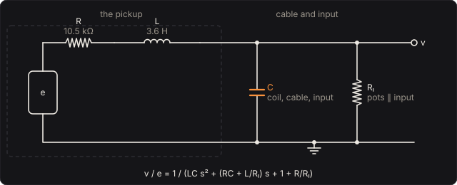

# Buffer

A passive bass pickup is a coil of a few henries, and the cable it drives is a capacitor. Together
they resonate, somewhere between 1 and 6 kHz, and whatever the cable plugs into either lets that
resonance ring or soaks it up. The Buffer computes that circuit twice: once as you are actually
plugged in (your cable into your audio interface, which has already shaped the signal arriving
here) and once as you want to hear it (a longer cable, a vintage fuzz's hungry 10 kΩ input, a
buffer right at the bass). It plays the difference. At its defaults the two are the same and the
signal passes untouched; turn **Cable length** up and you hear the top end of a long stage cable
roll off, turn **Input impedance** down and you hear what a low-impedance pedal does to a passive
bass before it does anything else.

Part of [PhuzzBox](../README.md).

| Input | |
|---|---|
| Your audio interface | pick it in the source menu (then **In 1** or **In 2**) |
| `Z`…`/`, `A`…`;`, `Q`…`P`, `1`…`0` | the test bass's E, A, D and G strings, open to the ninth fret |
| `Space` | the footswitch |

## The physics

The strings move steel through the pickup's field and induce an EMF *e*. The coil delivers it
through its own resistance *R* and inductance *L*, across a capacitance *C* to ground (the coil's
own winding capacitance, plus the cable's, plus the input's), and a resistance Rₗ to ground (the
bass's volume and tone pots, in parallel with the input it plugs into):



  v / e = 1 / (L C s² + (R C + L / Rₗ) s + 1 + R / Rₗ)

a second-order low-pass. With little damping it peaks near

  f₀ = 1 / (2π √(L C))

which is about 4.2 kHz for a 3.6 H pickup with 100 pF of its own and 3 m of 100 pF/m cable. Thirty
metres of the same cable put 3.1 nF across it and drop f₀ to 1.5 kHz: the top end of the bass
goes. A 10 kΩ input (a vintage germanium fuzz's) damps the peak away entirely, and since the coil's
10.5 kΩ of wire and that input make a divider, the level falls by about 6 dB too.

Your audio interface has already applied this filter once, with your cable and its own input
(usually 1 MΩ). The EMF is the same in both cases, so the pedal's filter is the ratio of the two:

  H(s) = D_plugged in(s) / D_wanted(s)

which is exactly 1 when the two circuits match. It is a biquad, discretised by the matched-z
transform (each pole and zero of *H* moved to e^{sT}), so both resonances ring at exactly the
right frequency; the response follows the analog one within 0.3 dB up to 8 kHz in every preset.

An **active** bass drives the cable from its preamp's output resistance (about 1 kΩ) with no
inductance: v / e = 1 / (R C s + 1 + R / Rₗ), whose corner sits far above the audio band for any
cable. Tick it and the cable and the load stop mattering, which is the point of active
electronics.

The controls:

- **Your bass**: the pickup's inductance, resistance and own capacitance, and the pots to ground.
  The defaults are a split-coil P pickup's, roughly (3.6 H, 10.5 kΩ).
- **How you are plugged in**: your cable's length, its capacitance per metre, and your
  interface's input impedance. Set these to what you have, and the pedal takes their effect off.
- **What it drives**: the cable and input you want to hear.
- **Level**: gain after it all.

## What to listen for

- **Thirty metres of cable**: the top of the slap and the string noise go dull, the fundamental
  stays.
- **Vintage fuzz input (10 kΩ)**: duller and quieter at once. This is why a germanium fuzz
  sounds different on a passive bass than on an active one, before any transistor clips.
- **Pedal by the bass (30 cm)**: a little brighter than your interface hears it, the resonance
  a little higher and stronger.

## Plugged in backwards

The Buffer has no **Reversed** switch: it has no circuit of its own to turn round, only what a cable
and an input do to your pickup. The [Wah](../wah/README.md) has one, and squeals.

## What is simplified

- The pickup is a lumped *R*, *L*, *C*. A real coil's inductance falls and its losses rise at high
  frequencies (eddy currents in the pole pieces and cover), which damps the resonance more than this
  model does.
- The tone pot and its capacitor are folded into one resistance: with the tone open, the capacitor
  is behind 250 kΩ and matters little; rolled off, it would add a pole this model leaves out.
- The interface's input capacitance is not modelled (a few tens of pF, a fraction of a metre of
  cable).
- The input signal is assumed to come from a passive pickup through the "How you are plugged in"
  circuit. From an active bass or a DI, set **Active electronics**.

## Files

```
buffer/index.html, style.css            page
buffer/src/buffer-params.js             parameters and presets
buffer/src/buffer-pedal.js              the descriptor: everything but the page
buffer/src/buffer-main.js               page wiring and views
buffer/src/buffer-worklet.js            its AudioWorklet module
buffer/wasm/buffer.wasm                 built from the C++
native/pedals/buffer/                   the physics in C++ (plugins and WebAssembly)
native/core/include/phuzzbox/pickup.h   the pickup circuit, shared with the test bass
test/buffer-tests.mjs                   node test/buffer-tests.mjs
```

## Prior art and references

* Horton, N. G. & Moore, T. R. (2009). "Modeling the magnetic pickup of an electric guitar."
  *Am. J. Phys.* 77(2), 144–150.
  [doi:10.1119/1.2990663](https://doi.org/10.1119/1.2990663). The pickup as a moving steel element
  in a magnet's field, inducing an EMF in a coil.
* The pickup's load as a series RLC circuit is ordinary circuit theory; the matched-z transform is
  in any digital signal processing text.
