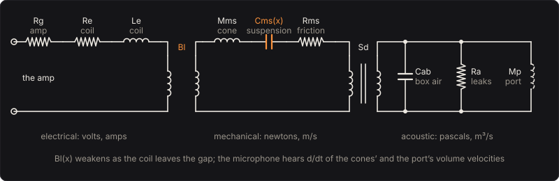

# Speaker Cabinet

A bass cabinet heard by a microphone: an 8 × 10, a 4 × 10, a 2 × 10 or a 1 × 15, sealed or
ported, or for a guitar a 4 × 12, 2 × 12 or 1 × 12 of guitar drivers, modelled from its drivers' Thiele–Small parameters. The amp's volts drive a voice coil in a
magnet's gap. The coil pushes a cone on its suspension, and the cone pushes on the air in the box
and, through a port, on the air in the port. The microphone, 1 m away, hears what all that air
does. Nothing is a recorded response: the low end, the bump at the box's resonance, the darker top
and the way loud low notes thicken all come from those parts.

## The circuit

A loudspeaker is three systems coupled together, and each has a circuit's equations: the coil's
volts and amps, the cone's forces and velocities, the box's pressures and volume velocities. The
motor couples the first two (a force Bl·i on the cone, a back voltage Bl·u in the coil), the cone's
area Sd the last two (a force Sd·p on the cone, a volume velocity Sd·u into the box).

For one driver, with e its share of the amp's volts, i the coil's current, x and u the cone's travel
and velocity, p the box's pressure (over its share of the box) and u_p the air's velocity in its
share of the port:

  L_e di/dt = e − (R_e + R_g) i − Bl(x) u
  M_ms du/dt = Bl(x) i − R_ms u − K(x) x + S_d p
  C_ab dp/dt = −S_d u − S_p u_p − p / R_a
  M_p du_p/dt = S_p p

The box's air is a spring, C_ab = V_b/(ρc²). Ported, it leaks through R_a, set to a loss Q of 7
at the port's tuning; sealed, it doesn't. The port's air is a mass, M_p = ρ S_p L_eff, where L_eff is the port's length plus end
corrections of 1.463 radii (one flanged end, one free).

The drivers share the box equally, so each one sees its share of the box and of the ports. Wired
two in series (the 4 × 10 and 8 × 10), each gets half the amp's volts. The impedance the amp sees
is a driver's times s²/N, for s in series and N in all: 5.6 Ω coils make a 5.6 Ω 8 × 10.

## The drivers

A driver's datasheet gives its Thiele–Small parameters. These are the small-signal parameters
Thiele and Small used to describe a driver in a box: its resonance in free air F_s, its electrical
and mechanical Q (Q_es and Q_ms), the volume of air as springy as its suspension V_as, and its coil
and cone. They turn into masses, springs and a motor:

  C_ms = V_as / (ρc² S_d²),  M_ms = 1/((2πF_s)² C_ms)
  Bl = √(2πF_s M_ms R_e / Q_es),  R_ms = 2πF_s M_ms / Q_ms

| | 10-inch | 15-inch |
|---|---|---|
| F_s | 45 Hz | 38 Hz |
| Q_es, Q_ms | 0.375, 5 | 0.4, 6 |
| V_as | 54 L | 180 L |
| R_e, L_e | 5.6 Ω, 0.8 mH | 5.4 Ω, 1.5 mH |
| S_d | 350 cm² | 855 cm² |
| X_max | 4 mm | 6 mm |

So the 10-inch has a 40.2 g cone on a 3.21 N/mm suspension and a 13.0 T·m motor. The values are
typical of bass drivers of each size, not one maker's.

A guitar's 12-inch driver is another animal, and its values are one maker's, Eminence's for its
Legend 1258 (an 8 Ω guitar driver): F_s 94 Hz, Q_es 1.18, Q_ms 6.15, V_as 32.5 L, R_e 7.44 Ω,
L_e 0.7 mH, S_d 506.7 cm² and X_max 0.48 mm. A light cone on a stiff suspension with a weak motor:
it is barely damped (Q_ts 0.99), rolls off a guitar's low E rather than reaching under it, and has
a tenth of a bass driver's travel.

## Sealed and ported

Sealed, the box's air is a second spring behind the cone. Thiele and Small's closed box is a
second-order high-pass filter with

  f_c = F_s √(1 + α),  Q_tc = Q_ts √(1 + α),  α = V_as / V_b

The 8 × 10 sealed preset puts eight 10-inch drivers in 200 L, so α = 2.16, f_c = 80.0 Hz and
Q_tc = 0.620. Below f_c the sound rolls off at 12 dB an octave, and the impedance peaks at f_c.

Ported, the port's air resonates with the box's spring at the Helmholtz frequency

  f_b = (c/2π) √(S_p / (V_b L_eff))

The 4 × 10 ported preset's two 10 cm ports, 9 cm long, in 140 L tune it to 45.3 Hz. Near f_b the
port does the work: the impedance dips between two peaks and the cones barely move. Below it, the
port's air no longer pushes back, the cones flap freely and the sound falls toward 24 dB an
octave. A low B (31 Hz) moves the cones 6.15 mm per volt, against 1.05 mm at the tuning.

The **Guitar 4 × 12 closed back** preset, which a page set for a guitar starts from, puts four
Legend 1258s in about 120 L, sealed, wired two in series by two in parallel (8 Ω), on a tube
amp's 4 Ω: α = 4 × 32.5/120 = 1.08, so f_c = 135.7 Hz and Q_tc = 1.43, a bump an octave above
the low E that is much of a guitar cabinet's thump.

## Reference efficiency

How loud a driver is for its watts is fixed by the same parameters. Small's reference efficiency,
radiating into half space, is

  η₀ = (4π²/c³) F_s³ V_as / Q_es

which is 1.28 % for the 10-inch: 93.2 dB SPL at 1 m for 1 W into R_e. The microphone hears

  p = N ρ/(2π r) · d/dt (S_d u + S_p u_p)

at r = 1 m, from all N drivers: the cones' and ports' volume acceleration, radiating into half space
(the cabinet on the floor, the microphone in front). The Microphone sensitivity turns pascals into
volts. Eight drivers, each with the same volts and its share of the box, make 18.06 dB (8 times the
pressure) more than one.

## When the cones run out of travel

Two parts of a driver change as the cone moves far. The coil leaves the magnet's gap, so the force
factor falls; and the suspension stiffens. Here

  Bl(x) = Bl / (1 + (x / 2.13 X_max)²),  K(x) = K_ms (1 + (x / 1.5 X_max)²)

so at X_max the force factor is 82 % of its rest value (a common definition of X_max) and the
suspension 44 % stiffer. Both are even in x, so the distortion they make is mostly odd harmonics,
and both take the most from the lowest, loudest notes, which move the cones furthest. A 0.15 V low
E at 32 dB of power amp gain is clean (0.61 % distortion). A 0.3 V one at 44 dB takes the 8 × 10
past X_max: 35.8 % distortion, and 12 dB more gain makes it only 10.7 dB louder. A 200 Hz note at the
same level stays at 0.30 %.

The port has its own limit: the air in it gets fast on loud low notes, which chuffs in a real
cabinet. Two ports tuned to 45 Hz, 7 cm across, carry it at 29.0 m/s on a loud note at the tuning;
12 cm across, at 9.9 m/s. The model keeps the port's air linear, so you see that speed in the
view rather than hear the chuff.

## Solving it

The four equations (five states with the travel) are integrated by the classic fourth-order
Runge–Kutta method at the sample rate, with the input held through each sample. The coil's time
constant L_e/(R_e + R_g) is the fastest rate. When it is too short for one step a sample, the
engine takes more, smaller steps: RK4 stays stable to |λh| ≈ 2.8, and it keeps |λh| under 1.5.
Against the small-signal response solved exactly, a 1 mV sine is within 0.01 dB from 25 Hz to
1.2 kHz. By 4 kHz holding the input through each sample shows, and it is 0.1 dB above. The output
is the volume acceleration at the end of each sample, which needs no differentiating. When every
state falls below what anyone could hear by hundreds of decibels, they are all set to zero
together, so silence after a note costs what silence from rest does. It takes under 0.5 % of a
core, with no latency.

## The controls

* **Power amp gain**: the clean power amp's voltage gain from your bass's volts to the cabinet's.
  It sets how hard the cones are pushed.
* **Microphone sensitivity**: the microphone's volts per pascal, the pedal's output level. A
  dynamic microphone gives about 2 mV/Pa, a condenser about 20.
* **Drivers**: 1 × 15, 2 × 10 in parallel, 4 × 10 (two in series, two strings), 8 × 10 (two in
  series, four strings); for a guitar 1 × 12, 2 × 12 in parallel and 4 × 12 (two in series, two
  strings). The size is a name: the cone is the driver's S_d.
* **Box** and **Box volume**: sealed or ported, and the air inside, shared by all the drivers.
* **Ports**, **Port diameter**, **Port length**: one to four round ports.
* **The drivers**: the Thiele–Small parameters above, and X_max.
* **Amp output impedance**: what the amp drives the cabinet through, near nothing for a solid-state
  amp, a few ohms for a tube amp through its transformer. It adds to the coil's resistance and
  weakens the motor's braking: at 4 Ω the bump at the box's resonance swells by 2.7 dB. That is the
  bloom of a tube amp into a cabinet.

## The views

* **The box**: the cabinet from the side in slow motion (1/10 to 1/1000 of real time): one driver's
  cone and, ported, the plug of air in the port, moving to the same (magnified) scale, and the air
  in the box shaded by its pressure. The page runs the engine itself on the last note played (until
  one is, a note of the test bass) and reads its state each sample (`cabinet_state`): the cone's
  excursion x, the box's pressure p, and the port's air velocity, summed into how far that air has
  moved.
* **The response**: what the microphone hears for a small steady sine at each frequency, and the
  impedance the amp drives, from the coupled equations solved in the frequency domain
  (`cabinet_response`).
* **The cone**: how far a 0.3 V sine at each frequency moves the cones at this gain, against
  X_max, and the cones' travel over the last second, from the engine as it plays.
* **Scope** and **Spectrum**: the input and output as they play.

## What to listen for

* The low end: the sealed 8 × 10 rolls off below 80 Hz and its low B is lighter than its low E. The
  ported 4 × 10 holds up to its tuning and falls away fast below it.
* The top: the coil's inductance chokes the current above R_e/(2πL_e), 1114 Hz for the 10-inch, and
  the cabinet darkens. More inductance, darker.
* Pushed hard: low notes thicken and stop getting louder, while high notes stay clean.
* A tube amp: a fatter, looser bump at the box's resonance.

## What is simplified

* The microphone hears the cabinet as one small source on the floor: no beaming or cone
  break-up at high frequencies, no room, and no distance between the drivers. Above a few kHz a
  real cabinet is far more directional and uneven than this.
* The coil is a plain inductance. A real coil's inductance falls with frequency (eddy currents)
  and changes as the coil moves.
* Only the force factor and the suspension are nonlinear. The coil's heating (power compression),
  the port's turbulence and the box's air at very high pressures are linear here.
* Every driver is identical and moves together, so a cabinet is one driver scaled.
* A ported box's losses are one resistance, set to a Q of 7 at the port's tuning; a sealed box
  has none. The box has no lining or standing waves.

## Files

* `src/cabinet-params.js`: the controls and presets (the C++ tables are generated from them).
* `src/cabinet-main.js`: the page's views; `src/cabinet-tour.js`: the tour;
  `src/cabinet-schematics.js`: the circuit above.
* `native/pedals/cabinet/cabinet-model.cpp`: the parameters as masses, springs and a motor; the
  equations; the small-signal response.
* `native/pedals/cabinet/cabinet-engine.cpp`: the effect, by RK4; `cabinet-web.cpp`: the page's
  model calls.
* `test/cabinet-circuit.mjs`: the same physics written independently, as four complex linear
  equations solved by Gaussian elimination, and Small's closed forms.
* `test/cabinet-tests.mjs`: the model against those, the engine against the model, large signals,
  and each hint.

## Prior art and references

* Thiele, A. N. (1971). "Loudspeakers in Vented Boxes: Part 1." *Journal of the Audio Engineering
  Society* 19. [AES E-Library](https://aes2.org/publications/elibrary-page/?id=2173). The
  equivalent circuits, the parameters F_s, V_as and Q, and the vented box's family of 24 dB an
  octave responses.
* Small, R. H. (1972). "Direct-Radiator Loudspeaker System Analysis." *Journal of the Audio
  Engineering Society* 20(5), 383–395.
  [AES E-Library](https://www.aes.org/e-lib/browse.cfm?elib=2066). Low-frequency response,
  efficiency and power ratings from a few basic parameters.
* Small, R. H. (1972). "Closed-Box Loudspeaker Systems, Part 1: Analysis." *Journal of the Audio
  Engineering Society* 20. [AES E-Library](https://aes2.org/publications/elibrary-page/?id=2022).
  The closed box as a second-order high-pass filter, f_c and Q_tc.
* Eminence Speaker, *Legend 1258* datasheet, [eminence.com](https://eminence.com/products/legend_1258).
  The guitar driver's Thiele–Small parameters.
* Klippel, W. (2006). "Tutorial: Loudspeaker Nonlinearities: Causes, Parameters, Symptoms."
  *Journal of the Audio Engineering Society* 54.
  [AES E-Library](https://aes2.org/publications/elibrary-page/?id=13881). The force factor Bl(x)
  and the suspension's stiffness K(x) as the dominant nonlinearities at low frequencies, and the
  distortion each makes.
