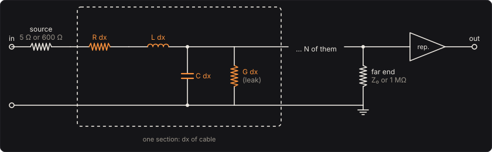
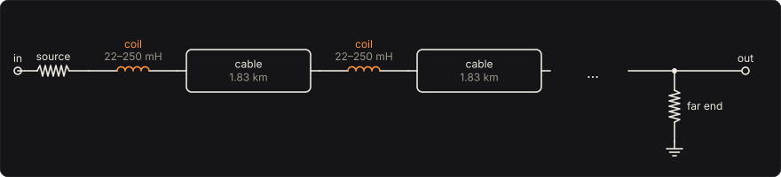

# Transatlantic Cable

Your bass sent down a long cable: the Atlantic telegraph cable of 1858 or 1866, or a telephone
pair, from 1 to 200 km of it, as the line's own equations say it arrives. Then load the line, with
coils every 1.83 km as the telephone companies did from 1900, or with inductance spread along its
whole length as Oliver Heaviside proposed, and hear why they did.

A long cable is not a wire with a little resistance. Every metre of it is a little resistance and
inductance in series and a little capacitance across, and the signal has to charge the cable as it
goes. On the first Atlantic cable a pulse didn't travel so much as seep down the line, like heat
into a bar, and arrived smeared out and late. William Thomson (later Lord Kelvin) worked this out
in the 1850s, before the cable was laid; his law of squares says how much worse a longer cable
gets.

Part of [PhuzzBox](../README.md).

| Input | |
|---|---|
| Your audio interface | pick it in the source menu (then **In 1** or **In 2**) |
| `Z`…`/`, `A`…`;`, `Q`…`P`, `1`…`0` | the test bass's E, A, D and G strings, open to the ninth fret |
| `Space` | the footswitch |

## The line



A cable has, per metre, a series resistance R and inductance L, and a shunt capacitance C and
leakance G to its return (the sea, for a submarine cable; the other wire, for a pair). Its voltage
and current obey the telegrapher's equations:

  ∂v/∂x = −R i − L ∂i/∂t,  ∂i/∂x = −G v − C ∂v/∂t

A sine of angular frequency ω travels down it as e^{−γx}, losing α = Re γ nepers a metre and
turning β = Im γ radians a metre, into the line's characteristic impedance Z₀:

  γ = √((R + iωL)(G + iωC)),  Z₀ = √((R + iωL)/(G + iωC))

A length ℓ of line, between a source of resistance Rs and a far end of resistance Rl, passes

  H = Rl / (A Rl + B + Rs (C' Rl + D)),  [A B; C' D] = [cosh γℓ, Z₀ sinh γℓ; sinh γℓ / Z₀, cosh γℓ]

of the source's voltage to the far end. **The response** draws |H|.

## The cables

The two Atlantic cables are worked out from how they were made: a stranded copper core inside a
sheath of gutta-percha, the sea outside it as the return. The 1858 core was a strand of seven
copper wires weighing 107 lb per nautical mile (26 kg/km), in 261 lb of gutta-percha (64 kg/km); the
1866 core 300 lb of copper (73 kg/km), in 400 lb of insulation (98 kg/km), gutta-percha in layers
with Chatterton's compound, all taken here as gutta-percha. From the densities (copper
8960 kg/m³, gutta-percha 980 kg/m³) come the core's diameter d and the sheath's D, and from them, as for any coaxial line,

  R = ρ / (π d²/4),  C = 2π ε₀ εr / ln(D/d),  L = (µ₀/2π) ln(D/d)

with copper's ρ = 1.72 × 10⁻⁸ Ω·m and gutta-percha's εr taken as 3. The telephone pair is two
0.4 mm copper wires, with the 0.6 mH/km and 52 nF/km typical of such a pair.

| Cable | Core, sheath | R | L | C | \|Z₀\| at 1 kHz | Source |
|---|---|---|---|---|---|---|
| Atlantic telegraph, 1858 | 1.92 mm, 9.32 mm | 5.93 Ω/km | 0.316 mH/km | 0.106 µF/km | 97 Ω | 5 Ω |
| Atlantic telegraph, 1866 | 3.22 mm, 11.73 mm | 2.11 Ω/km | 0.259 mH/km | 0.129 µF/km | 57 Ω | 5 Ω |
| Telephone pair, 0.4 mm | two wires | 274 Ω/km | 0.6 mH/km | 0.052 µF/km | 915 Ω | 600 Ω |

The cables are driven as a telegraph battery and key drove them, through a few ohms; the pair as a
telephone drives it, through 600 Ω. **Far end** matched ends the line in |Z₀| at 1 kHz, which
absorbs most of what arrives; open ends it in an amplifier's megohm, which reflects it back. The
**Repeater** amplifies what arrives, from 0 to 80 dB.

## Unloaded: Kelvin's cable

A submarine cable's R is far larger than ωL at the bass's frequencies, and G is nothing, so

  γ ≈ √(iωRC),  α = √(ωRC/2)

A sine's loss in nepers, and so in decibels, grows as the square root of its frequency: a slope
no filter of a few parts has, which the longer the cable the steeper it gets. 100 km of the 1858
cable passes 1 kHz 15 dB below the bass (82 Hz), and 200 km 37 dB below it.

Above a few kilohertz the cable's own inductance takes over from its resistance (ωL > R above
3.0 kHz on the 1858 cable, 1.3 kHz on the 1866), and the loss stops growing: it levels off at
(R/2)√(C/L) nepers a metre, 0.47 dB/km on the 1858 cable. Over 200 km that floor is far below the
bass, but it is there, and the solver keeps it (see *Solving it*).

In time, the same equations without L and G are the heat equation, RC ∂v/∂t = ∂²v/∂x². Thomson
solved them for a cable of length ℓ, a volt switched on at one end, the other end open:

  v(ℓ, t) = 1 − (4/π) Σ (−1)ⁿ/(2n + 1) exp(−(2n + 1)² π² t / (4 RC ℓ²))

The far end reaches half the volt at t = 0.379 RCℓ². The time grows as the square of the length:
Kelvin's law of squares. On the 1858 cable RCℓ² is 6.3 ms for 100 km; for the 3200 km across the
Atlantic it is 6.4 s, and a pulse took 2.4 s to reach half its height. **The arrival** shows a volt
switched on at your end arriving at the far one, at this length and at half and twice it. The tests
check the engine against Thomson's formula: the 1858 cable, open at 80 and 160 km, reaches half in
his time to 3 % (its battery's 5 Ω and its inductance hold it back a little), and twice the length
takes four times as long, to 3 %. Matched at the far end, which takes some of what arrives,
200 km takes 3.5 times as long as 100.

## Coils: Pupin and Campbell



Make ωL large next to R and the line changes character: γ ≈ R/(2Z₀) + iω√(LC), a loss that
hardly depends on frequency, and a wave that travels at 1/√(LC). Michael Pupin and George
Campbell, independently, worked out that the inductance need not be spread along the line: coils
every so often will do, as long as there are several to a wavelength. Telephone cables had them
every 6000 feet (1.83 km), as here, with coils of tens to hundreds of millihenries (88 mH by
default). The line is then a ladder of L and C, and a
ladder has a cutoff, where each section turns the wave by half a cycle:

  f_c = 1 / (π √((L_coil + L d) C d)),  d the spacing

On the telephone pair, 3.4 kHz with 88 mH coils, 2.0 kHz with 250 mH; on the 1858 cable, 2.4 kHz.
Below the cutoff the coils pass far more: down 30 km of telephone pair, 1 kHz arrives 20 dB louder
than without them. Above it, nothing arrives at all: the coil-loaded line passes 4 kHz more than
100 dB below 300 Hz. A loaded telephone line sounds like a telephone line for this reason.

## Heaviside's distortionless line

Heaviside saw, in the 1880s, that a line with

  L/R = C/G

loses every frequency alike and delays every frequency alike: then (R + iωL)(G + iωC) is a
perfect square, and exactly

  γ = √(RG) + iω√(LC),  Z₀ = √(L/C)

so the line is a pure delay ℓ√(LC) with a flat loss e^{−ℓ√(RG)}. The trouble is that a cable's G
is far too small and its L too small for this. **Heaviside** loading adds **Heaviside inductance**
along the cable and just enough leakage to meet the condition. Down 100 km of the 1866 cable,
100 mH/km delays the bass 11.4 ms and loses 2.1 dB; 1 H/km, 35.9 ms and 0.7 dB. The bass arrives
late and whole. With the far end open, the wave doubles there and runs back; the battery's few
ohms, nearly a short against Z₀'s thousands, turn it over and send it out again; and you hear the
reflections one round trip apart (72 ms, down 100 km of the 1866 cable at 1 H/km), alternating,
dying away by the line's loss each way.

## Solving it

Unloaded and coil-loaded lines are solved as a ladder of sections, each dx of cable as a series
R dx and L dx and a shunt C dx and G dx (a coil in series before every few, with coils). Their
currents and voltages, all at once, are integrated by the trapezoidal rule: each sample is a
tridiagonal system, factored once when the parameters change and solved by Thomas's algorithm. The
trapezoidal rule hears the ladder at f exactly as the ladder itself responds at (fs/π) tan(πf/fs)
(a test checks this to 0.02 dB).

The ladder stands for the continuous line. An unloaded line has enough sections that each turns a
sine by under 0.28 rad, up to the frequency where the line loses 80 dB more than it does the bass
at 20 Hz (up to 10 kHz), from 24 to 224 sections. A coil-loaded one has a section for every coil,
split further until each turns a sine at the cutoff by under 0.05 rad (up to eight to a coil, and
256 sections in all). The tests compare the ladder with the line's ABCD matrices over every cable,
loading and far end from 5 to 200 km: within a dB wherever the line passes a sine within 60 dB of
the bass, up to 10 kHz and below 70 % of the coils' cutoff. A volt switched on arrives in the
engine as in the continuous line to 2 %, the line's own step response computed by inverting its
Laplace transform numerically (Talbot's method).

Heaviside's line is solved exactly, as d'Alembert's two waves: a forward one launched at the near
end and a backward one at the far end, each a delay of ℓ√(LC) (read between samples by cubic
interpolation) and a loss of e^{−ℓ√(RG)}, reflected at each end by (Z − Z₀)/(Z + Z₀). The tests
check the engine against the bounce diagram to 10⁻⁴ V, but for a few samples round each edge,
where the interpolation rounds it.

The pedal is linear, so there is nothing to oversample. The longest coil-loaded line is the
heaviest: about 11 % of a core as WebAssembly on the test machine.

## The controls

- **Length**, **Loading**, **Repeater** and the **Far end** switch are on the face.
- **Cable**, **Loading coils** and **Heaviside inductance** are the bench, under *The line*.

## The views

- **Along the cable**: the voltage at 24 points from your end to the far end, thirty times a
  second, and how far it has swung lately. Unloaded, a note seeps into the line and dies away
  within the first stretch, the higher notes sooner; loaded, it travels.
- **The response**: how much of each frequency reaches the far end, with the coils' cutoff.
- **The arrival**: a volt switched on at your end, arriving at the far end, at this length
  (solid) and at half and twice it (faint).
- **Scope** and **Spectrum**: the input and the output.

## What to listen for

- **1858 cable, 100 km**, then **1858 cable, 200 km, into a galvanometer**: the bass muffled, then
  smothered: only the fundamental gets through, late.
- **1866 cable, 200 km**: the thicker core, brighter over the same distance.
- **Telephone pair, 10 km**, then **Telephone pair with coils, 30 km** and **Heavy coils: a lower
  cutoff**: a dull line, then three times as long and clearer, with the telephone's band edge.
- **Heaviside: a clean delay**, then **Heaviside, far end open: echoes**: the bass late but whole,
  then its reflections.
- **Heaviside on a telephone pair**: the pair's loss made flat.

## Plugged in backwards

The Transatlantic Cable has no **Reversed** switch: a line is the same from either end, but the
battery and the far end aren't.

## What is simplified

- The cables' constants don't change with frequency. A real conductor's resistance rises at high
  frequencies (the skin effect: at 10 kHz copper's skin depth is 0.65 mm, less than the 1866
  core's radius), and gutta-percha's permittivity and loss vary with frequency and temperature.
- The return is a perfect conductor. In the sea the return current spreads through the water and
  the cable's iron armour, which adds resistance and inductance.
- The cores' dimensions come from their weights per mile (the 1866 insulation's Chatterton's
  compound counted as gutta-percha), the copper's conductivity is today's
  annealed copper's (the 1858 copper was far less pure), and gutta-percha's permittivity is a
  round 3.
- Heaviside loading adds the leakage that meets L/R = C/G exactly, with no losses of its own; real
  loading (continuous iron wire wound round the core, Krarup's) only approached the condition.
- The coils are ideal inductors, with no resistance and no saturation.
- The telegraph source is a resistance: no battery polarity and no key. The 1858 cable failed
  after three weeks, after Wildman Whitehouse drove it with up to 2000 volts from induction coils;
  this one takes your bass's volt and suffers nothing.

## Files

```
cable/index.html, style.css            page
cable/src/cable-params.js              parameters and presets
cable/src/cable-pedal.js               the descriptor: everything but the page
cable/src/cable-main.js                page wiring and views
cable/src/cable-worklet.js             its AudioWorklet module
cable/src/cable-tour.js                the guided tour
cable/src/cable-schematics.js          the diagrams
cable/wasm/cable.wasm                  built from the C++
native/pedals/cable/                   the line, its ladder and its waves in C++
test/cable-circuit.mjs                 the physics worked out independently, for the tests
test/cable-tests.mjs                   node test/cable-tests.mjs
```

## Prior art and references

* Thomson, W. (1856). "On the theory of the electric telegraph." *Proceedings of the Royal Society
  of London* 7, 382–399. [doi:10.1098/rspl.1854.0093](https://doi.org/10.1098/rspl.1854.0093).
  The cable as the heat equation, and the law of squares.
* Heaviside, O. (1893). *Electromagnetic Theory*, vol. 1. The Electrician Printing and Publishing
  Co., London. [archive.org](https://archive.org/details/electromagnetict0001heav). The telegrapher's
  equations, and the distortionless line.
* Pupin, M. I. (1900). "Art of reducing attenuation of electrical waves." US Patent 652,231.
  [link](https://patents.google.com/patent/US652231). Loading coils.
* Pupin, M. I. (1900). "Wave transmission over non-uniform cables and long-distance air-lines."
  *Transactions of the American Institute of Electrical Engineers* 17, 445–512.
  [doi:10.1109/T-AIEE.1900.4764144](https://doi.org/10.1109/T-AIEE.1900.4764144). Coils in place of
  continuous inductance, several to a wavelength.
* Campbell, G. A. (1903). "On loaded lines in telephonic transmission." *The London, Edinburgh,
  and Dublin Philosophical Magazine and Journal of Science*, series 6, 5(27), 313–330.
  [doi:10.1080/14786440309462928](https://doi.org/10.1080/14786440309462928). The coil-loaded line
  as a ladder, and its cutoff.
* Talbot, A. (1979). "The accurate numerical inversion of Laplace transforms." *Journal of the
  Institute of Mathematics and its Applications* 23(1), 97–120. The contour the tests invert the
  line's step response on.
* Abate, J. & Valkó, P. P. (2004). "Multi-precision Laplace transform inversion." *International
  Journal for Numerical Methods in Engineering* 60(5), 979–993.
  [doi:10.1002/nme.995](https://doi.org/10.1002/nme.995). Talbot's contour in the fixed form the
  tests use.
* Bill Burns, *History of the Atlantic Cable & Undersea Communications*:
  [the 1858 and 1866 cables' specifications](https://atlantic-cable.com/Article/1867CableTech/index.htm):
  the cores' weights of copper and insulation.
