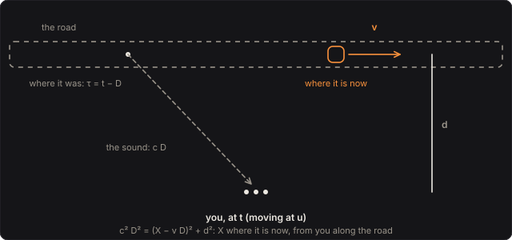

# Doppler

A car goes by and its engine's note falls; a train's horn slides down as it passes; a jet arrives
as a boom, and only then do you hear it come. All of it is one piece of physics: what you hear now
was sent some time ago, from where the source was then, and the faster the source moves, the more
those moments crowd together or spread apart. Here your bass is the source. It rides past you on a
straight road, pass after pass, and each of your ears hears it at its retarded time, solved
exactly, so the pitch, the swell and, past Mach 1, the boom come from the geometry alone.

Part of [PhuzzBox](../README.md).

| Input | |
|---|---|
| Your audio interface | pick it in the source menu (then **In 1** or **In 2**) |
| `Z`…`/`, `A`…`;`, `Q`…`P`, `1`…`0` | the test bass's E, A, D and G strings, open to the ninth fret |
| `Space` | the footswitch |

## The road

The source moves at **Speed** v along a straight road **Distance** d from you, through still air.
You move along the road at **Your speed** u (0 by default). Each pass lasts **Every** T: the source
sets off from T/2 before it is level with you, and goes on as far past. Over the first and last
min(T/6, 1 s) of each pass it fades in and out, a raised cosine, so a pass begins and ends
without a click. Sound travels at

  c = 331.3 √(1 + θ / 273.15) m/s,

the ideal gas's speed at θ °C: 331 m/s at 0 °C, 343 m/s at 20 °C (**Air**). Your ears are 17.5 cm
apart along the road.

A change to the pass (Speed, Distance, Every, Your speed, Air) takes effect from the next pass, as
the next car is another car.

## The retarded time

What an ear hears at time t was sent at τ = t − D, from where the source was then. The sound's path
from there to the ear is c D long. With X the source's position now along the road, relative to the
ear, the source was X − v D along the road when it sent it, so

  c² D² = (X − v D)² + d²,  X = (v − u) s − e,

with s the time from the middle of the pass and e the ear's offset. That is a quadratic in D,

  (c² − v²) D² + 2 X v D − (X² + d²) = 0,

solved exactly. Below Mach 1 it has one root that has already happened,

  D₀ = (X² + d²) / (X v + S),  S = √(c² X² + (c² − v²) d²),

written so that it never cancels. Above Mach 1 it has none until c² X² ≥ (v² − c²) d² with the
source already past, and then two: D₀, and D₁ = (X v + S) / (v² − c²). In the tests the engine's
delays agree with bisection on the light-cone condition c (t − τ) = |path| itself to 2.2 × 10⁻¹³,
in 912 cases from standing still to Mach 2.

## What reaches you

A point source of strength q(t) moving through the air makes the field the wave equation solves
in closed form:

  φ = Σ q(τ) / (4π R |1 − M_r|),

summed over every retarded time τ, with R = c D the path and M_r the source's speed toward you
over c. This is the acoustic Liénard–Wiechert form; 1 − M_r = dt/dτ is how much the source's
moments are squeezed together or spread apart on arrival. Here q is your bass's voltage, and the
level is set so that a slow source at its closest, R = d, comes out at the bass's own level.

The engine does not differentiate anything. For each output sample it finds the emission times
that arrive within that sample, at both its ends, and integrates the input, linearly
interpolated, over them, weighted by d / R. The width of that emission interval is the
compression 1 / |1 − M_r|. So the output is the field averaged over each sample, and it stays
finite where the field itself is infinite, at the Mach cone.

The tests check it three ways:

* **Against the field.** For a car passing at 25 m/s, 4 m away, both ears agree with the field
  summed at retarded times found by bisection to 0.003 % RMS.
* **A click's area.** A click arrives with its area whole, scaled by d / R, within 0.06 %: at
  25 m/s, at 330 m/s 2 m away, and at Mach 2, where the cone squeezes it hardest.
* **The ears.** The left ear hears the coming source first, by 2 × 8.75 cm × cos θ / c. The
  tests measure 500 µs where 507 µs is expected.

## The pitch

The textbook Doppler shift, for sound sent at angle θ to the road, is

  f_heard / f_sent = (1 − u cos θ / c) / (1 − v cos θ / c).

It is the source's and the listener's speeds through the air that count, not only how fast they
close. In the tests the pitch the engine plays agrees with it to 0.10 cents, at 18 moments across
five passes. At 20 °C:

| | coming | going | the fall |
|---|---|---|---|
| a car at 25 m/s (90 km/h) | +131 cents | −122 cents | 253 cents, 2.5 semitones |
| you riding past it at 25 m/s | +122 cents | −131 cents | 253 cents |
| both at 25 m/s, head on | +253 cents | −253 cents | 506 cents |
| a train at 40 m/s | +215 cents | −191 cents | 405 cents |
| a race car at 90 m/s | +527 cents | −403 cents | 930 cents |
| a jet at 250 m/s | +2257 cents | −947 cents | 3204 cents |

How fast the pitch falls depends on how close the road is. At 25 m/s the middle of the fall takes
180 ms with the road 4 m away and 1660 ms at 40 m. Close by, the level swells 23 times (27 dB) as
the source passes; at 40 m, 2.5 times.

## Mach 1 and the boom

Above the speed of sound the source outruns its own sound. Nothing reaches you until the Mach
cone, of half-angle μ with sin μ = c / v, sweeps over you. That happens when the source is
d √(M² − 1) past: 0.2523 s after it passes at Mach 2, 100 m away, where μ is 30°; 0.0375 s at
380 m/s (Mach 1.107), 30 m away. In the tests the output is exactly zero until the cone arrives,
and the loudest moment is there, within a sample.

At the cone the two roots meet: everything the source sent around one moment arrives at once, the
boom. After it you hear two sounds together:

* what the source sends now, falling in pitch as it goes;
* what it sent as it came, backwards: of two clicks it sent 0.30 s apart on its approach, the
  later arrives first, 284.3 ms before the other.

The boom of a point source is far louder than its pass. A 0.2 V, 80 Hz tone at Mach 2 booms at
6.56 V, so the Mach presets turn **Level** down by 24 dB.

## Solving it

The input is kept for 11.2 s, the longest any sound can take at the controls' limits (750 m/s
between source and listener, 8 s passes, 100 m, at −20 °C). Each pass is kept until its last
sound can have arrived; at most 16 are heard at once. It costs under 1 % of a core in the
browser, 0.84 % at the busiest.

## The controls

* **Speed**: 0–700 m/s, the source through the air.
* **Distance**: 1–100 m, how close the road comes.
* **Every**: 1–8 s, the time from one pass to the next.
* **Dry**: your bass as it came in.
* **Your speed**: −50 to 50 m/s along the road.
* **Air**: −20 to 40 °C, which sets the speed of sound.
* **Fly-by** and **Level**: the mix, and gain after it.

## The views

* **The road**: from above, the source, you and the wavefronts it sent, each spreading from where
  the source was when it sent it; above Mach 1, the cone.
* **The pitch**: over one pass, the pitch you hear against the pitch sent, and the level, with now
  marked; above Mach 1, both branches, the backwards one dashed.
* **Spectrum** and **Scope**: the input and your left ear as they play.

## What to listen for

* **Car at 90 km/h**: the classic fall, 2.5 semitones, quick and close.
* **Race car** and **Train**: faster and closer, slower and farther.
* **You ride past** and **Head on**: the listener moving, and both.
* **Jet, low pass**: Mach 0.73 at 60 m; it screams in, 2257 cents high, and drops.
* **Just past Mach 1** and **Mach 2**: silence, the boom, then the sound and its approach
  backwards.

## What is simplified

* **A point source in still air.** The source has no size and no directivity, and the air no
  wind. A real car is several metres of engine, tyres and exhaust, each a little apart.
* **The bass is the source's strength.** The field here is the wave equation's for a point
  source, which is a velocity potential's. The pressure from a moving loudspeaker carries one more
  factor of 1 / (1 − M_r) and a near-field term, which make an approaching source louder still.
* **No air absorption and no ground.** Real air absorbs the highs over hundreds of metres. A real
  road has a ground that reflects a second image of the source, and the two interfere, the comb of
  a fly-by.
* **A linear boom.** A real sonic boom is shaped by the aircraft's volume and by the air's own
  nonlinearity into an N-wave. Here the cone gathers only what the source plays, and a point
  source's boom is infinitely sharp. Averaged over each sample, its peak grows a little with the
  sample rate, as √fs.
* **Straight, steady passes.** Each pass is at one speed on one straight road.

## Files

* `src/doppler-params.js`: the controls and the presets (the C++ tables are generated from them).
* `src/doppler-main.js`: the page's views; `src/doppler-tour.js`: the tour;
  `src/doppler-schematics.js`: the diagram above.
* `native/pedals/doppler/doppler-model.h`, `doppler-model.cpp`: the speed of sound, the retarded
  delays in closed form, the cone.
* `native/pedals/doppler/doppler-engine.cpp`: the passes, the ears and the integration over each
  sample; `doppler-web.cpp`: the page's model calls.
* `test/doppler-circuit.mjs`: the same physics written independently: the ideal gas's speed of
  sound, the retarded times by bisection, the field summed over them, the textbook shift and the
  Mach cone.
* `test/doppler-tests.mjs`: the engine against those, and each hint.

## Prior art and references

* C. Doppler (1842). "Ueber das farbige Licht der Doppelsterne und einiger anderer Gestirne des
  Himmels." *Abhandlungen der Königlich Böhmischen Gesellschaft der Wissenschaften*, V. Folge,
  Bd. 2, 465–482. The shift, proposed for the colours of double stars.
* C. H. D. Buys Ballot (1845). "Akustische Versuche auf der Niederländischen Eisenbahn, nebst
  gelegentlichen Bemerkungen zur Theorie des Hrn. Prof. Doppler." *Annalen der Physik*.
  [doi:10.1002/andp.18451421102](https://doi.org/10.1002/andp.18451421102). Musicians played on a
  moving train and were heard from beside the track: the shift first tested, with sound.
* G. B. Whitham (1952). "The flow pattern of a supersonic projectile." *Commun. Pure Appl. Math.*
  5(3), 301–348. [doi:10.1002/cpa.3160050305](https://doi.org/10.1002/cpa.3160050305). The
  N-wave a real body's volume makes of its boom, which a point source does not.
* J. Ahrens & S. Spors (2008). "Reproduction of Virtual Sound Sources Moving at Supersonic Speeds
  in Wave Field Synthesis." *Audio Engineering Society 125th Convention*, San Francisco. The same
  field of a moving point source, with its two retarded times above Mach 1, rendered over an array
  of loudspeakers.
* The Rotary Speaker, PhuzzBox's: the same retarded time, for a horn going round.
