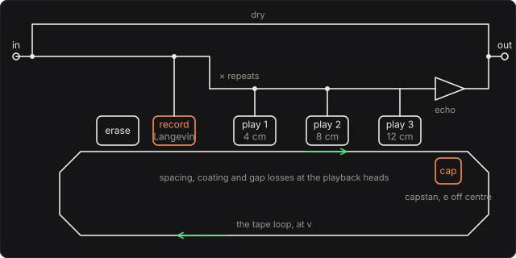

# Tape Echo

The multi-head tape echo of the 1970s: a loop of tape past an erase head, a record head and three
playback heads. The echoes are the distances between the heads over the tape's speed. What makes
them sound like tape is the physics of the tape and the heads, not a filter drawn to taste:

* The tape keeps a magnetisation that bends over as it fills.
* The playback heads hear its field through the gap between them and the tape, so short wavelengths
  are lost and slow tape is dark.
* Each repeat is recorded again, darker and more saturated.
* The capstan that pulls the tape is never quite round.

## The tape path

The playback heads sit 4, 8 and 12 cm after the record head. A head a distance d behind reads tape
that passed the record head d/v ago, so at 19 cm/s the three echo after 211, 421 and 632 ms. The
erase head wipes the loop just before the record head, so each pass records on clean tape.

The engine keeps the tape as it was written: each sample, and the tape position X at which it
was written. Each sample the tape moves on by v/f_s. A playback head reads the tape at X − d,
between the two samples written either side of that position, by cubic interpolation. So a change
of speed is heard as it would be on a machine. Tape recorded at one speed and played at another
comes out at a pitch scaled by their ratio, and the echo times follow the motor.

## The motor and the capstan

The motor and its flywheel follow the **Tape speed** knob with a time constant of 0.25 s:

  v(t) = v₂ + (v₁ − v₂) e^{−t/τ}

Turn the knob from 10 to 20 cm/s with a note on the tape, and the echo rises toward an octave. At
0.62 s after the turn, the tests hear a 150 Hz note at 287.3 Hz, against f·v(t)/v = 287.4 Hz.

The capstan, 5 mm across, pulls the tape. A shaft e off centre pulls it at v(1 + (e/r) cos θ),
once a turn. The tape that a head plays was recorded d/r radians of the capstan earlier, so the
echo's pitch wavers by the difference of the two speeds:

  rate v/(2πr),  depth 2(e/r)|sin(d/2r)|

At 19 cm/s that is 12.1 Hz. At the default 3 µm the depth is ±0.24 % on the first head (±4 cents).
At 20 µm it is ±1.58 %, and the tests measure ±1.56 %.

## Recording: the anhysteretic curve

The record head's field is proportional to its current, which follows the input and the repeats
through a coupling capacitor (a 20 Hz high-pass). A tape recorder adds an AC bias, a tone far above
hearing, to the record current. With an ideal bias, what the tape keeps is the anhysteretic
magnetisation, which takes no account of the tape's history. That is the Langevin function of
Jiles and Atherton's model of a ferromagnet:

  M = M_s (coth(H/a) − a/H)

**Record level** sets H/a for a volt at the record head, g = 10^(level/20) per volt. The playback is
normalised so a quiet note comes back at the level it went in:

  m(x) = 3 L(g x) / g,  L(u) = coth u − 1/u ≈ u/3 − u³/45

So the tape is linear for quiet notes, and harder playing is compressed as the particles line up,
with a third harmonic and no second. A 0.3 V note at 200 Hz comes back with 0.13 % third harmonic
at 0 dB, and 1.94 % at +12 dB. Driven 12 dB hard with 0.4 V, the engine's fundamental and third
harmonic match the curve's Fourier coefficients (by Simpson's rule) within 1 % and 3 %.

## Playback: the heads' losses

A recorded wavelength λ = v/f has the wavenumber k = 2πf/v along the tape. The playback head hears
its field through three losses (Bertram; in the form of Chowdhury's tape model):

  spacing e^{−kd},  thickness (1 − e^{−kδ})/(kδ),  gap sin(kg/2)/(kg/2)

* **Spacing.** The head rides d from the tape (dust, wear, a tired pressure pad). The field of
  a wavelength falls away as e^{−kd}, 54.6 dB for each wavelength of distance.
* **Thickness.** The coating, δ = 8 µm thick, is a stack of layers, each further from the head
  than the last.
* **Gap.** The head's gap g averages the field across it. Where a wavelength fits in the gap it
  cancels itself, at f = v/g. At the default 5 µm gap and 19 cm/s that is 38 kHz; at 10 µm and
  5 cm/s it is 5 kHz.

All three depend only on k, so slow tape loses more. At 19 cm/s and the default 4 µm spacing, one
pass loses 6.8 dB at 3 kHz. At 9.5 cm/s it loses 13.3 dB. The playback amplifier is taken as an
ideal integrator of the head's voltage, flat but for these losses.

The losses are one linear-phase FIR of 255 taps, designed from the closed form at the motor's speed
and redesigned whenever the speed moves by half a percent. Its 127-sample latency is taken out of
the heads' distances, so the pedal has none. The losses' kernels have long tails (the spacing
loss's is a Cauchy curve), which is why the FIR is long. With the heads 1 and 4 µm from the tape it
is within 0.2 dB of the closed form from 300 Hz, down to 30 dB of loss, at every speed. At 15 µm
and 5 cm/s, where the tails run longest, it is within 1 dB.

## Repeats

The heads' sum is recorded again, times **Repeats**. Each pass goes through the tape and the heads
once more, so a quiet repeat comes back repeats × the heads' losses as loud as the one before. At
70 % and 19 cm/s, 300 Hz keeps 65 % a pass and 3 kHz keeps 32 %. Past 100 % the loop grows until the
tape's curve flattens it at its ceiling, 3/g volts. That is the runaway these machines are known for.

## Solving it

Each sample:

1. The motor and the capstan move the tape on.
2. The input and the repeats go through the coupling RC (the trapezoidal rule) and the tape's curve
   to the record head.
3. Each playback head reads its place on the tape.
4. The FIR applies the heads' losses.

The tape holds 2.4 s, the longest echo at the slowest speed. It takes about 2 % of a core in
WebAssembly. Until anything is recorded, the motor runs at the knob's speed at once, since a blank
tape can't be heard coming up to speed.

## The controls

* **Tape speed** (5 to 40 cm/s): the echo times, their brightness, and the pitch bend as it moves.
* **Playback heads**: any of the three, alone or together.
* **Repeats**: what is recorded again.
* **Record level**, **Head spacing**, **Head gap** and **Capstan eccentricity**: the machine.
* **Dry**, **Echo** and **Level**: the mix.

## The views

* **The heads**: what one pass through the tape keeps of each frequency at the knob's speed (the
  FIR, from `echo_response`), and what the second to fourth repeats keep.
* **The tape**: the anhysteretic curve (`echo_curve`), and how far along it the record head has been
  driven, from the engine's messages.
* **Spectrum** and **Scope**: the input and output as they play.

## What to listen for

* **Slapback**: one quick echo, as on rockabilly records, at 38 cm/s.
* **Dub bass**: the second head, long repeats, a little driven: each repeat darker.
* **Three heads**: the three heads together, a rhythm from one note.
* **Worn machine**: slow tape, the heads far from it, a wobbly capstan.
* **Runaway**: repeats past 100 %. The loop builds until the tape holds it. Turn Repeats down to
  let it go, or turn Tape speed to bend it.

## What is simplified

* **An ideal bias.** The tape keeps the anhysteretic curve, with no hysteresis loop and no
  bias-dependent losses. Chowdhury's model integrates the Jiles–Atherton loop with the bias
  itself; this one takes the limit a well-biased machine approaches.
* **Ideal record head.** No record-side losses, and no self-erasure of short wavelengths.
* **Losses as written.** The coating's 8 µm, the capstan's 5 mm and the heads' places are chosen
  for a typical machine, not measured from one.
* **No hiss, no dropouts, no tape stretch.** The motor is a first-order lag, and the only flutter
  is the capstan's.

## Files

* `src/echo-params.js`: the controls and presets (the C++ tables are generated from them).
* `src/echo-main.js`: the page's views; `src/echo-tour.js`: the tour;
  `src/echo-schematics.js`: the tape path above.
* `native/pedals/echo/echo-model.h`, `echo-model.cpp`: the tape's curve, the heads' losses and their
  FIR.
* `native/pedals/echo/echo-engine.cpp`: the tape loop; `echo-web.cpp`: the page's model calls.
* `test/echo-circuit.mjs`: the same physics written independently, with the curve's harmonics by
  Simpson's rule and the flutter's closed form.
* `test/echo-tests.mjs`: the engine against those, and each hint.

## Prior art and references

* J. Chowdhury (2019). "Real-time physical modelling for analog tape machines." *Proc. 22nd Int.
  Conf. Digital Audio Effects (DAFx-19)*, Birmingham.
  [PDF](https://dafx.de/paper-archive/2019/DAFx2019_paper_3.pdf). A tape machine from its physics:
  the Jiles–Atherton hysteresis with its Langevin anhysteretic curve, the bias, and the playback
  head's spacing, thickness and gap losses as an FIR from their closed form.
* D. C. Jiles & D. L. Atherton (1986). "Theory of ferromagnetic hysteresis." *Journal of Magnetism
  and Magnetic Materials* 61, 48–60. The anhysteretic magnetisation as a Langevin function.
* H. N. Bertram (1994). *Theory of Magnetic Recording*. Cambridge University Press. The playback
  head's response and its losses.
* "The reproduction of magnetically recorded signals." *The Bell System Technical Journal*,
  October 1951. [Nokia Bell Labs](https://www.nokia.com/bell-labs/publications-and-media/publications/the-reproduction-of-magnetically-recorded-signals/).
  The loss of a playback head's signal with its spacing from the medium, measured with shims.
