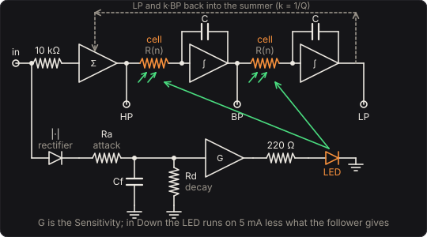

# Envelope Filter

A resonant filter swept by how hard you play: the funk box of the 1970s. The first of these, the
Mu-Tron III that Mike Beigel designed in 1972, is a state-variable filter tuned by opto-isolators,
with low-pass, band-pass and high-pass outputs. This pedal is built the same way from parts with
physics: an envelope follower drives an LED, the LED lights two photocells, and the photocells are
the resistors that set the filter's cutoff. How fast it sweeps, how it lets go and how it remembers
a long note come from the follower's resistors and capacitor and from the photocells' electrons,
not from a curve drawn to taste.

## The circuit

## The filter

A state-variable filter is a summer and two integrators in a loop. Each integrator is an op-amp
with a capacitor C in its feedback and a resistor R at its input, so it integrates at ω = 1/(RC).
The summer subtracts the low-pass output and k times the band-pass output from the input, and the
three nodes are the three responses:

  low-pass ω²/(s² + kωs + ω²),  band-pass ωs/(…),  high-pass s²/(…),  k = 1/Q

At the cutoff the band-pass output is Q times the input. That peak riding up and down through a
note's harmonics is the quack. **Resonance** is Q, from 0.5 to 15; at 0.7 the low-pass is flat to
the cutoff with no peak.

Each integrator's resistor here is a photocell, with 33 kΩ across it and 1 kΩ in series:

  R = (R_cell ∥ 33 kΩ) + 1 kΩ,  f_c = 1/(2π R C)

With 47 nF capacitors (the **Range**), the dark cells leave the 33 kΩ, and the cutoff rests at
101.2 Hz. With the LED at its 20 mA the cells fall to about 1.2 kΩ, and the cutoff rises to
1537 Hz. That is the sweep for bass. With 15 nF it is 317 Hz to 4815 Hz, a guitar's range,
since the cutoff goes as 1/C. The two cells are lit by one LED and are taken as matched.

## The follower and the LED

The follower is a rectifier charging a capacitor C_f through an attack resistor R_a, while the
input is above it (an ideal diode), with a decay resistor R_d across it that always drains it:

  C_f dv/dt = (|G v_in| − v)/R_a · [|G v_in| > v] − v/R_d,  τ_a = R_a C_f,  τ_d = R_d C_f

G is the **Sensitivity**, 0 to 40 dB. The follower drives the LED through 220 Ω, at most 20 mA:

  Up: i = v / 220 Ω,  Down: i = 5 mA − v / 220 Ω

Up, each pluck lights the LED and sweeps the cutoff up, and it falls as the note fades. Down, the
LED stands at 5 mA, which rests the cutoff at 948 Hz; each pluck dims it and pulls the cutoff
down, and it rises again as the note dies. An LED's light is close to proportional to its current
and follows it within nanoseconds, so the light Λ is the current in units of 1 mA.

## The photocells

The cells are cadmium sulphide, like the Opto Compressor's, and the model is the same: free
electrons n made by the light and lost by recombination, and traps that catch some of them and
let them go slowly (Albert Rose's picture of a photoconductor, RCA Review 1951):

  dn/dt = Λ/τ − (n/τ)(1 + n/n₁) − k n (N − m) + m/τ_e
  dm/dt = k n (N − m) − m/τ_e
  1/R_cell = 1/R_dark + n/R_lit

with n₁ = 1, N = 2 traps, k = 1 /s and R_dark = 2 MΩ. τ is the **Carrier lifetime** (15 ms),
τ_e the **Trap release time** (0.5 s) and R_lit the **Cell resistance, lit** (5 kΩ). A steady
light leaves the traps in balance and n where Λ = n(1 + n/n₁), so 1 mA keeps n = 0.618, and a cell
is 1.6 times R_lit. The response is sublinear, so twenty times the light only opens the cell
about six and a half times as far.

The cells give the sweep its feel. They light within a few milliseconds of the LED, faster the
brighter it is. They darken over the carrier lifetime, so a long lifetime holds the sweep up after
the follower has let go: 150 ms after a note, with a 20 ms decay, the cutoff is still 36 % of the
way up at a 150 ms lifetime, against 10 % at 5 ms. And a long, hard note fills the traps, which
then feed electrons back as they empty. The filter takes 240 ms to come within 5 % of rest after a
0.15 s note, and 900 ms after a 3 s one (420 ms with 0.2 s traps).

## Solving it

Each sample first takes the follower's exact step with the input held through it. Then it moves
the cells' electrons on by one step of Heun's method; their fastest rate, (1 + 2n)/τ, is at most
9/τ, a few thousand a second at the shortest lifetime, far slower than the 48 000 samples a
second. Last, it runs the filter with the integrators' resistance the
cells now give. The filter is integrated by the trapezoidal rule, which is the bilinear transform
of its circuit, in the topology-preserving form Zavalishin describes, so it stays stable however
fast the cutoff moves. At rest each output is the analog response at (f_s/π)·tan(πf/f_s), within
0.0001 dB. Against an RK4 integration of the follower and the cells together, the engine's cutoff
on the test bass is within 0.07 %. It takes under 0.2 % of a core, with no latency.

## The controls

* **Mode**: low-pass, band-pass or high-pass, the filter's three outputs.
* **Resonance (Q)** and **Range (capacitors)**: the filter.
* **Sensitivity**, **Direction**, **Attack** and **Decay**: the follower and the LED. A softer
  note at 28 dB sweeps as high as a harder one at 16: the test bass's A reaches 863 Hz at 16 dB
  and 1439 Hz at 28. A 2 ms attack takes the cutoff 90 % of the way up in 10 ms, a 60 ms attack in
  90 ms.
* **Carrier lifetime**, **Trap release time** and **Cell resistance, lit**: the photocells.
* **Clean blend** and **Level**: the dry signal mixed back in after the filter, and the gain.

## The views

* **The filter**: the response where the cells have the cutoff now, from the engine's messages,
  and at rest and at the far end of the sweep (`envelope_static`, the cells' steady state). The
  note being played is marked, and its harmonics ride the curve as dots, each as large as it is
  loud at the input: the quack is the peak lifting them one after another.
* **The sweep**: the last four seconds of the cutoff, the LED's current and the traps' fill.
* **Scope** and **Spectrum**: the input and output as they play.

## What to listen for

* **Quack (band-pass)**: each note says *wow* as the peak passes up through its harmonics and
  falls back.
* **Synth bass (low-pass)**: the top opens with the pluck and closes as the note fades.
* **Downward**: dark on the pluck, opening as the note dies.
* **Slow cells**: the follower lets go fast, the cells slowly. After a long note the filter creeps
  down rather than dropping.

## What is simplified

* The follower's diode is ideal and its rectifier exact: no forward drop, no offset.
* The LED's light is proportional to its current, and the two cells are identical and lit alike.
  Real opto-isolators differ from one to the next, which is why a real pedal's two halves never
  quite track.
* The op-amps are ideal, with no slew limit, noise or clipping at their rails. At high Q and a hot
  input a real one clips at the peak, and this one does not.
* The cell's constants (n₁, N, k, the 33 kΩ and 1 kΩ around it) are chosen to give a bass sweep
  and a cell's typical speed. They are physical in kind, not measured from a particular part. The
  original's circuit values are not reproduced here.

## Files

* `src/envelope-params.js`: the controls and presets (the C++ tables are generated from them).
* `src/envelope-main.js`: the page's views; `src/envelope-tour.js`: the tour;
  `src/envelope-schematics.js`: the circuit above.
* `native/pedals/envelope/envelope-model.h`: the follower, the LED, the cells and the filter.
* `native/pedals/envelope/envelope-engine.cpp`: the effect; `envelope-web.cpp`: the page's model
  calls.
* `test/envelope-circuit.mjs`: the same physics written independently: the follower and the cells
  integrated together by RK4, the cells' steady state, and the filter's analog response and its
  bilinear image.
* `test/envelope-tests.mjs`: the engine against those, and each hint.

## Prior art and references

* "Mu-Tron III." Wikipedia. [link](https://en.wikipedia.org/wiki/Mu-Tron_III). Mike Beigel's
  envelope-controlled filter of 1972: a state-variable filter with low-pass, band-pass and
  high-pass responses, controlled by opto-isolators, sweeping up or down.
* Zavalishin, V. (2018). *The Art of VA Filter Design*, rev. 2.1.0. Native Instruments.
  [PDF](https://www.native-instruments.com/fileadmin/ni_media/downloads/pdf/VAFilterDesign_2.1.0.pdf).
  Chapter 4, the state-variable filter, and the topology-preserving transform (trapezoidal
  integration without a unit delay in the loop) by which this one is solved.
* Rose, A. (1951). "An outline of some photoconductive processes." *RCA Review* 12, 362–414.
  Its *Citation Classic* commentary:
  [PDF](https://garfield.library.upenn.edu/classics1980/A1980KF12700001.pdf). Free and trapped
  electrons in a photoconductor, the model of the cells here and in the Opto Compressor.
