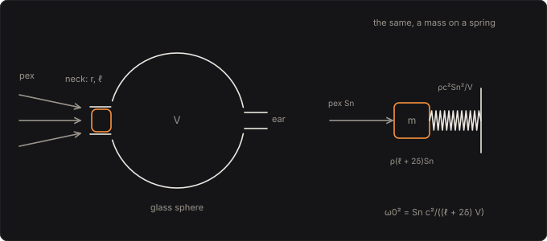

# Helmholtz's Resonators

Your bass heard through one of Hermann von Helmholtz's glass resonators, held to your ear. In *On
the Sensations of Tone* (1863) Helmholtz set out to hear the partials that make up a musical tone,
and he made himself an instrument for it: a hollow glass sphere with a short neck facing the sound and
a second, small opening fitted to his ear. "If the proper tone of the resonator is sounded, it brays
into the ear most powerfully": play a note with a partial at the resonator's pitch, and that partial
rings out of the note. This pedal is his ten glass resonators, from the measurements he gave of them,
each the air in its neck, a mass, on the spring of the air inside. You hear the one at your ear, with
the room at your other ear, and Koenig's flames show all ten at once.

Part of [PhuzzBox](../README.md).

| Input | |
|---|---|
| Your audio interface | pick it in the source menu (then **In 1** or **In 2**) |
| `Z`…`/`, `A`…`;`, `Q`…`P`, `1`…`0` | the test bass's E, A, D and G strings, open to the ninth fret |
| `Space` | the footswitch |



## A mass on a spring

The air in the neck, of radius r and length ℓ, moves as one body: a mass ρ (ℓ + 2δ) Sn, Sn = π r² the
opening's area, δ the end correction for the air moving just outside each end of the neck. The air
inside the sphere, of volume V, is its spring: pushing the neck's air in by a volume squeezes the air
inside, and its pressure rises by ρc² over V for each unit of volume. Rienstra and Hirschberg write the
pressure inside, p, driven by the sound's pressure outside, pex, as

  ((ℓ + 2δ) V/(c² Sn)) p'' + (R V/(ρ c² Sn)) p' + p = pex,   ω0² = Sn c²/((ℓ + 2δ) V),

R the neck's resistance. Below the resonance the air inside simply follows the air outside, p = pex;
at it, the sound inside is Q times the sound outside; above it, it falls away, 12 dB an octave. The
second opening, at the ear, is closed by the ear, as Helmholtz says it may be taken to be.

For an orifice in a thin wall, ℓ = 0, Helmholtz worked out the pitch as n = 56174 σ^¼/√S (σ the
opening's area in mm², S the volume in mm³, at the 332.26 m/s of 0 °C). But he found by experiment that
for openings a fourth to a fifth of the sphere's diameter, as most of his were, the coefficient is
47000. His spheres had short necks, and the pedal gives each the neck that makes his measured
coefficient come out with Rienstra and Hirschberg's end correction for an orifice, δ = 0.85 r: a neck
0.544 of the opening's radius long.

## His ten resonators

Helmholtz's table, "a list of the measurements of my glass resonators" (Ellis's translation,
Appendix II), and what the pedal makes of them at 20 °C:

| | sphere (mm) | orifice (mm) | volume (cm³) | pitch (Hz) | Q |
|---|---|---|---|---|---|
| 1 | 154 | 35.5 | 1773 | 204.5 | 105 |
| 2 | 131 | 28.5 | 1092 | 233.5 | 108 |
| 3 | 130 | 30.2 | 1053 | 244.7 | 102 |
| 4 | 115 | 30 | 546 | 338.8 | 81 |
| 5 | 79 | 18.5 | 235 | 405.5 | 95 |
| 6 | 76 | 22 | 214 | 463.4 | 79 |
| 7 | 70 | 20.5 | 162 | 514.1 | 77 |
| 8 | 53.5 | 8 | 74 | 475.2 | 100 |
| 9 | 46 | 15 | 49 | 799.6 | 68 |
| 10 | 43 | 15 | 37 | 920.2 | 61 |

They run from 204.5 Hz, the largest, to 920.2 Hz, the smallest. He named each by the note it sounds, in the letters of his day, which the scans of the book don't
show legibly enough to copy; the pedal gives each its pitch from his formula instead. Sound travels at
343.2 m/s at 20 °C and 331.3 m/s at 0 °C, c = 343.2 √(T/293.15) m/s, and every resonator's pitch goes
with it: the largest sounds 204.5 Hz at 20 °C and 197.4 Hz at 0 °C, 3.5 % lower.

## How sharply each rings

Two things take the energy of the air moving in the neck. The neck radiates sound back into the room,
as the open end of a pipe does: a resistance ¼ (k r)² ρc (Rienstra and Hirschberg's eq. 6.93, k = ω/c),
which for a resonator small against the wavelength is a monopole's, and gives a Q of 4π/(k³V). And the
neck's walls drag on the air, in a boundary layer: over the neck's length, 2ρc α of resistance, α the
viscous part of Kirchhoff's attenuation in a pipe, (1/(r c)) √(π f μ/ρ), μ the air's viscosity, about
1.82 × 10⁻⁵ Pa·s. The radiation takes most of the energy in all but the eighth, whose mouth is only 8 mm
across: their Qs run from 61 to 108, so that each rings on for a second or so after the note (the
largest 1.13 s to die away by 60 dB, the fifth 0.52 s), and a partial 1 % off the largest's pitch
comes through 7.4 dB under one on it.

"Reducing the size of the orifice also deepens the pitch of the resonator, and this gives an easy
means of tuning it to any required pitch," Helmholtz writes, and a narrower mouth rings more sharply:
"It is just as in microscopes; the greater the magnifying power, the smaller the field of view." The
Opening does it. At 70 % of his opening the largest resonator rings at 163 Hz with a Q of 124, against
204.5 Hz and 105 as he made it; narrower still, the friction of the walls wins, and at 30 % its Q is
43. Opened to 112.6 % it rings at 220.0 Hz, with a Q of 92: the fourth harmonic of your open A string,
the second of A2, and the third of D2, 220.25 Hz.

## Koenig's flames

The Paris instrument maker Rudolph Koenig, who made Helmholtz's resonators in glass and then in brass,
found a way to show what they hear: a small gas chamber behind a rubber membrane at the resonator's second opening, its gas
burning at a fine jet, so that the flame leaps as the air in the resonator shakes. Seen in a rotating
mirror a steady flame draws a smooth ribbon and a shaking one a row of tongues. Set resonators side by
side, each with its flame, and a note lights the ones its partials fall on. The view does that with
Helmholtz's ten, drawing each flame as the air in its resonator's neck moves, as the pressure inside
less the pressure outside: below its pitch a resonator's air follows the air outside and its neck's
barely moves, so that a note lights only the resonators its partials fall on.

## Playing it

The bass is the sound's pressure outside the resonator; what you hear is the pressure inside. All ten
resonators ring all the time, each a state-variable filter whose two integrators
are the trapezoidal rule's, its frequency prewarped, so that it stays passive as its knobs move. You hear the one at your ear; stepping
the Resonator fades the old one out and the new one in over 20 ms, and the Other ear and the Level
glide over the same time. The resonator is linear: it makes no new frequencies, only lifts the
partial that falls on its resonance and lets the rest of the bass through below it. The output is
mono, on both sides.

## The controls

- **Resonator**: which of the ten is at your ear; an expression pedal steps through them.
- **Opening** (%): the opening's diameter, against Helmholtz's.
- **Other ear** (dB): the bass as it is, at your open ear; at −60 dB, off.
- **Level** (dB): the output. At 0 dB the bass far below the resonance comes out as it went in, and at
  the resonance Q times louder.
- **Temperature** (°C): the air's.

## The views

- **The resonators**: each one's pressure inside for a pascal outside, the one at your ear bright,
  with the note you play and its harmonics.
- **Koenig's flames**: the ten flames, each shaking as its resonator rings in what you play.
- **Scope**: the input and the output in volts.
- **Spectrum**: the input's and the output's.

## What to listen for

- **His largest**: a ring at 204.5 Hz that sings out of every note with a partial near it.
- **Tuned to A**: the open A string, A2 and D2 all ring it.
- **Narrowed**: lower, sharper, the ring lasting longer.
- **A middle one** and **His smallest**: the ring an octave and more up, the notes' upper partials
  picked out one by one.
- **Both ears plugged**: only what the resonator lets through, the bass's own fundamentals under it.
- **A cold room**: every resonator 3.5 % flat.
- Step the **Resonator** with an expression pedal, as Helmholtz moved from resonator to resonator.

## What is simplified

- The necks' lengths aren't in Helmholtz's table: each is the one that gives his measured
  coefficient, 47000, with an orifice's end correction, though his rule is for openings a fourth to a
  fifth of the sphere's diameter and his eighth's is narrower.
- The ear is a rigid cap on the second opening: no eardrum, no ear canal, no leak around the glass.
- The resonators are rigid and smooth, and only the neck loses energy: no losses to the sphere's
  walls, and the air at the opening moves smoothly, with none of the jetting a loud sound makes.
- The sound outside is the bass as it is, the same at every resonator, and the resonator doesn't
  disturb it; Koenig's flames are drawn from the sound coming in, not the burning of any gas.

## Files

```
helmholtz/index.html, style.css             page
helmholtz/src/helmholtz-params.js           parameters and presets
helmholtz/src/helmholtz-pedal.js            the descriptor: everything but the page
helmholtz/src/helmholtz-main.js             page wiring and views
helmholtz/src/helmholtz-worklet.js          its AudioWorklet module
helmholtz/src/helmholtz-tour.js             the guided tour
helmholtz/src/helmholtz-schematics.js       the resonator's drawing
helmholtz/wasm/helmholtz.wasm               built from the C++
native/pedals/helmholtz/                    the resonators and the engine in C++
test/helmholtz-circuit.mjs                  the resonators worked out independently, for the tests
test/helmholtz-tests.mjs                    node test/helmholtz-tests.mjs
```

## Prior art and references

* Helmholtz, H. von (1863). *Die Lehre von den Tonempfindungen als physiologische Grundlage für die
  Theorie der Musik*. Braunschweig: Vieweg. In English, *On the Sensations of Tone as a Physiological
  Basis for the Theory of Music*, trans. A. J. Ellis, 3rd ed. (1895). London: Longmans, Green: the
  resonators, pp. 43–44; Appendix II, "On the size and construction of resonators", pp. 372–374, the
  table of his glass resonators, his coefficients 56174 and 47000, and Koenig's flames.
  [archive.org](https://archive.org/details/onsensationsofto00helmrich)
* Koenig, R. (1872). "Die manometrischen Flammen." *Annalen der Physik* 222(6), 161–199.
  [doi:10.1002/andp.18722220602](https://doi.org/10.1002/andp.18722220602)
* Rienstra, S. W. & Hirschberg, A. *An Introduction to Acoustics*. Eindhoven University of
  Technology: eqs. (5.41)–(5.42), the Helmholtz resonator; eq. (5.43), an orifice's end correction;
  eq. (6.93), the radiation resistance of an open pipe's end; eq. (2.13), the attenuation of a pipe's
  plane waves by its walls' boundary layers. [win.tue.nl](https://www.win.tue.nl/~sjoerdr/papers/boek.pdf)
