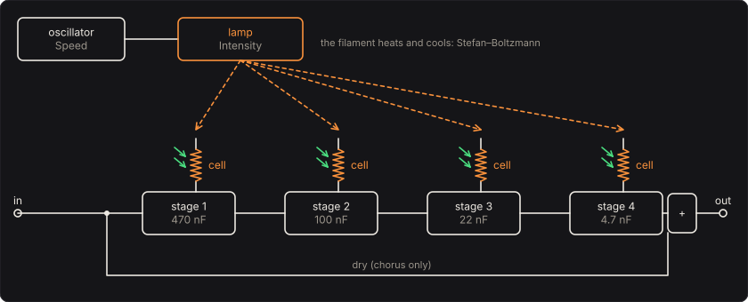
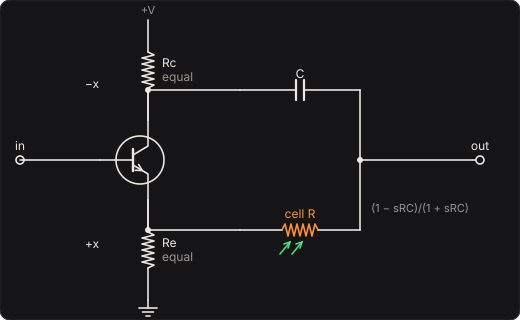

# Lamp Vibe

A phase vibe lit by a light bulb. A slow oscillator sets the voltage on a small tungsten lamp; the
lamp shines on four cadmium-sulphide photocells; each cell is the resistor of an all-pass stage
in your bass's path. As the filament heats and cools, the cells' resistance falls and climbs, the
stages' phase sweeps, and the note throbs (chorus) or wavers in pitch (vibrato).

The lamp is the instrument here. Its filament is a black body heated by its current and cooled by
radiating, as T⁴. It stores heat, so it lags the oscillator, and lags more the faster it goes. It
heats quickly but cools slowly, because a cooler filament radiates less. And the cells see only
the short-wavelength tail of its glow, which swells far faster than the power it radiates.

Part of [PhuzzBox](../README.md).

| Input | |
|---|---|
| Your audio interface | pick it in the source menu (then **In 1** or **In 2**) |
| `Z`…`/`, `A`…`;`, `Q`…`P`, `1`…`0` | the test bass's E, A, D and G strings, open to the ninth fret |
| `Space` | the footswitch |

## The circuit



The oscillator puts a voltage on the lamp that dips from its rating by **Intensity** each cycle:

  v(t) = V (1 − D (1 − sin 2πft) / 2)

so at 70 % it falls to 30 % of the rating at the bottom of each sweep, and at 0 the lamp burns
steady.

## The filament

The filament is a thin tungsten wire. Its current heats it, and it cools by radiating
(Stefan–Boltzmann). Conduction down its leads is neglected:

  m c dT/dt = v² / R(T) − ε(T) σ A (T⁴ − T₀⁴),  R(T) = ρ(T) L / (π d²/4)

Here ρ(T) is tungsten's measured resistivity, from Forsythe and Watson's table (5.65 µΩ·cm at
300 K, 73.9 at 2500 K). Hot, a filament has thirteen times its cold resistance, so a cold lamp
switched on draws thirteen times its running current. The emissivity ε(T) also comes from the
resistivity, through the free-electron theory of metals: Parker and Abbott's form of the
Hagen–Rubens relation, carried over all angles and wavelengths,

  ε = 0.766 √(ρT) − (0.309 − 0.0889 ln ρT) ρT − 0.0175 (ρT)^{3/2},  ρ in Ω·cm.

For tungsten it gives 0.03 at room temperature and 0.24 at 2500 K. It agrees with Davisson and
Weeks's older series to 1.5 % up to 2500 K (a test checks this).

Each lamp is sized from its rating: all three run at 2500 K at their rated voltage and current.
That gives the wire's resistance V/I = ρ L/(π d²/4), and its area A = π d L, which must radiate
the power V I. Together these fix d and L, and from them the wire's mass and heat capacity
(19 300 kg/m³, 150 J/(kg K)).

| Lamp | Rating | Filament | Time constant at rating | at half voltage |
|---|---|---|---|---|
| Grain of wheat | 12 V, 50 mA | 11 µm × 32 mm | 6.2 ms | 15 ms |
| Pilot lamp | 6.3 V, 150 mA | 23 µm × 24 mm | 12.9 ms | 31 ms |
| Panel bulb | 12 V, 5 W | 46 µm × 64 mm | 25.5 ms | 62 ms |

Near where it settles, the filament relaxes with the time constant τ = C / (−d(net power)/dT).
Two things set the slope. Radiation grows as T⁴, so a hot filament sheds heat fast. And the
filament's resistance rises with temperature, so a warmer filament draws less power from the same
voltage. Dimmer, both slopes are gentler, and τ grows: two and a half times longer at half the
voltage. So the lamp brightens quickly and lingers in the dark part of each cycle. A bigger lamp
has a thicker wire with more heat to store for the light it gives, so it follows the oscillator
less.

Swept at 70 % Intensity, the pilot lamp's filament swings between 1710 K and 2500 K at 1 Hz, and
only between 2010 K and 2390 K at 12 Hz.

## The glow

A cadmium-sulphide cell responds to a bell of wavelengths around 540 nm, green, about 160 nm wide.
The light it sees is the photons it catches from the filament's black-body spectrum (Planck's law):

  Λ(T) ∝ ∫ S(λ) λ B_λ(T) dλ,  B_λ(T) = 2hc² / λ⁵ / (e^{hc/λkT} − 1)

taken relative to the lamp at its rating. At 2500 K most of the filament's light is infrared; the
cells look at the short-wavelength side of the peak, where e^{−hc/λkT} makes the light swell
fastest as T rises. From 2000 K to 2500 K the light the cells see grows elevenfold, while the
power the filament radiates only triples. So a modest swing in temperature is a deep swing in
light, which is why a lamp makes a good vibe.

## The cells

The light frees electrons in the cadmium sulphide. They recombine with each other, at a rate that
grows with how many there are (Rose's picture of a photoconductor, without the traps the Opto
Compressor's cell has):

  dn/dt = Λ/τ − (n/τ)(1 + n),  R = 1 / (1/Rdark + n/Rlit)

Here n is counted in units of the free electrons the rated glow keeps there (the root of
n(1 + n) = 1), Rlit is 3 kΩ and Rdark is 10 MΩ. At the lamp's rating each cell is 4.85 kΩ. Brightly
lit, the electrons find each other and recombine quickly; dim, they linger for **Cells**, the
lifetime τ. So the cells' resistance falls fast as the light comes up and climbs back slowly. At
70 % Intensity, slowly swept, the cells climb from 5 kΩ to some 250 kΩ.

## The stages



Each stage is a phase splitter: a transistor with equal collector and emitter resistors gives −x
and +x. These meet through the capacitor C and the cell R:

  H(s) = (1 − s R C) / (1 + s R C)

That is unity gain at every frequency, with the phase falling through −90° at 1/(2πRC). The four
capacitors (470, 100, 22 and 4.7 nF) spread the stages' corners over two decades. Together they
turn the highs through 720°.

**Chorus** mixes the stages' output with the dry signal, half and half, which gives a gain of
|cos(φ/2)|. That cancels where the stages have turned a frequency by 180° and 540°: two notches.
With the cells at their rated 4.85 kΩ these are at 131 Hz and 3.7 kHz. With the cells at
250 kΩ they drop to 2.6 Hz and 72 Hz. The lamp sweeps them up and down.

**Vibrato** is the stages alone. There are no notches, but as the lamp sweeps the phase, each
frequency's phase φ slides back and forth, and its pitch with it, by

  Δf = (1/2π) dφ/dt.

A test checks the engine's wavering pitch against this, from the engine's own record of its cells.

## Solving it

The oscillator, the filament and the cells run at a quarter of the sample rate. Their quickest
rate is a cold filament just switched on, under a millisecond, and they are far slower once warm. The
filament is solved by the classical Runge–Kutta method and the cells by Heun's. The stages run at
the sample rate, each a one-pole filter by the bilinear transform (Zavalishin's topology-preserving
form). Each is prewarped so its corner lands where 1/(2πRC) puts it, its coefficient glides
between control steps, and the all-pass is 2 × low-pass − 1. The pedal is linear in the signal,
so there is nothing to oversample.

## The controls

- **Speed**, **Intensity**, **Level** and the **Mode** switch are on the face.
- **Lamp** and **Cells** are the bench, under *The lamp and cells*.

## The views

- **The lamp**: the bulb, drawn in its filament's colour and brightness, and the last two and a
  half seconds of the lamp's voltage, the filament's temperature and the cells' resistance.
- **The glow**: Planck's spectrum at the filament's temperature now and at its rating, and the
  cells' bell of wavelengths.
- **The phase**: in chorus, the gain with its two notches, now and at the ends of the swing; in
  vibrato, the four stages' phase.
- **Scope** and **Spectrum**: the input and the output.

## What to listen for

- **Chorus**, then **Slow throb**: the notches sweep through the notes, then slowly and deeply.
- **Vibrato**, then **Seasick vibrato**: the pitch wavers, then wanders.
- **Lamp steady: the notches stand still**: a fixed comb, Intensity at 0.
- **Grain of wheat, quick**, then **Panel bulb: the lamp can't keep up**: at 6 Hz the small lamp
  still swings deeply; the big one's filament can't heat and cool that fast, and the sweep goes
  shallow.
- **Slow cells**: the cells smooth the sweep and lag the lamp.

## Plugged in backwards

The Lamp Vibe has no **Reversed** switch: the stages' transistors pass the signal one way only.

## What is simplified

- The phase splitters are ideal, with exactly −x and +x and no loading by the next stage. There is
  no transistor distortion and no input or output buffer.
- The filament loses heat by radiation alone, not by conduction down its leads, which in a real
  small lamp carry away a share of it, more when it is dim. Its specific heat is a constant
  150 J/(kg K), though tungsten's rises by about a third from room temperature to 2500 K. The
  emissivity is the free-electron theory's; tungsten's measured emissivity when hot is somewhat
  higher.
- The lamps' ratings are typical of their kinds, not of particular part numbers, and all run at
  2500 K.
- The cells' response is a Gaussian bell, the four cells are identical and equally lit, and they
  have no traps (no memory longer than τ). Real cells differ from one another, which spreads a
  vibe's notches.
- The bulb is drawn in an approximate colour for its temperature (Helland's fit), for the page
  only.

## Files

```
lampvibe/index.html, style.css            page
lampvibe/src/lampvibe-params.js           parameters and presets
lampvibe/src/lampvibe-pedal.js            the descriptor: everything but the page
lampvibe/src/lampvibe-main.js             page wiring and views
lampvibe/src/lampvibe-worklet.js          its AudioWorklet module
lampvibe/src/lampvibe-tour.js             the guided tour
lampvibe/src/lampvibe-schematics.js       the diagrams
lampvibe/wasm/lampvibe.wasm               built from the C++
native/pedals/lampvibe/                   the filament, the cells and the stages in C++
test/lampvibe-circuit.mjs                 the physics worked out independently, for the tests
test/lampvibe-tests.mjs                   node test/lampvibe-tests.mjs
```

## Prior art and references

* Forsythe, W. E. & Watson, E. M. (1934). "Resistance and radiation of tungsten as a function of
  temperature." *Journal of the Optical Society of America* 24, 114–118. The resistivity table,
  as reprinted in the *CRC Handbook of Chemistry and Physics* (D. R. Lide, ed.).
* Parker, W. J. & Abbott, G. L. (1965). "Theoretical and experimental studies of the total
  emittance of metals." In *Symposium on Thermal Radiation of Solids* (S. Katzoff, ed.), NASA
  SP-55, pp. 11–28. The emissivity from ρT.
* Davisson, C. & Weeks, J. R., Jr. (1924). "The relation between the total thermal emissive power
  of a metal and its electrical resistivity." *Journal of the Optical Society of America* 8,
  581–605. The older series the tests compare against.
* Planck, M. (1901). "Ueber das Gesetz der Energieverteilung im Normalspectrum." *Annalen der
  Physik* 309(3), 553–563. The black body's spectrum.
* Rose, A. (1951). "An outline of some photoconductive processes." *RCA Review* 12, 362–414.
  Its *Citation Classic* commentary:
  [PDF](https://garfield.library.upenn.edu/classics1980/A1980KF12700001.pdf). Free electrons
  recombining in a photoconductor, the model of the cells.
* Hewlett, W. R. (1942). "Variable frequency oscillation generator." US Patent 2,268,872.
  [link](https://patents.google.com/patent/US2268872). A lamp's resistance rising with its
  filament's temperature, used to hold an oscillator's amplitude steady: the same nonlinearity
  that makes this lamp lag and linger.
* Zavalishin, V. (2018). *The Art of VA Filter Design*, rev. 2.1.0. Native Instruments.
  [PDF](https://www.native-instruments.com/fileadmin/ni_media/downloads/pdf/VAFilterDesign_2.1.0.pdf).
  The one-pole filter by the topology-preserving transform, and the all-pass made from it.
