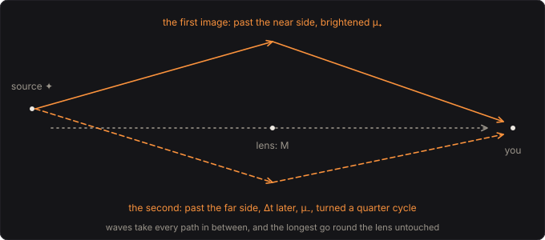

# Gravitational Lens

Mass bends the paths of waves past it, light, or gravitational waves, or here your bass. Put a
star or a black hole between a source and you and the source is seen twice: once past the near
side of the mass, brightened, and once past the far side, later, fainter, and turned a quarter
cycle. Einstein worked out in 1936 what a star would do to the light of one behind it; in 1979 a
quasar was found twice in the sky, and its two images turned out to flicker alike 417 days apart. This pedal puts your bass far
behind a point mass of 1 to 1000 suns and plays what arrives: the two images beating into a comb,
and, because sound is a wave, everything else too: the longest waves, too long to be bent, going
round the lens untouched.

Part of [PhuzzBox](../README.md).

| Input | |
|---|---|
| Your audio interface | pick it in the source menu (then **In 1** or **In 2**) |
| `Z`…`/`, `A`…`;`, `Q`…`P`, `1`…`0` | the test bass's E, A, D and G strings, open to the ninth fret |
| `Space` | the footswitch |



## Fermat's principle: two images

Measure the plane of the lens in Einstein radii, and the source's offset from the line through the
lens as y. The path through the plane at x arrives at

  T(x) = |x − y|²/2 − ln|x|,

in units of 4GM/c³ (19.7 µs for every sun's worth of mass, 19.7 ms for 1000 suns): the geometric detour of the bent path,
less the Shapiro delay of passing close to the mass. Rays take the paths where T is stationary,
Fermat's principle, and a point mass has two: a minimum on the source's side and a saddle across
the lens,

  x± = (y ± √(y² + 4))/2,

1.62 and −0.62 for a source one Einstein radius off. Each is magnified, its brightness multiplied, by

  μ± = 1/2 ± (y² + 2)/(2y√(y² + 4))

(μ₋ is negative: the saddle's image is mirrored), together Paczyński's

  A(u) = |μ₊| + |μ₋| = (u² + 2)/(u√(u² + 4)),

with u = y: 1.13 at 1.5 Einstein radii, 1.34 at 1, 2.18 at 0.5 (3.4 dB), 10.0 at 0.1 (10.0 dB), 20.0 at
0.05 (13.0 dB),
growing as 1/u as the source lines up and the images close into the Einstein ring. The second
image arrives later by

  ΔT = y√(y² + 4)/2 + ln((√(y² + 4) + y)/(√(y² + 4) − y)),

1.01 units at 0.5 (1.99 ms behind 100 suns), 2.08 at 1 (41.0 ms behind 1000 suns, 38 % as loud as
the first), 7.80 at 3 (15.4 ms behind 100 suns, 9.2 % as loud). A lens far off stretches all of it
by (1 + z) on the way, so the mass that counts is M(1 + z): 100 suns at z = 1 delay the second image
3.98 ms. Refsdal saw in 1964 that measuring the delay between two images of a varying source would
measure the distances and so the Hubble constant; the delay of the twin quasar Q0957+561, 417 ± 3
days, was measured that way.

## Every path at once

A ray takes the stationary paths; a wave takes every path, each arriving at its own time. Summed
over the plane of the lens, the wave reaching you at frequency f is the wave without the lens
times

  F(w) = (w/2πi) ∫ d²x e^{iwT(x)},  w = 2πf · 4GM/c³,

the amplification factor of wave optics. Grouping the paths by when they arrive, with A(τ) the
area of the plane whose paths arrive before τ, F(w) = (w/2πi) ∫ A′(τ) e^{iwτ} dτ, and integrating
twice by parts,

  F(w) = ∫ h(τ) e^{iwτ} dτ,  h(τ) = A″(τ)/2π:

the lens's impulse response is the second derivative of that area. **The lens plane** draws it
growing. It starts from nothing at the minimum and grows as an ellipse, so A′ jumps there and h
begins with a spike, √μ₊: the first image. As the area wraps round the saddle A′ has a logarithmic
peak, and h swings through −√|μ₋|/(π(τ − T₋)): the second image. Far out the area grows as
2πτ + π ln 2τ + …, so h ends in a slow tail, −1/(2τ²), the part of the wave not focused but bent
round the lens.

For a point mass the integral can be done exactly (Peters's solution, in Takahashi and Nakamura's
eq. 17), with a Γ function and a confluent hypergeometric function, and the tests check the
engine's kernel against it, at w from 0.1 to 20 and y from 0.1 to 2: within 0.001 dB and 0.0001
rad.

## A quarter cycle turned

Near the minimum, every path is a little later than the stationary one; near the saddle, later in
one direction and earlier in the other. So the paths round the saddle add up a quarter cycle out of
step at every frequency: the second image is the first one Hilbert-transformed (in Dai and
Venumadhav's words, the type II image's "positive-frequency components are shifted by a phase
−π/2"; with the e^{−iωt} of engineering the sign flips and the image is −H[x], H the usual Hilbert
transform). In geometric optics, Takahashi and Nakamura's eq. 18:

  F = |μ₊|^½ − i|μ₋|^½ e^{2πifΔt},  |F|² = |μ₊| + |μ₋| + 2|μ₊μ₋|^½ sin(2πfΔt).

The spectrum is the note's, but the shape is not: a sine becomes a cosine, and a plucked string's
sharp attack comes back as a spike-and-swing. And the two images beat into a comb whose teeth are
moved a quarter of the way along: behind 100 suns, half an Einstein radius off, the images are 1.99
ms apart, brightened 6.15 dB where in step and cut 6.15 dB where opposed (12.3 dB between peaks and
dips), with peaks every 502 Hz from 126 Hz and 628 Hz and dips at 377 Hz and 879 Hz, where a plain
echo would dip at odd multiples of 251 Hz.

## Too long to be bent

When the wavelength is long compared with the lens, that is when w is below about 1, below
c³/(8πGM), the wave doesn't notice the lens and goes round it, gaining nothing: 81 Hz for 100
suns, 2.69 kHz for 3, 8.1 kHz for one. In the kernel this is its tail, and it makes the kernel
sum to exactly one, F(0) = 1. Behind 3 suns the open E (41.2 Hz) comes out 0.1 dB louder; in
geometric optics, which bends every wavelength alike, it would be 3.4 dB. At 20 Hz behind 10 suns
(w = 0.025) the lens brightens by 2 %.

The same smooths the ring. Exactly behind the lens, rays would focus to an infinite brightness;
the wave can't be focused finer than its wavelength, and eq. 17 at y = 0 gives
|F|² = πw/(1 − e^{−πw}), finite at every frequency, growing with it.

## Rays, causally

The **Optics** switch plays geometric optics alone, the two images at every wavelength. The Hilbert
transform the saddle's image needs reaches back forever, before the first image arrives, so it
can't be played as it stands. As frequency shifters do, each image goes instead through its own
chain of seven first-order allpass sections, the two chains' phases a quarter cycle apart: 90°
within ±0.4° from 20 Hz to 20 kHz (the poles were found by minimising the largest error over 12 Hz
to 120 kHz, then put through the bilinear transform). The images keep their sizes and their
relative phase, so the comb is geometric optics' to within 0.05 dB from 20 Hz to 20 kHz; what they
share is a phase that bends with frequency, the lowest notes a little behind the treble (7.0 ms at
the open E, 0.3 ms at 1 kHz), which a single image barely shows. Both images arrive 8 samples after the input (0.17 ms
at 48 kHz), so the second can be read between samples, by a 16-tap Kaiser-windowed sinc, even when
it follows within one. That sinc passes the second image within 0.4 dB at 20 kHz (0.42 fs).

## Solving it

The kernel is h sampled at the engine's rate: each tap is (A(τ + Δ) − 2A(τ) + A(τ − Δ))/(2πΔ), Δ one
sample in units of 4GM/c³, which is A″/2π averaged over a triangle two samples wide: exact for the
first image's spike, and a straight line between samples for the rest. The area A(τ) is an
integral over the radius of the angle the region spans there, by 24-point Gauss–Legendre after a
substitution that smooths the square-root edges, split at the saddle's radius, where the angle dips
sharply as τ nears T₋. Away from the images h is smooth on the scale of its distance from them, so it
is worked out exactly at taps a tenth of that distance apart (every tap within ten of an image) and
by cubic interpolation between: within 0.0015 dB of working out every tap, in at most about 570
areas. The kernel is cut once the lowest note's waves are carried (10/w at 20 Hz, at least 8 units
past the saddle), faded out over its last quarter, with what the rest would have added at DC put
back there, so it sums to one: 3,918 taps at 48 kHz behind 100 suns, up to 16,384.

The engine convolves the bass with it with no latency: the first 128 taps sample by sample, the rest
in partitions of 128 by FFT (uniformly partitioned overlap-save), each block's sum ready when its
block begins. When the lens changes, the new kernel is built a little each block, its partitions
transformed, and the output faded over to it in 30 ms: about 50 ms from turning a knob to hearing
it. At its heaviest, 1000 suns three Einstein radii off and the lens moving ten times a second, it
takes under 5 % of a core in WebAssembly.

The straight line between samples rounds the saddle's image off at the top: averaged over the
comb, the waves are a few tenths of a decibel under geometric optics at 16 to 20 kHz, where the two
should agree.

## The controls

- **Mass**, **Offset** and **Optics** are on the face, with the source's offset on the expression
  pedal (MIDI CC 1): rock it to move the source across the lens.
- **Lens redshift** and **Level** are under *The sky and output*.

## The views

- **The lens plane**: the arrival-time surface round the lens, its contours half a unit apart,
  the Einstein ring, the source and the two images, as big as they are bright and glowing as you
  play, and the area arrived by a time that sweeps on, whose second derivative is the response.
- **Arrivals**: the impulse response in waves, against geometric optics' two images.
- **The response**: the gain against frequency in waves and in rays, the diffraction frequency
  c³/(8πGM) and the average brightening |μ₊| + |μ₋|.
- **Scope**: the input and the output in volts.
- **Spectrum**: the input's and the output's.

## What to listen for

- **A star of 100 suns**: 1.99 ms between the images, a comb from 126 Hz, and the bass's lowest
  notes, below 81 Hz, passing round.
- **Nearly aligned: an Einstein ring**: 0.05 Einstein radii off, 20.0 times as bright (13.0 dB), the
  images 0.20 ms apart and the dips every 5.1 kHz.
- **Rays: geometric optics**: the default lens with no diffraction: the comb all the way down.
- **A light lens: 3 suns**: the bass untouched, its overtones above 2.69 kHz combed.
- **A heavy lens: 1000 suns**: one Einstein radius off, a 41.0 ms echo at 38 %, Hilbert-transformed.
- **Far off the axis**: 2 Einstein radii, the second image 17 % as loud, 9.05 ms late.
- **A distant lens: z = 1**: the default lens at redshift 1, every delay doubled.

## What is simplified

- The lens is a point mass, and thin: all of its bending happens in one plane, as for any lens much
  smaller than the distances to it. Galaxies, with their spread-out mass, make more images.
- The source sits still, and so does the lens: nothing moves while a note sounds but what the
  Offset knob moves.
- The distances themselves don't appear: the Einstein radius sets the scale, and with it the
  brightening is relative to the source without the lens.
- Sound doesn't bend round masses; light and gravitational waves do, by the same wave optics, which
  is what this plays, at audio frequencies.

## Files

```
lens/index.html, style.css             page
lens/src/lens-params.js                parameters and presets
lens/src/lens-pedal.js                 the descriptor: everything but the page
lens/src/lens-main.js                  page wiring and views
lens/src/lens-worklet.js               its AudioWorklet module
lens/src/lens-tour.js                  the guided tour
lens/src/lens-schematics.js            the paths' diagram
lens/wasm/lens.wasm                    built from the C++
native/pedals/lens/                    the area, the kernel, the rays and the engine in C++
test/lens-circuit.mjs                  the lens worked out independently, for the tests
test/lens-tests.mjs                    node test/lens-tests.mjs
```

## Prior art and references

* Einstein, A. (1936). "Lens-like action of a star by the deviation of light in the gravitational
  field." *Science* 84(2188), 506–507.
  [doi:10.1126/science.84.2188.506](https://doi.org/10.1126/science.84.2188.506)
* Refsdal, S. (1964). "On the possibility of determining Hubble's parameter and the masses of
  galaxies from the gravitational lens effect." *Monthly Notices of the Royal Astronomical
  Society* 128(4), 307–310: "the difference Δt in the time of light travel for these two paths can
  amount to a couple of months or more, and may be measurable."
  [doi:10.1093/mnras/128.4.307](https://doi.org/10.1093/mnras/128.4.307)
* Walsh, D., Carswell, R. F. and Weymann, R. J. (1979). "0957 + 561 A, B: twin quasistellar objects
  or gravitational lens?" *Nature* 279, 381–384.
  [doi:10.1038/279381a0](https://doi.org/10.1038/279381a0)
* Kundić, T. et al. (1997). "A robust determination of the time delay in 0957+561A,B and a
  measurement of the global value of Hubble's constant." *The Astrophysical Journal* 482, 75–82:
  "a best fit delay of 417 ± 3 days".
  [doi:10.1086/304147](https://doi.org/10.1086/304147)
* Paczyński, B. (1986). "Gravitational microlensing by the galactic halo." *The Astrophysical
  Journal* 304, 1–5: the images' positions (its eq. 3) and total magnification (eq. 5),
  A = (u² + 2)/(u(u² + 4)^½). [doi:10.1086/164140](https://doi.org/10.1086/164140)
* Deguchi, S. and Watson, W. D. (1986). "Diffraction in gravitational lensing for compact objects
  of low mass." *The Astrophysical Journal* 307, 30–37: the wave treated with "a scalar wave
  equation which has the same form as the Schrödinger equation for Coulomb scattering".
  [doi:10.1086/164389](https://doi.org/10.1086/164389)
* Nakamura, T. T. and Deguchi, S. (1999). "Wave optics in gravitational lensing." *Progress of
  Theoretical Physics Supplement* 133, 137–153.
  [doi:10.1143/PTPS.133.137](https://doi.org/10.1143/PTPS.133.137)
* Takahashi, R. and Nakamura, T. (2003). "Wave effects in gravitational lensing of gravitational
  waves from chirping binaries." *The Astrophysical Journal* 595, 1039–1051: the amplification
  factor of a point mass (eq. 17, after Peters 1974), its geometric-optics limit (eq. 18) and
  |F|² (eq. 21), the images' magnifications and delay, and "For w ≲ 1, the amplification is very
  small due to the diffraction effect".
  [doi:10.1086/377430](https://doi.org/10.1086/377430), [arXiv:astro-ph/0305055](https://arxiv.org/abs/astro-ph/0305055)
* Dai, L. and Venumadhav, T. (2017). "On the waveforms of gravitationally lensed gravitational
  waves." [arXiv:1702.04724](https://arxiv.org/abs/1702.04724): the Morse index of each image, and
  a type II image's waveform as the Hilbert transform of the source's.
* Schneider, P., Ehlers, J. and Falco, E. E. (1992). *Gravitational Lenses*. Springer.
  [doi:10.1007/978-3-662-03758-4](https://doi.org/10.1007/978-3-662-03758-4)
* Prša, A. et al. (2016). "Nominal values for selected solar and planetary quantities: IAU 2015
  Resolution B3." *The Astronomical Journal* 152, 41: the nominal solar mass parameter
  GM☉ = 1.3271244 × 10²⁰ m³ s⁻², which makes 4GM☉/c³ = 19.70 µs.
  [doi:10.3847/0004-6256/152/2/41](https://doi.org/10.3847/0004-6256/152/2/41)
