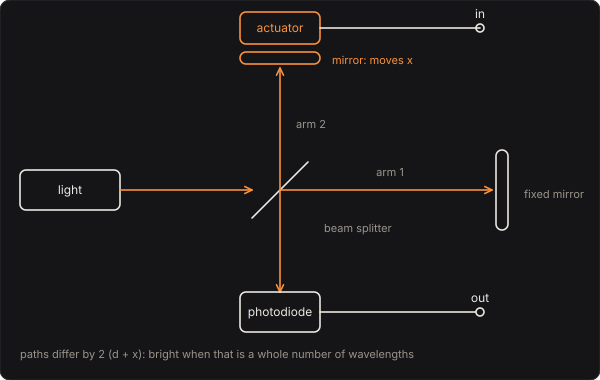

# Michelson Interferometer

The instrument that measured the metre in wavelengths of light, failed to find the ether, and, four
kilometres long, heard two black holes merge. A beam of light is split in two, each half goes down
an arm to a mirror and back, and the halves meet again on a photodiode. Your bass moves one of the
mirrors. Every half wavelength it moves, about 316 nm for a red laser, the light on the detector goes
from bright to dark and back, so the detector's output is the bass folded over a fringe at a time:
a wavefolder whose fold is the wavelength of light.

Part of [PhuzzBox](../README.md).

| Input | |
|---|---|
| Your audio interface | pick it in the source menu (then **In 1** or **In 2**) |
| `Z`…`/`, `A`…`;`, `Q`…`P`, `1`…`0` | the test bass's E, A, D and G strings, open to the ninth fret |
| `Space` | the footswitch |

## The bench



The two paths differ by OPD = 2 (d + δ + x + w): twice the arms' difference d (the micrometer), the
fine offset δ (the **Fringe** knob, a small steady voltage on the actuator), the mirror's motion x
and the air's drift w. For light of one wavelength λ the detector sees

  I = ½ (1 + V cos(2π · OPD / λ))

from 0 (dark) to 1 (bright), V the fringes' contrast. The detector's amplifier turns 1 mW of light at
0.4 A/W into 2.5 kΩ, so dark to bright is 1 V; a coupling capacitor (5 Hz) passes only the change.

**Fringe** sets where on a fringe the mirror rests, as a phase. The micrometer is taken to the
nearest whole wavelength of the source's centre, so the Fringe knob alone sets the phase: 0° is a
bright fringe, 180° a dark one, 90° and 270° halfway up a side.

**Stroke** is how far the mirror moves per volt of your bass: from 20 to 4000 nm/V. At 400 nm/V a
note that peaks at 0.5 V moves it 200 nm each way, changing the paths by 0.63 of the red laser's
wavelength.

## A sine on the mirror: Bessel functions

If the mirror moves as x = A sin ωt, the light is

  I = ½ (1 + V cos(φ + β sin ωt)),  β = 4π A / λ

and the Jacobi–Anger expansion, cos(φ + β sin ωt) = Σ J_n(β) cos(φ + nωt), says the n-th harmonic
of the output has amplitude |J_n(β)| · |sin φ| for odd n and |J_n(β)| · |cos φ| for even n (in units
of the 1 V full scale). Resting mid-fringe (φ = 90°) the output has odd harmonics only; resting on
a crest (φ = 0°), even ones only: the note comes out an octave up. It is the arithmetic of an FM
synthesiser, with the mirror's swing as the modulation index. The tests check the engine's first
eight harmonics against Bessel functions computed from their integral.

For a quiet note mid-fringe the output is the mirror's travel times the fringe's slope,
½ · 4π/λ · 1 V: a sensor of displacement, linear to a few percent for a swing under 20 nm. That is
what LIGO is, at the level of 10⁻¹⁹ m.

## The light

Each source is one or two spectral lines, each Gaussian in wavenumber with a full width Δλ. A line's
fringes have the contrast

  V(OPD) = exp(−(π Δλ OPD / λ²)² / (4 ln 2))

the Fourier transform of its shape (Wiener–Khinchin): the narrower the line, the longer it stays in
step with itself. With several lines, their fringes add.

| Light | λ | width | |
|---|---|---|---|
| HeNe laser | 632.8 nm | 0.002 nm | a few longitudinal modes: coherent over some 20 cm |
| Green laser | 532 nm | 0.1 nm | a diode-pumped pointer: a few millimetres |
| Violet laser | 405 nm | 1 nm | a multimode diode: the contrast halves at 36 µm of arm difference |
| Sodium lamp | 589.0 and 589.6 nm | 0.005 nm each | the D lines, D₂ twice as bright as D₁ |
| White LED | 450 nm and 565 nm | 20 and 110 nm | a blue chip and its yellow phosphor, 0.4 : 1 |

A shorter wavelength makes more fringes for the same stroke: violet folds 1.6 times as often as red.
The sodium lamp's two lines, 0.6 nm apart, make fringes that slip against each other as the arm
difference grows: half a fringe apart at 145 µm, where the contrast falls to a third (the two
lines' brightnesses are 2 : 1, so they never cancel), and back in step at 291 µm. Where the
fringes fade is the classic laboratory measurement of the doublet's separation. The white LED has fringes only with the arms
equal: within a micrometre they are strong; out to 2 µm or so the blue chip's narrower line leaves
a faint tail; beyond, nothing.

## The mount

The mirror is a mass on a spring, driven by the actuator:

  x'' + (ω₀/Q) x' + ω₀² x = ω₀² s v

with s the Stroke and v the bass's voltage. A **piezo stack** is stiff: ω₀ = 2π · 20 kHz, Q = 8, so
across a bass's range the mirror follows the voltage. A **loudspeaker cone** with the mirror glued
to it rides a soft suspension: ω₀ = 2π · 80 Hz, Q = 0.8. Below 80 Hz it follows; above, its mass
holds it back, 12 dB less travel each octave up, so high notes fold less than low ones.

## The air

Warm air drifting through the arms changes their optical length. **Air currents** sets the RMS of
that drift, from 0 (a bench under a hood) to 200 nm; it wanders as an Ornstein–Uhlenbeck process,
forgetting itself over half a second:

  w ← a w + σ √(1 − a²) n,  a = exp(−Δt / 0.5 s)

with n a fresh normal deviate each sample, so its variance stays σ². At 80 nm the red laser's resting
point wanders over a quarter of a fringe, and the tone with it.

## Solving it

The actuator is a state-variable filter by the bilinear transform, prewarped so its resonance lands
where it should. For the light, a fold is an instant change of direction, which puts harmonics far
above the sample rate; two things keep them from aliasing. The circuit runs at 4× the sample rate
at high quality (2× medium, 1× low), through the same oversampling filters as the other pedals; and
each step's light is the average of the cosine over the step, from its antiderivative,

  ⟨cos φ⟩ = (sin φ₁ − sin φ₀) / (φ₁ − φ₀)

(first-order antiderivative antialiasing), with the contrast taken at the step's middle. A deep fold
of a 1 kHz note keeps its inharmonic products more than 40 dB down at high quality.

## The controls

- **Stroke**, **Fringe**, **Level** and the **Light** switch are on the face.
- **Arm difference**, **Mirror mount** and **Air currents** are the bench, under *The bench*.

## The views

- **The fringes**: what a screen in the detector's place shows with the beam spread a little.
  Off the axis the paths differ by OPD cos θ, so the fringes are rings, which swell out of the
  middle or shrink into it as the mirror moves. With the arms equal there are no rings: the field
  brightens and darkens all at once.
- **The fringe**: the light on the detector against the mirror's travel from rest, the contrast's
  envelope dashed, and the light as you play.
- **The mount**: the mirror's travel per volt against frequency.
- **Scope** and **Spectrum**: the input and the output.

## What to listen for

- **Red laser, mid-fringe**, then **Deep folds**: 400 nm/V, then 2000 nm/V: a few folds a cycle,
  then a dense, ringing fold.
- **Bright fringe: an octave up** and **Dark fringe**: the same gentle stroke on a crest and in a
  trough: the note an octave up, in even harmonics.
- **Green laser** and **Violet laser**: more fringes for the same stroke, so brighter, denser folds.
- **Sodium lamp, lines in step**, then **Sodium lamp, lines out of step** (145 µm): the same folds,
  then shallow ones, at a third of the contrast.
- **White light at zero path**, then **White light, out and back** (4000 nm/V): a hard note swings
  the mirror 2 µm each way, right out of the fringes, so the light flickers only as it passes the
  middle.
- **Loudspeaker mount**: low notes fold more than high ones.
- **Breezy lab**: 80 nm of drift, and the tone wanders.

## Plugged in backwards

The interferometer has no **Reversed** switch. Plugged in backwards the bass would drive the
detector's amplifier's output, and light doesn't run back up a photodiode into a mirror's
actuator: silence, as from a real one.

## What is simplified

- The lines' shapes are Gaussian in wavenumber, and their widths are typical of each kind of source,
  not measured: real HeNe lasers have a few discrete modes, a diode's spectrum has its own structure,
  and a white LED's spectrum is not two Gaussians. The sodium lines' widths depend on the lamp.
- The beams are perfectly aligned and equal in power, so the contrast is the light's coherence alone;
  a real bench loses some to tilt, wavefront and unequal arms. The rings are drawn for an on-axis
  view; the detector is a point.
- The detector has no noise and no bandwidth limit, and the actuator has one resonance and no
  hysteresis (a real piezo stack has a few percent).
- The micrometer is taken to whole wavelengths, so the Fringe knob alone sets the phase.

## Files

```
michelson/index.html, style.css            page
michelson/src/michelson-params.js         parameters and presets
michelson/src/michelson-pedal.js          the descriptor: everything but the page
michelson/src/michelson-main.js           page wiring and views
michelson/src/michelson-worklet.js        its AudioWorklet module
michelson/src/michelson-tour.js           the guided tour
michelson/src/michelson-schematics.js     the bench's diagram
michelson/wasm/michelson.wasm             built from the C++
native/pedals/michelson/                  the light, the mount and the engine in C++
test/michelson-circuit.mjs                the physics worked out independently, for the tests
test/michelson-tests.mjs                  node test/michelson-tests.mjs
```

## Prior art and references

* Michelson, A. A. & Morley, E. W. (1887). "On the relative motion of the Earth and the luminiferous
  ether." *American Journal of Science* s3-34(203), 333–345.
* Michelson's measurement of the metre against the cadmium red line, with Benoît (1892–93), and the
  interferometer's other uses, are in Born, M. & Wolf, E. *Principles of Optics*, 7th ed. (Cambridge
  University Press, 1999), chapter 7, as are fringe visibility and the coherence of a source.
* Hecht, E. *Optics*, 5th ed. (Pearson, 2017), chapter 9: the Michelson interferometer, its circular
  fringes, and measuring the sodium doublet's separation from where the fringes fade.
* Abbott, B. P. et al. (LIGO Scientific Collaboration and Virgo Collaboration) (2016). "Observation of
  gravitational waves from a binary black hole merger." *Physical Review Letters* 116, 061102.
  [doi:10.1103/PhysRevLett.116.061102](https://doi.org/10.1103/PhysRevLett.116.061102).
* Kramida, A., Ralchenko, Yu., Reader, J. and NIST ASD Team. *NIST Atomic Spectra Database*: the
  sodium D lines at 588.995 and 589.592 nm.
* Parker, J. D., Zavalishin, V. & Le Bivic, E. (2016). "Reducing the aliasing of nonlinear waveshaping
  using continuous-time convolution." *Proc. 19th Int. Conf. on Digital Audio Effects (DAFx-16)*,
  Brno. Antiderivative antialiasing.
* Zavalishin, V. (2012). *The Art of VA Filter Design*. Native Instruments. The state-variable filter
  by the bilinear transform.
