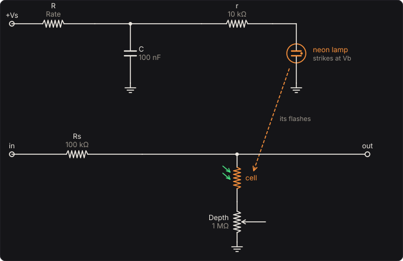

# Neon Tremolo

A tremolo with no oscillator but a neon lamp. A capacitor charges through a resistor until the gas
in the lamp breaks down; the lamp flashes, dumps the capacitor's charge in a few milliseconds and
goes dark, and the capacitor starts again. Each flash lights a cadmium-sulphide photocell that
pulls the bass down, and the bass swells back as the cell goes dark.

The lamp is the instrument here. When it strikes is Paschen's law: a gas insulates until the
field is strong enough for an electron's avalanche to replace itself, and the voltage that takes
depends only on the gas's pressure times the gap. Once lit it burns
a little above the bottom of that curve, so it strikes high and goes out low, and that gap
between the two is what makes it flash rather than glow.

Part of [PhuzzBox](../README.md).

| Input | |
|---|---|
| Your audio interface | pick it in the source menu (then **In 1** or **In 2**) |
| `Z`…`/`, `A`…`;`, `Q`…`P`, `1`…`0` | the test bass's E, A, D and G strings, open to the ninth fret |
| `Space` | the footswitch |

## The circuit



Above, the relaxation oscillator: the supply Vs charges C through the **Rate** resistor R, and the
lamp sits across C. Below, the signal: the bass through 100 kΩ, the cell and the **Depth** pot to
ground. This is Pearson and Anson's circuit of 1921, and the one General Electric's *Glow Lamp
Manual* gives for its lamps.

## Paschen's law

An electron leaving the cathode gathers energy from the field and ionises the gas as it goes,
α times per centimetre, so it reaches the anode with e^(αd) − 1 ions left behind it. They drift
back and knock electrons out of the cathode, γ of them for each ion. The discharge keeps itself
going when that makes one electron for the one that started (Townsend):

  γ (e^(αd) − 1) = 1.

Townsend's α at a field E in a gas at pressure p is A p e^(−B p/E), with A and B the gas's
constants: neon's are 4 /(cm Torr) and 100 V/(cm Torr), good for E/p from 100 to 400 V/(cm Torr);
helium's 3 and 34 (20 to 150); argon's 12 and 180 (100 to 600).
With E = V/d, the condition solves for the breakdown voltage:

  Vb = B pd / ln(A pd / ln(1 + 1/γ)).

It depends on p and d only through their product (Paschen's law). Too little gas, and an electron
crosses the gap without making enough ions, however hard it is pushed; at pd = ln(1 + 1/γ)/A,
0.37 Torr·cm for neon with γ at 0.3, the curve meets a wall where no voltage strikes at all. Too
much gas, and an electron collides before it gathers the energy to ionise, so it takes more field.
Between them lies the minimum,

  Vmin = e (B/A) ln(1 + 1/γ),  at pd = e ln(1 + 1/γ)/A:

100 V at 1 Torr·cm for neon with γ at 0.3. A better cathode, a higher γ, needs a smaller avalanche
and lowers the whole curve: neon's minimum is 207 V at γ = 0.05 and 314 V at 0.01. The stock lamp
is neon at 3 Torr·cm, where it strikes at 143 V; at 2 Torr·cm it would strike at 118 V and at 10,
302 V.

| Gas | A (1/(cm Torr)) | B (V/(cm Torr)) | Strikes (3 Torr·cm, γ 0.3) | Burns from |
|---|---|---|---|---|
| Neon | 4 | 100 | 143 V | 110 V |
| Helium | 3 | 34 | 56 V | 50 V |
| Argon | 12 | 180 | 169 V | 66 V |

## Burning, and going out

Once the lamp is lit, the glow builds a thin layer of ions in front of the cathode, the cathode
fall, which carries nearly all the voltage. It is free to set its own thickness, and in the simple
theory of the cathode layer it settles at whatever thickness needs the least voltage:

  V0 = 3 (B/A) ln(1 + 1/γ),

3/e times the curve's minimum, 110 V for the stock lamp. So the lit lamp burns from V0 whatever its
gap, and strikes at Vb, higher: the lamp has hysteresis. Near the minimum, Vb is below V0 and it
cannot flash; at γ = 0.05 the stock lamp would strike at 219 V but burn from 228 V.

General Electric's manual draws a lit lamp as V0 in series with a resistance, 5.5 kΩ for the NE-2,
so it passes (v − V0)/r, and the capacitor discharges toward the Thévenin voltage of the supply
through R and the lamp through r,

  vi = (Vs r + V0 R)/(R + r),  with time constant C (R ∥ r).

In the normal glow the glow covers a share of the cathode in proportion to the current, so its
light is in proportion to its current. The manual warns against running a lamp below 50 µA; here
that is where the glow goes out, at Ve = V0 + r · 50 µA, 0.3 V above V0. If the supply can push
that much through R by itself, (Vs − V0)/(R + r) > 50 µA, the lamp never goes out: with the stock
lamp and a 180 V supply that is any R below about 1.4 MΩ, and the tremolo stops with the bass held
down. A higher supply needs a larger R: at 400 V it needs more than 5.8 MΩ. And if the supply is
below Vb, the lamp never strikes at all.

## The period

Out, the capacitor charges toward Vs from Ve until it reaches Vb; lit, it flashes back down to Ve.
Each stretch is an exponential, so the period is

  T = R C ln((Vs − Ve)/(Vs − Vb)) + C (R ∥ r) ln((Vb − vi)/(Ve − vi)).

This is the manual's formula for the period, with the flash added. With the stock 4.7 MΩ, 100 nF
and a 180 V supply, the lamp flashes about 3.4 times a second, each flash lasting 2.8 ms. The rate
follows R C: 2.2 MΩ flashes about 7 times a second and 47 MΩ once every 3 seconds; 10 nF some 34
times a second and 1 µF once every 3 seconds. And it follows how far the supply sits above Vb:
150 V flashes about 1.25 times a second, 300 V 10.9 times. Each flash passes the charge
C (Vb − Ve) and a little more that the supply adds meanwhile.

## The cell

The flash's light frees electrons in the cell's cadmium sulphide, which recombine with each other,
as in the Lamp Vibe's cells:

  dn/dt = Λ/τ − (n/τ)(1 + n),  Λ = i / 0.5 mA,  R = 1 / (1/1 MΩ + n/5 kΩ).

Lit by the flash, the electrons pile up at once; dim, they linger for τ, the **Cell** control. The
cell, with the Depth pot's (1 − d)² of 1 MΩ in series, is the lower leg of a divider after 100 kΩ.
Between flashes the cell is dark, a megohm, and the divider passes nine tenths of the bass. Each
flash ducks it by about 11 dB at 90 % Depth, 13.4 dB at full, under half a decibel at 0, and it
swells halfway back in about 35 ms with the stock τ of 30 ms (12 ms at 8 ms, 107 ms at 120 ms).

## Solving it

Each sample, the oscillator advances exactly: each stretch is an exponential, and a strike or the
glow going out is found where it falls inside the sample, by its logarithm. The charge through the
lamp in the sample, integrated exactly, is its light; the cell's electrons take a step of Heun's
method; the bass is multiplied by the divider's gain. Nothing moves faster than the flash, so
nothing is oversampled: under half a percent of a core.

## The controls

- **Rate R**, **Supply**, **Depth** and **Level** are on the face. An expression pedal (MIDI CC 1)
  sweeps the Rate.
- **Gas**, **Gap × pressure**, **Cathode γ**, **Capacitor** and **Cell** are under *The lamp and
  cell*.

## The views

- **The lamp**: the bulb, its cathode covered in glow in proportion to its current, and the last
  two and a half seconds of the capacitor's voltage between Vb and Ve, and of the bass's gain.
- **Paschen's curve**: the striking voltage against pd for the three gases at the cathode's γ,
  the lamp's own marked, with the supply and the burning voltage.
- **Scope**: the bass going in and coming out.
- **Spectrum**: the input's and the output's.

## What to listen for

- **Neon pulse**: the stock lamp, 3.4 flashes a second, each a sharp duck and a swell.
- **Fast flicker** and **Slow blink**: 2.2 MΩ and 47 nF, 15 flashes a second; and 22 MΩ, one
  every 1.4 seconds.
- **Soft throb**: a slow cell and a bigger capacitor, so the dips run together.
- **Sharp chop**: a quick cell, so each flash is a short bite.
- **Helium lamp** and **Argon lamp**: other gases, other curves.
- **Steady glow**: R at 1 MΩ, too small to let the glow go out: the bass held down, no tremolo.
- **Below the strike**: a 130 V supply, below the lamp's 143 V: dark, the bass untouched.

## Plugged in backwards

The Neon Tremolo has no **Reversed** switch. Backwards, the bass would drive the cell's end of
the divider directly and come out through 100 kΩ into the next input: the flashes would pull
only at the pickup itself.

## What is simplified

- The lamp is three voltages and a hold current: no statistical delay before it strikes (a real
  lamp in the dark can wait for a stray electron, which is why some carry a trace of radioactive
  priming), no time for the ions to clear after it goes out, and no drift as its cathode ages.
- A, B and γ are constants: Townsend's exponential holds only over a range of fields, and a real
  cathode's γ changes with the field. Real indicator lamps strike below 100 V because they are
  filled with neon and a trace of argon, which metastable neon atoms ionise (the Penning effect),
  and their cathodes are coated; here the lower γ stands in for both.
- The lamp burns from the simple theory's cathode fall behind GE's NE-2 resistance, and goes
  out at 50 µA; a real lamp's extinguishing voltage also depends on the resistance it is fed
  through. Its light is its current exactly.
- The cell has one kind of electron, no traps, no temperature, and is linear in its voltage.

## Files

```
neon/index.html, style.css                page
neon/src/neon-params.js                   parameters and presets
neon/src/neon-pedal.js                    the descriptor: everything but the page
neon/src/neon-main.js                     page wiring and views
neon/src/neon-worklet.js                  its AudioWorklet module
neon/src/neon-tour.js                     the guided tour
neon/src/neon-schematics.js               the diagram
neon/wasm/neon.wasm                       built from the C++
native/pedals/neon/                       the lamp, the oscillator and the cell in C++
test/neon-circuit.mjs                     the physics worked out independently, for the tests
test/neon-tests.mjs                       node test/neon-tests.mjs
```

## Prior art and references

* Paschen, F. (1889). "Ueber die zum Funkenübergang in Luft, Wasserstoff und Kohlensäure bei
  verschiedenen Drucken erforderliche Potentialdifferenz." *Annalen der Physik* 273(5), 69–96.
  [doi:10.1002/andp.18892730505](https://doi.org/10.1002/andp.18892730505)
* Townsend, J. S. (1901). "The conductivity produced in gases by the motion of negatively charged
  ions." *Philosophical Magazine* (6) 1(2), 198–227: the ionisation coefficient α.
  [doi:10.1080/14786440109462605](https://doi.org/10.1080/14786440109462605)
* Townsend, J. S. (1915). *Electricity in Gases.* Oxford: Clarendon Press. §206, the formula
  α = A p e^(−B p/E), and §207, its fit for air (A 14.6, B 365); §225, the theory of sparking.
  [scan](https://archive.org/details/electricityinga00towngoog)
* Wang, H., Venkattraman, A., Loveless, A. M., Buerke, C. J. & Garner, A. L. (2022). "An empirical
  relationship for ionization coefficient for microscale gaps and high reduced electric fields."
  *Journal of Applied Physics* 132, 073302. Table I: A and B for neon, helium and argon, and the
  fields where they hold. [doi:10.1063/5.0098961](https://doi.org/10.1063/5.0098961)
* "Analysis of the cathode fall of a normal glow." Course handout, EECS 517, University of
  Michigan: the normal glow's cathode fall at its least voltage, 3 (B/A) ln(1 + 1/γ).
  [handout](https://cpseg.eecs.umich.edu/classes/pub/eecs517/handouts/analytic_cathode_fall.pdf)
* Pearson, S. O. & Anson, H. St. G. (1921). "The neon tube as a means of producing intermittent
  currents." *Proceedings of the Physical Society of London* 34(1), 204–212: a neon tube and a
  condenser in parallel, fed through a high resistance, flash intermittently.
  [doi:10.1088/1478-7814/34/1/341](https://doi.org/10.1088/1478-7814/34/1/341)
* General Electric (1966). *Glow Lamp Manual: Theory, Circuits, Ratings*, 2nd ed. Cleveland: GE
  Miniature Lamp Department. p. 2, the normal glow covering the cathode in proportion to the
  current; pp. 7–8, the lamp as V0 behind a resistance (5.5 kΩ for the NE-2); p. 8, not to be run
  below 50 µA; p. 16, the relaxation oscillator's period; pp. 73–74, glow lamps with
  cadmium-sulphide photocells. [scan](https://archive.org/details/ge-glow-lamp-manual-1966)
* Penning, F. M. (1927). "Über Ionisation durch metastabile Atome." *Die Naturwissenschaften*
  15(40), 818: the Penning effect. [doi:10.1007/BF01505431](https://doi.org/10.1007/BF01505431)
* Penning, F. M. (1934). "The starting potential of the glow discharge in neon argon mixtures
  between large parallel plates." *Physica* 1(7–12), 1028–1044.
  [doi:10.1016/S0031-8914(34)80298-4](https://doi.org/10.1016/S0031-8914(34)80298-4)
* Formosa, D. (2013). "A brief history of tremolo." *Premier Guitar*, 10 October 2013: Fender's
  blackface amplifiers of 1963 on, a 12AX7 oscillator and a neon light opening and closing a
  photocell. [article](https://www.premierguitar.com/gear/a-brief-history-of-tremolo)
