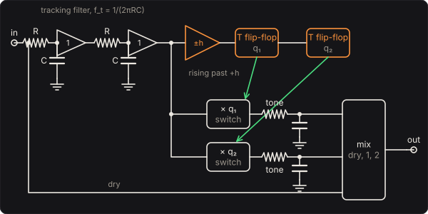

# Octave Down

The analog octave divider, as the octave boxes of the 1980s built it. It has no pitch detection
and no synthesis: a comparator watches the bass cross zero, a flip-flop toggles once a cycle, and
a switch flips the bass's polarity each time it does. Every other cycle of the note comes out
upside down, so the wave repeats every two cycles, an octave below. A second flip-flop, toggled by
the first, gives two octaves down. What it does well (instant, it follows the string's own
waveform) and badly (warbling on rich low notes, stopping when a note dies) comes from that
circuit.

## The circuit

**The tracking filter** is two buffered RC low-passes at f_t, which take the harmonics off the
bass before the comparator sees it:

  x_f = x / (1 + jf/f_t)²

**The comparator** has hysteresis ±h. It goes high when x_f rises past +h and low when it falls
past −h, so noise and small wobbles near zero don't flip it.

**Flip-flop 1** toggles on the comparator's rising edge: q₁ = ±1 changes once a cycle, a square
wave at half the note's frequency. **Flip-flop 2** toggles on q₁'s rising edge, at a quarter.

**The switches** flip the filtered bass's polarity: x_f·q₁ and x_f·q₂. Each goes through a
one-pole RC low-pass, the **Tone**, and the mix adds them to the dry bass.

## One octave down, exactly

For a sine of amplitude a at the comparator, with h small, x_f·q₁ is a sin θ for one cycle and
−a sin θ for the next. Its component at half the frequency is

  (1/2π) ∫₀^{4π} y(θ) e^{−iθ/2} dθ → a · 8/(3π) = 0.849 a

so one octave down comes out 1.4 dB below the filtered note, before the tone filter. Two octaves
down has its own fundamental at a quarter of the frequency, 0.340 a. With h not small the flips
come a little after zero, at asin(h/a), and the coefficients change; the tests integrate the
waveform by Simpson's rule for each case. The engine matches them, through both filters, within
0.1 %.

The flips come where x_f is only h from zero, so the switch's steps are small (2h at most)
and need no band-limiting: what folds back above the Nyquist frequency is 62 dB below the octave
on a 220 Hz note.

## Tracking

The comparator has to cross once a cycle, and a bass's low strings have a strong second harmonic.
If the tracking filter leaves enough of it, the waveform crosses zero four times a cycle. The
comparator then rises twice a cycle, and the "octave" jumps up to the note itself or warbles
between the two. On an 82.4 Hz note with a second harmonic nearly as strong as its fundamental,
the comparator runs at 82.4 Hz behind a 60 Hz tracking filter, and at 164.8 Hz behind 1 kHz.

The default is 70 Hz. With it, the comparator rises once a cycle on the test bass's open strings
and the E string's 12th fret for 99 % of each note. The price is that high notes are far into
its roll-off. The switch flips the filtered signal, so their octave is weak, and above the 12th
fret it fades. **High notes, two down** sets 150 Hz for playing up the neck.

A guitar is an octave above a bass, its low E at 82.4 Hz, so a page set for a guitar (the Rig's
**Instrument**) starts the tracking filter an octave up too, at 150 Hz. With it the comparator
rises once a cycle on the test guitar's open strings and its low E's 12th fret for 99 % of each
note.

A note that decays below the hysteresis stops the comparator, and the flip-flops hold. The octave
path is then the filtered note with a fixed polarity, at its own pitch, until the next note
starts the dividers again. That last moment of the note at its own pitch is part of how these
boxes sound.

## Solving it

Each sample runs the two RC sections, the comparator, the flip-flops, the switches and the tone
filters. The RC sections are integrated by the trapezoidal rule, the bilinear transform of their
circuits; the tracking filter matches it within 0.0001 dB from 40 Hz to 1.5 kHz. The comparator
and flip-flops act on the sample at which x_f passes the threshold. It takes under 0.1 % of a
core, with no latency.

## The controls

* **Dry**, **One octave down**, **Two octaves down**: the mix.
* **Tracking filter**: f_t, 40 Hz to 1 kHz.
* **Hysteresis**: h, 0.5 to 50 mV.
* **Tone**: the RC low-pass after the switches. At 150 Hz the octave of a 55 Hz note has its 19th
  harmonic 57 dB below its fundamental, against 41 dB at 5 kHz.
* **Level**: the gain after the mix.

## The views

* **The divider**: eight cycles of a steady 200 mV sine at the note you are playing, through the
  divider as it is set: x_f with the thresholds, q₁, q₂, and the two octave paths (`octave_wave`
  runs the C++ divider for it).
* **Spectrum** and **Scope**: the input and output as they play.

## What to listen for

* **Octave under**: the note with its octave under it, like a second bass an octave down.
* **Octave alone**: a buzzier, rounder sub than the note. Every other hump of the wave is upside
  down.
* **Sub synth**: two octaves down under a low E is 10 Hz, felt more than heard. It comes into its
  own from the A string up.
* **Tracking too high**: on the low strings, the octave stutters and jumps up to the note itself.

## What is simplified

* The comparator and the flip-flops switch at the sample at which x_f passes the threshold, not
  in between. On a bass note that is a jitter of a fraction of a sample in the flips' timing,
  which is in the 62 dB figure above.
* The switches are ideal, with no charge injection or on-resistance, and the buffers are perfect.
* The comparator's thresholds are exactly symmetric, and nothing drifts with temperature or with
  the battery.

## Files

* `src/octave-params.js`: the controls and presets (the C++ tables are generated from them).
* `src/octave-main.js`: the page's views; `src/octave-tour.js`: the tour;
  `src/octave-schematics.js`: the circuit above.
* `native/pedals/octave/octave-model.h`, `octave-engine.cpp`: the divider; `octave-web.cpp`: the
  page's picture of it.
* `test/octave-circuit.mjs`: the divider's ideal waveforms and their Fourier coefficients by
  Simpson's rule, and the RC sections' bilinear images, written independently.
* `test/octave-tests.mjs`: the engine against those, its aliasing, its tracking on the test bass,
  and each hint.

## Prior art and references

* mirosol (2014). "EHX Octave Multiplexer (RI)." *killall -9 humans*.
  [link](https://mirosol.kapsi.fi/2014/10/ehx-octave-multiplexer-ri/). A build of the
  Electro-Harmonix Octave Multiplexer, an analog octave-down pedal: its low octave is made by a
  4013 flip-flop, and the divider stops working when the signal is too weak.
* "Octave effect." Wikipedia. [link](https://en.wikipedia.org/wiki/Octave_effect). What an
  octave effect is: the input mixed with a copy an octave below or above it.
