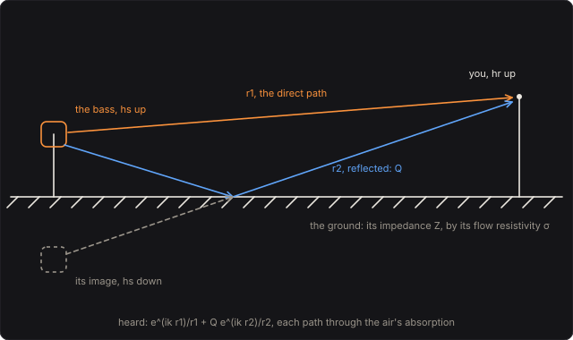

# Open Air

Your bass heard across open ground. Out of doors a sound reaches you twice, straight across and
bounced off the ground, and the air soaks up its treble on the way. Over a hard ground the two
paths make a comb; over soft ground, grass or snow, the reflection comes back shifted in phase and
digs a dip into the bass's range that deepens as you walk away: the ground effect, which Weyl and
van der Pol's formula for a spherical wave over an absorbing plane describes, and which acousticians
have measured over fields since the 1970s. The air's absorption is ISO 9613-1's.

Part of [PhuzzBox](../README.md).

| Input | |
|---|---|
| Your audio interface | pick it in the source menu (then **In 1** or **In 2**) |
| `Z`…`/`, `A`…`;`, `Q`…`P`, `1`…`0` | the test bass's E, A, D and G strings, open to the ninth fret |
| `Space` | the footswitch |



## The field

The bass's speaker stands hs above the ground, you stand d away along it with your ears hr up. The
direct path is r1 = √(d² + (hs − hr)²) long; the reflected one, as if from the bass's image hs below
the ground, r2 = √(d² + (hs + hr)²), arriving at θ from the vertical, cos θ = (hs + hr)/r2. With the
air's absorption α along each, in e^(−iωt), the pressure you hear is

  p = e^(ik r1)/r1 · 10^(−α r1/20) + Q e^(ik r2)/r2 · 10^(−α r2/20),

k = 2πf/c, with c = 343.2 √(T/293.15) m/s (331.3 m/s at 0 °C, 343.2 at 20 °C). The pedal plays it
as a microphone would that is turned up to make the direct sound as loud as it was a metre from the
bass, and that takes away its delay (a kilometre is three seconds), so

  H = 10^(−α r1/20) + (r1/r2) Q 10^(−α r2/20) e^(ik (r2 − r1)).

At the lowest frequencies the paths arrive in phase and H = 1 + r1/r2: the bass comes 6 dB up.

## The air

The air absorbs sound by friction, by the time its molecules take to share a sound wave's energy
among their rotations, and above all by the vibrations of its oxygen and nitrogen molecules, which
take up a sound wave's energy and give it back late. Water vapour makes them give it back sooner, so
it moves their relaxation frequencies up. ISO 9613-1 (1993), from Bass, Sutherland, Zuckerwar,
Blackstock and Hester's equations, gives the absorption in dB/m:

  α = 8.686 f² [1.84 × 10⁻¹¹ (pa/pr)⁻¹ (T/T0)^½ + (T/T0)^(−5/2) (0.01275 e^(−2239.1/T)/(frO + f²/frO) + 0.1068 e^(−3352/T)/(frN + f²/frN))],

with the relaxation frequencies frO = (pa/pr)(24 + 4.04 × 10⁴ h (0.02 + h)/(0.391 + h)) and
frN = (pa/pr)(T/T0)^(−½)(9 + 280 h e^(−4.170((T/T0)^(−⅓) − 1))), h the molar concentration of water
vapour from the relative humidity and the saturation pressure, T0 = 293.15 K and pr = 101.325 kPa.
The pressure is sea level's: it barely matters, since the humidity is relative. The pedal's
absorption rounds to ISO 9613-2's table everywhere it is given: at 20 °C and 70 %, 0.1, 0.3, 1.1,
2.8, 5.0, 9.0, 22.9 and 76.6 dB/km from 63 Hz to 8 kHz.

Dry air takes the most treble: over a kilometre at 20 °C, 2 kHz loses 45 dB at 10 % humidity but
10 dB at 50 %. Cold air takes more too: at 50 %, 4 kHz loses 71 dB over a kilometre at 0 °C, 30 dB
at 20 °C.

## The ground

A porous ground, soil, grass or snow, lets the sound into its pores, where the air's viscosity
drags on it. Its flow resistivity σ, the pressure it takes to push air through a metre of it at a
metre a second, sets how much. Delany and Bazley fitted the impedance of fibrous absorbers to σ in
1970, and Miki (1990) refitted it so that it behaves at low frequencies: in e^(−iωt),

  Z/ρc = 1 + 9.08 (f/σ)^−0.75 + i 11.9 (f/σ)^−0.73, σ in kPa·s/m².

The grounds take the geometric middles of the ranges Piercy and Embleton gathered from fitting
measurements of excess attenuation over real ground (1982): fresh snow 15–30 kPa·s/m², so 21.2; a
forest floor 20–80, so 40.0; grass 150–300, so 212; a dirt road 2000–4000, so 2828; asphalt, over
20 000, is taken as rigid. The reflection of a plane wave arriving at θ would be

  Rp = (Z cos θ − 1)/(Z cos θ + 1),

which near grazing, cos θ → 0, goes to −1: the reflection turned over, cancelling the direct sound.
But a real source's wave is spherical, and along a soft ground part of it travels as a ground wave.
Weyl and van der Pol's formula, the spherical wave's reflection off a locally reacting plane, adds it:

  Q = Rp + (1 − Rp) F(w),  F(w) = 1 + i √π w e^(−w²) erfc(−iw),  w = √(i k r2/2) (1/Z + cos θ).

At 100 Hz a kilometre over grass the plane wave's reflection is −0.91 but |Q| is 1.78. Far off in
wavelengths and well above grazing, Q goes to Rp; at the lowest frequencies, where Z grows without
end, even fresh snow is a mirror, Q = 1.

w(z) = e^(−z²) erfc(−iz) is the Faddeeva function, which the pedal works out by Weideman's rational
approximation (1994), good to a few parts in 10¹³, and by Laplace's continued fraction far out.

## What you hear

Over a mirror, Q = 1, the two paths make a comb, in phase at the bottom and cancelling where the
reflected path is half a wavelength longer, at (2m + 1) c/(2(r2 − r1)): 100 m away, with the bass
1 m up and you at 1.6 m, first at 5.4 kHz; 30 m across a car park, at 1.6 kHz and then 4.8 kHz.

A soft ground's reflection comes back late in phase and pulls that first null down into the bass's
range. At 100 m it is at 190 Hz over fresh snow, 240 Hz over a forest floor, 500 Hz over grass and
1.6 kHz over a dirt road. Over grass it is 18 dB deep at 100 m and 40 dB at 1 km; the air meanwhile
takes 30 dB from 4 kHz over the kilometre. The heights move it: over grass at 100 m it is at
1.2 kHz with the bass 0.2 m up, 500 Hz at 1 m and 400 Hz at 3 m; with your ears at 0.5 m it is at
680 Hz and 24 dB deep, at 3 m at 480 Hz and 12 dB deep.

## Playing it

The field's response has a slow tail: over soft ground the ground wave's low frequencies take tens
of milliseconds to arrive in full. The pedal plays it through a filter 4096 taps long at 44.1 or
48 kHz, 85 ms (twice as many at 88.2 or 96 kHz, four times above), as a partitioned convolution:
its first 128 taps directly, sample by sample, and the rest in 31 partitions of 128 by FFT, each
block's worth worked out at the end of the block before. It has no latency.

Miki's law and Weyl and van der Pol's formula are approximations, and the response they give is not
quite causal: a little of it would come before the sound. A filter that begins with the sound can't
play that, so the pedal plays the minimum-phase filter with the response's magnitude, the causal
one whose sound comes soonest, its phase fixed by its magnitude as causality fixes it. It is
designed from the magnitude through the cepstrum (Oppenheim, Schafer and Stockham), and matches it
within 0.1 dB from 40 Hz to 16 kHz. Over a hard ground the two paths are already minimum phase,
and the filter is just them: the direct sound at once and the reflection, r1/r2 as strong, (r2 − r1)/c
later. When you turn a knob it designs the new filter at the end of a block, and fades over to it
across 8 blocks.

## The controls

- **Distance** (m): how far you stand from the bass, along the ground; an expression pedal moves it.
- **Ground**: fresh snow, a forest floor, grass, a dirt road or asphalt.
- **Humidity** (%) and **Temperature** (°C): the air.
- **Level** (dB): the output; at 0 dB the direct sound is as loud as a metre from the bass.
- **Source height** and **Listener height** (m): the bass's speaker and your ears.

## The views

- **The response**: what reaches you at each frequency, against the air alone (dashed) and against a
  hard ground (dotted), with the harmonics of the note you play riding on it.
- **The ground**: the spherical wave's reflection |Q| against the plane wave's |Rp|.
- **Scope**: the input and the output in volts.
- **Spectrum**: the input's and the output's.

## What to listen for

- **Across a field**: the bass a little fuller, 6 dB up at the bottom, and hollowed at 500 Hz.
- **Fresh snow** and **In the woods**: the dip down among the bass's own notes, its body scooped out.
- **Dirt road**: the dip up at 1.6 kHz, in the string's attack.
- **Car park**: a hard ground's comb, its first null at 1.6 kHz.
- **Far across the field**: a kilometre away, the dip deep and the treble gone.
- **Dry air**: 10 % humidity over a dirt road, the air taking 45 dB from 2 kHz over a kilometre.
- **Winter night**: over snow on a cold night, the bass's fundamental and little else.

## What is simplified

- The air is still and the same all the way up: no wind and no temperature gradient, which outdoors
  bend sound up or down (refraction) and can carry it far further on a still night, or cast a shadow.
  No turbulence either, which makes a distant sound flutter.
- The ground is flat, uniform and locally reacting, its impedance Miki's one-parameter law, with no
  layering and no roughness. The grounds' resistivities are typical values, not one field's.
- The pressure is sea level's.
- The bass is a point source; a speaker cabinet beams its treble forward.
- The response's phase is the minimum phase its magnitude allows, not the model's own (see Playing it).

## Files

```
openair/index.html, style.css            page
openair/src/openair-params.js            parameters and presets
openair/src/openair-pedal.js             the descriptor: everything but the page
openair/src/openair-main.js              page wiring and views
openair/src/openair-worklet.js           its AudioWorklet module
openair/src/openair-tour.js              the guided tour
openair/src/openair-schematics.js        the field's diagram
openair/wasm/openair.wasm                built from the C++
native/pedals/openair/                   the air, the ground, the filter and the engine in C++
test/openair-circuit.mjs                 the field worked out independently, for the tests
test/openair-tests.mjs                   node test/openair-tests.mjs
```

## Prior art and references

* International Organization for Standardization (1993). *ISO 9613-1: Acoustics — Attenuation of
  sound during propagation outdoors — Part 1: Calculation of the absorption of sound by the
  atmosphere*. [iso.org](https://www.iso.org/standard/17426.html). Its equations, in a free copy:
  [sengpielaudio](https://sengpielaudio.com/AirdampingFormula.htm).
* Bass, H. E., Sutherland, L. C., Zuckerwar, A. J., Blackstock, D. T. & Hester, D. M. (1995).
  "Atmospheric absorption of sound: Further developments." *J. Acoust. Soc. Am.* 97(1), 680–683.
  [doi:10.1121/1.412989](https://doi.org/10.1121/1.412989); erratum 99(2), 1259 (1996),
  [doi:10.1121/1.415223](https://doi.org/10.1121/1.415223).
* International Organization for Standardization (1996). *ISO 9613-2: Acoustics — Attenuation of
  sound during propagation outdoors — Part 2: General method of calculation*, Table 2, the
  atmospheric attenuation in octave bands.
* Delany, M. E. & Bazley, E. N. (1970). "Acoustical properties of fibrous absorbent materials."
  *Applied Acoustics* 3(2), 105–116. [doi:10.1016/0003-682X(70)90031-9](https://doi.org/10.1016/0003-682X(70)90031-9)
* Miki, Y. (1990). "Acoustical properties of porous materials — Modifications of Delany–Bazley
  models." *J. Acoust. Soc. Jpn. (E)* 11(1), 19–24. [doi:10.1250/ast.11.19](https://doi.org/10.1250/ast.11.19)
* Piercy, J. E. & Embleton, T. F. W. (1982). "Review of sound propagation in the atmosphere."
  *Canadian Acoustics* 10(1), 24–37: Fig. 3, the effective flow resistivities of grounds.
  [jcaa.caa-aca.ca](https://jcaa.caa-aca.ca/index.php/jcaa/article/view/477)
* Embleton, T. F. W., Piercy, J. E. & Daigle, G. A. (1983). "Effective flow resistivity of ground
  surfaces determined by acoustical measurements." *J. Acoust. Soc. Am.* 74(4), 1239–1244.
  [doi:10.1121/1.390029](https://doi.org/10.1121/1.390029)
* Cotté, B. (2019). *Outdoor sound propagation*, course notes, ENSTA Paris: eq. (2.78), Weyl and van
  der Pol's formula, in e^(−iωt). [pdf](https://perso.ensta.fr/~cotte/files/Course_notes_propa_2019.pdf)
* Attenborough, K., Li, K. M. & Horoshenkov, K. (2007). *Predicting Outdoor Sound*. London: Taylor &
  Francis. [doi:10.1201/9781482295023](https://doi.org/10.1201/9781482295023)
* Weideman, J. A. C. (1994). "Computation of the complex error function." *SIAM J. Numer. Anal.*
  31(5), 1497–1518. [doi:10.1137/0731077](https://doi.org/10.1137/0731077)
* Oppenheim, A. V., Schafer, R. W. & Stockham, T. G. (1968). "Nonlinear filtering of multiplied and
  convolved signals." *Proceedings of the IEEE* 56(8), 1264–1291: the complex cepstrum, and the
  minimum-phase sequence's, which vanishes at negative times.
  [doi:10.1109/PROC.1968.6570](https://doi.org/10.1109/PROC.1968.6570)
