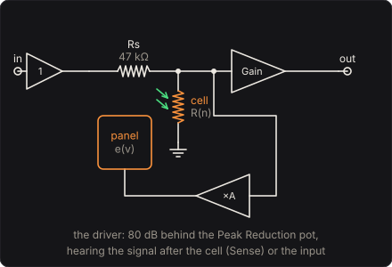

# Opto Compressor

An electro-optical leveler for bass, after the leveling amplifiers of the 1960s whose gain
reduction is a light and a photocell. No amplifier in the signal path changes its gain: a
photocell shunts the signal to ground after a resistor. The brighter an electroluminescent panel
lights the cell, the lower its resistance and the more it takes away. A driver lights the panel
from the signal itself, so the bass levels itself.

What gives such a leveler its character is the photocell's physics. Cadmium sulphide has free
electrons that recombine quickly and traps that hold electrons for seconds. A note is caught in
about 10 ms. Half of the gain comes back in under a tenth of a second, and the rest over seconds,
slower the longer the cell was lit. Here those come from rate equations for the cell's electrons,
not from attack and release knobs. The model is tuned to the timing Universal Audio publishes for
the LA-2A: attack 10 ms, release 0.06 s for half, 0.5 to 5 s for all of it.

## The circuit

The input is a 1 MΩ buffer, and the line's voltage passes it unchanged (a passive bass's pickup
into 1 MΩ is the Buffer pedal's story). The attenuator is a divider:

  a = R_cell / (R_s + R_cell),  1/R_cell = 1/R_dark + n / R_lit

where n is the cell's free electrons, counted so that the reference glow keeps n ≈ 0.62 in it
(see below). R_lit is 2 kΩ and R_dark 5 MΩ, so at rest the pedal loses 0.08 dB. Lit hard, with n
near 2, the cell is about 1 kΩ and takes some 30 dB away.

The driver amplifies by 10 000 (80 dB) behind the Peak Reduction pot, an audio taper whose lower
part is (81^x − 1)/80 of the track: 10 % at half travel. It swings at most ±150 V (the Driver's
swing). With Sense after the cell, the classic arrangement, it hears the attenuated signal: a
feedback loop. Before the cell it hears the input: feed-forward.

## The panel

An AC electroluminescent panel is a phosphor powder between two electrodes. It flashes on every
half-cycle of the voltage across it, as brightly as the voltage is high. The steep voltage law of
powder electroluminescence is

  B = B₀ exp(−b / √V)

and the model takes the panel's emission at each instant as that law, at the instantaneous
voltage, relative to its glow at 100 V:

  e(v) = exp(−b (1/√|v| − 1/√100)),  b = 70 √V

so that 50 V glows at 6 % of 100 V and 150 V at 360 %. The phosphor's afterglow smooths the
flashes with a time constant τ_p = 1 ms:

  dΛ/dt = (e − Λ) / τ_p

Λ is the light on the cell, in units of the reference glow.

## The cell

A photoconductor's free electrons are made by the light and lost by recombination. Some fall into
traps, defects that hold them until heat shakes them loose. Albert Rose's outline of
photoconductivity (RCA Review, 1951) lays out this picture: the traps are why a photocell's
response time is longer than its electrons' lifetime. Here it is with one kind of trap:

  dn/dt = Λ/τ − (n/τ)(1 + n/n₁) − k n (N − m) + m/τ_e
  dm/dt = k n (N − m) − m/τ_e

| | value | |
|---|---|---|
| τ | 60 ms | the free electrons' lifetime (the Carrier lifetime knob) |
| n₁ | 1 | at n = n₁ recombination among the free electrons doubles the rate: a sublinear response |
| N | 2 | the traps, in units of n |
| k | 1 /s | the rate at which a free electron finds an empty trap, per unit of n |
| τ_e | 1.5 s | how long a trapped electron stays (the Trap release time knob) |

Under a steady light the traps come into balance, k n (N − m) = m/τ_e, and the free electrons
settle where

  Λ = n (1 + n/n₁),  n = (n₁/2)(√(1 + 4Λ/n₁) − 1)

So the reference glow (Λ = 1) keeps n = 0.618 in the cell, and four times the light only about
2.6 times the electrons.

When the light goes, the free electrons recombine within τ. That is the fast release: half the
gain comes back in 70 to 90 ms. The traps then let their electrons go over τ_e, and the cell
recombines each one in turn. Lightly lit (n ≪ n₁, m ≪ N) the equations are linear, with two
modes: 53 ms and 1.7 s at the defaults. The slow mode's weight is how full the traps are. A short
note barely fills them, so the cell lets go at once. A held one fills them, and the last
decibels take seconds. That is the leveler's program-dependent release.

## Solving it

The cell changes over milliseconds and the signal within one, so each sample does three things.
It takes the attenuator's gain from the cell as it is. It moves the panel's light on by its exact
one-pole step. It moves the electrons on by one step of Heun's method. The fastest rate in the
cell is under 1/(2 ms), a hundred times slower than a sample, so neither the explicit step nor
the one-sample delay in the loop is audible, and no oversampling is needed: the gain moves too
slowly to alias. It costs well under 1 % of a core.

## The controls

* **Peak Reduction**: the driver's pot. At 30 % only hard notes (0.3 V and up) reach the panel.
  Past 70 % even a 30 mV note loses several decibels.
* **Gain**: make-up gain after the cell, 0 to 40 dB. The panel listens before it, so it changes
  only the level.
* **Sense**: after the cell (feedback) or before it (feed-forward); see below.
* **Clean blend**: the dry signal mixed back in after the make-up gain, for parallel compression.
* **The panel**: its voltage constant b, the phosphor's afterglow, and the driver's swing.
* **The cell**: its resistance under the reference glow and in the dark, the free electrons'
  lifetime, and the traps' release time.

### Feedback and feed-forward

After the cell, a note lights the panel hardest at its very start, before the cell has acted. So
the cell catches it fast (10 ms to 90 %), then the panel dims to just what holds the note there.
The panel needs signal to stay lit, so louder in is always a little louder out. The ratio rises
gently with level, about 3:1 to 5:1 over the bass's range.

Before the cell, nothing holds the panel back and nothing pushes it ahead. Set for the same
8 dB on a 0.2 V note, the cell settles in about 110 ms rather than 10, so each note's front gets
through. And the light rises with level faster than the divider can follow: past a point, a
harder note comes out quieter than a softer one.

## The views

* **The cell**: the last six seconds of gain reduction, the panel's light and the traps' fill,
  from the engine as it plays.
* **The curve**: the quasi-static curve, out against in for a steady note at each level. A sine's
  cycle-averaged light is found by bisection on the cell's steady state (`opto_static`). The ring
  marks what you are playing.
* **Scope** and **Spectrum**: the input and output as they play.

## What to listen for

* A held note settling in its first 10 ms, then sitting still.
* Release: after staccato notes the bass comes straight back. After a long held note it creeps
  back over a second or two.
* Low notes heavily compressed take on a slight edge. The panel flashes 82 times a second on a
  low E, and the cell's resistance ripples with the flashes, which is distortion: about 3 %
  (−30 dB) at 25 dB of reduction with the 1 ms afterglow, and a quarter of that at 8 ms. At
  1 kHz it is under 0.02 %.
* Feed-forward: the pluck of each note through, then the body leveled.

## What is simplified

* The panel's light is its voltage law at each instant. A real panel's brightness also grows with
  frequency (more flashes a second), and its law holds best for the RMS voltage.
* One kind of trap, one recombination path, and no temperature: a real cell has a spread of trap
  depths, and its speed drifts with temperature and with how long it sat in the dark.
* The cell is linear in its voltage (an ohmic resistor), and nothing in the signal path clips:
  the buffer and make-up stage are ideal.
* The driver is a linear amplifier with a hard limit at its swing, with no frequency response
  of its own (the classic leveler's driver has some high-frequency emphasis).
* The constants (R_s, the driver's gain, n₁, N, k) are chosen to give the published timing, not
  measured from a particular cell. They are physical in kind, not copied from one.

## Files

* `src/opto-params.js`: the controls and presets (the C++ tables are generated from them).
* `src/opto-main.js`: the page's views; `src/opto-tour.js`: the tour.
* `native/pedals/opto/opto-model.h`: the panel, the cell's rate equations, the quasi-static gain.
* `native/pedals/opto/opto-engine.cpp`: the effect; `opto-web.cpp`: the page's model calls.
* `test/opto-circuit.mjs`: the same physics written independently. It has Runge–Kutta
  integration, the closed-form steady state, the linearised release's eigenmodes, and the
  quasi-static gain by Simpson's rule and the secant method.
* `test/opto-tests.mjs`: the engine against those, against the published timing, and each hint.

## Prior art and references

* Universal Audio, "Teletronix LA-2A Classic Leveling Amplifier," specifications.
  [link](https://help.uaudio.com/hc/en-us/articles/206356233-Teletronix-LA-2A-Classic-Leveling-Amplifier).
  Attack time 10 ms; release 0.06 s for 50 %, 0.5 to 5 s for complete release; 0 to 40 dB of
  gain limiting. The timing this model is tuned to and tested against.
* Rose, A. (1951). "An outline of some photoconductive processes." *RCA Review* 12, 362–414.
  Its *Citation Classic* commentary:
  [PDF](https://garfield.library.upenn.edu/classics1980/A1980KF12700001.pdf). Free and trapped
  electrons, and why a photoconductor's response time exceeds its electrons' lifetime.
* Haranath, D., Sahai, S., Husain, M., Mishra, S. & Shanker, V. (2012). "Fabrication and
  electro-optic properties of MWCNT driven novel electroluminescent lamp." arXiv:1207.7320.
  [link](https://arxiv.org/abs/1207.7320). The brightness–voltage law B = B₀ exp(−b/V^½) of
  powder electroluminescence, and its brightness rising with frequency (left out here).
