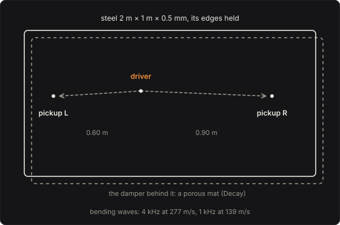

# Plate Reverb

The studio reverb of the 1960s: a sheet of steel two metres long, hung in a frame, shaken by a
driver near its middle and heard by contact pickups near its ends. A sound sent into it travels as
bending waves, which reflect from its edges again and again until the plate rings in thousands of
its modes at once. Bending waves are dispersive: the high frequencies travel faster, so they reach
the pickups first. The steel's own losses take the highs away soonest, and a damper, a porous mat
moved nearer or further, sets how long the rest rings. The Plate Reverb is that plate, played as
its modes.

Part of [PhuzzBox](../README.md).

| Input | |
|---|---|
| Your audio interface | pick it in the source menu (then **In 1** or **In 2**) |
| `Z`…`/`, `A`…`;`, `Q`…`P`, `1`…`0` | the test bass's E, A, D and G strings, open to the ninth fret |
| `Space` | the footswitch |

## The plate

The plate is an EMT 140's as Willemsen gives it: steel 2 m by 1 m and 0.5 mm thick (Young's
modulus 200 GPa, density 7850 kg/m³, Poisson's ratio 0.3), the driver at (0.8 m, 0.415 m) and
pickups at (0.2 m, 0.45 m) and (1.7 m, 0.45 m), the left and right channels, measured from the
plate's left and bottom edges. Those are where they sit by default; each is a control, and on the
page they can be dragged across the plate.

A plate this thin bends as Kirchhoff's thin plate:

  ρh ∂²w/∂t² + D ∇⁴w = F,  D = E h³ / 12(1 − ν²)

With its edges simply supported (held, free to turn), its modes are sin(mπx/Lx) sin(nπy/Ly), at

  ω_mn = κ [(mπ/Lx)² + (nπ/Ly)²],  κ = √(D/ρh) = h √(E / 12ρ(1 − ν²)) = 0.7637 m²/s

The lowest is at 1.5 Hz. Above that the plate has a mode, on average, every 2κ/S hertz (S its
area): 1.31 modes in every hertz, as many at 4 kHz as at 40 Hz. Played from 20 Hz to the default
5 kHz that is 6432 modes; the tests count them on the lattice and find 6430 by Weyl's law with its
edge term, S k²/4π − (Lx + Ly) k/2π.

## The waves

A bending wave's frequency goes as its wavenumber squared, ω = κk², so its group velocity is

  c_g = dω/dk = 2√(κω)

139 m/s at 1 kHz, 277 m/s at 4 kHz. Its speed rises with frequency: every sound arrives at the
pickups as a falling chirp, the highs first. The left pickup is 0.60 m from the driver, the right
0.90 m. In the tests a 4 kHz burst reaches the left pickup at 2.17 ms (2.17 ms predicted) and the
right at 3.21 ms (3.25 ms); a 1 kHz burst reaches the left at 4.19 ms (4.34 ms). Nothing in the
engine knows about waves: the arrival comes out of the sum of the modes.

## The losses

Each mode dies at a rate α, its T₆₀ = 3 ln 10 / α. Three things take its energy, as Willemsen
gives them:

* **Thermoelastic loss.** As the plate bends, one face is squeezed and warms while the other is
  stretched and cools, and heat flows across the thickness:
  α = ω² R₁ C₁ / 2(ω²h² + C₁²/h²), with steel's R₁ = 4.94 × 10⁻³ and C₁ = 2.98 × 10⁻⁴ m²/s. It
  rises with frequency and then holds, near 2.9 per second above 1 kHz.
* **Radiation** into the air on both sides. The plate's coincidence frequency, c²/2πκ, is 24.5 kHz,
  above hearing, so it radiates little: α = (1/4π²)(ρ_a c/ρh)(2(Lx + Ly)/(Lx Ly))(c/f_c) g(√(f/f_c)),
  0.10 per second at 1 kHz.
* **The damper**, a porous mat beside the plate. It takes the same rate from every frequency, set
  so that a 100 Hz note dies in the Decay knob's time.

The steel alone would let 100 Hz ring 10.3 s, 1 kHz 2.35 s and 4 kHz 2.18 s. With the damper at
3 s, 1 kHz rings 1.51 s and 4 kHz 1.44 s. The tests play a click and measure each band's decay by
Schroeder's backward integral: 3.12 s near 100 Hz, 1.48 s near 1 kHz, 1.44 s near 4 kHz.

## Solving it

Each mode is a damped resonator. Its velocity at a pickup for a force impulse at the driver is

  (Φ_d Φ_p / M) e^{−αt} (cos ω_d t − (α/ω_d) sin ω_d t),  M = ρh Lx Ly / 4

with Φ the mode's shape at the driver and the pickup. The engine samples that exactly, by the
impulse invariant: a complex one-pole z ← e^{(−α+iω_d)T} z + b x, read as z_r − (α/ω_d) z_i. The
pickups' gain is set once for the plate, so that white noise in comes out of each pickup at its own
level with the damper at 3 s (the tests find 0.26 dB under).

6432 resonators at 48 kHz is a great deal of arithmetic. The modes below 0.09 of the sample rate
(4.32 kHz at 48 kHz) are played at a quarter of it, the rest at half, eight at a time. Linear-phase
lowpass filters (Kaiser windows, 70 dB) bring the driver's signal down to each rate and the
pickups' back up. A mode played at a lower rate is the same sampled response, so the cost is a
delay of the plate's sound: 80 samples, 1.67 ms, at the default 5 kHz. Against every mode summed
at 48 kHz in double precision, the engine's response to a 1 kHz burst differs by 0.13 % RMS, and
to a 4.4 kHz burst, which spans both rates, by 0.17 %. At 5 kHz it takes about 9 % of one core in
the browser.

**Quality** (in the plugins and the app) lowers Modes up to: Medium plays to 4 kHz at most, Low to
2.5 kHz.

## The controls

* **Decay**: the damper. A low note's T₆₀; the highs ring shorter, as the steel takes them.
* **Reverb** and **Dry**: the mix.
* **Modes up to**: the highest mode played, 2–8 kHz. Higher is brighter and costs more.
* **Where they sit**: the driver's and each pickup's place on the plate, across and up. A mode
  whose nodal line passes through the driver is not played, and one whose nodal line passes
  through a pickup is not heard: with the driver in the middle, 1 m across, every mode with an even
  number of half-waves across (half of them, 49.8 % to 5 kHz) is silent. The two pickups hear
  different mixtures of the same modes, which is the stereo; put them in one place and the
  channels are the same. The transducers' gain is the one set for the default places, so a pickup
  moved onto the nodal lines of the loud modes comes out quieter, as it would on the plate.
* **Level**: gain after the mix.

## The views

* **The plate**: the plate from above, in slow motion (1/10 to 1/1000 of real time): the last
  note played (until one is, a note of the test bass) sent into the driver from rest, and every
  mode the engine plays summed into the plate's velocity on a 192 × 96 grid. The page plays the
  engine's own modes (`plate_modes`, `plate_decay`, `plate_info`) a sample at a time at the full
  rate, so the ripples are the engine's: they spread from the driver, the short waves fastest, and
  come back off the edges. The tests check that what this hears at the pickups is every mode summed
  independently, and that its picture is each mode's shape times its motion. Of a note played,
  the input's analyser holds about the first 0.13 s; after that the plate hears silence here.
* **The decay**: each frequency's T₆₀, against the steel alone (`plate_decay`).
* **Spectrum** and **Scope**: the input and the left pickup as they play.

## What to listen for

* **Studio plate**: a 2.5 s plate under the bass, the attack left clear.
* **Short and tight**: 0.8 s, a sense of space more than a tail.
* **Long and dark**: 8 s at 100 Hz, but the highs still gone in about 2: the steel keeps the
  lows.
* **All plate**: the pickups alone. Pluck a single note and hear the chirp of the first arrival.
* **Light on the computer**: the modes to 2.5 kHz only.

## What is simplified

* **No tension.** A real plate is hung in its frame under tension, which raises its lowest modes;
  here it is Kirchhoff's plate alone, its edges simply supported.
* **The damper is one rate.** A real porous mat damps by an amount that changes with frequency and
  with its distance from the plate.
* **Point transducers, flat.** The driver is a force at a point and the pickups read the plate's
  velocity at a point; real ones have responses and sizes of their own.
* **The modes stop at Modes up to and start at 20 Hz.** Above, the plate is silent here; below, the
  bass's own notes are left alone.
* **The plate's sound is 1.67 ms late**, by the filters; the dry signal is not.
* **Linear.** The plate is driven gently enough that it stays so.

## Files

* `src/plate-params.js`: the controls and presets (the C++ tables are generated from them).
* `src/plate-main.js`: the page's views; `src/plate-motion.js`: the slow motion's modes and the
  plate's velocity on a grid; `src/plate-tour.js`: the tour;
  `src/plate-schematics.js`: the diagram above.
* `native/pedals/plate/plate-model.h`, `plate-model.cpp`: the plate, its modes and losses.
* `native/pedals/plate/plate-engine.cpp`: the modes, the two rates and their filters;
  `plate-web.cpp`: the page's model calls (the modes, their decay, their shapes at the
  transducers).
* `test/plate-circuit.mjs`: the same physics written independently: the lattice, Weyl's law, the
  losses, the group velocity, and every mode summed at 48 kHz in double precision.
* `test/plate-tests.mjs`: the engine against those, and each hint.

## Prior art and references

* S. Bilbao, K. Arcas & A. Chaigne (2006). "A Physical Model for Plate Reverberation."
  *Proc. IEEE ICASSP 2006*, Toulouse, 165–168. The plate reverb as a physical model of the plate.
* S. Bilbao (2007). "A Digital Plate Reverberation Algorithm." *J. Audio Eng. Soc.* 55(3),
  135–144. [AES e-library](https://www.aes.org/e-lib/browse.cfm?elib=14153). A digital plate
  reverberator from the plate's physics.
* S. Willemsen (2017). *Virtual Analog Simulation and Extensions of Plate Reverberation* (Master's
  thesis), Aalborg University.
  [PDF](https://projekter.aau.dk/projekter/files/259831180/Master_Thesis_Silvin_Willemsen_SMC171032___2.pdf).
  A modal synthesis of the EMT 140: the plate's dimensions and steel, the driver's and pickups'
  positions, the thermoelastic and radiation loss formulas, and the damper's range.
