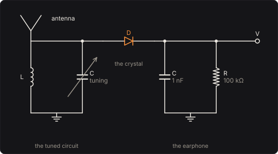

# Crystal Radio

Your bass, broadcast as an AM station and heard on a crystal set. A crystal set has no battery
and no amplifier: a coil and a capacitor tuned to the station, a point-contact diode, and an
earphone, moved by the station's own power. Braun found in 1874 that some metal sulphides pass
current more easily one way than the other; Bose patented a pair of galena contacts as a detector
of radio waves in 1904, and Pickard a point on silicon in 1906. Braun shared the 1909 Nobel Prize
with Marconi for wireless telegraphy.

What the diode does to a signal depends on how strong it is. A faint station is detected by the
diode's curvature: the sound comes out as the square of the carrier, the square law, and a note
comes back with its own second harmonic. A strong one is detected by its peaks, and comes out
straight. In between, the tuned circuit cuts the treble if it is sharp, lets the next station
in if it isn't, and the capacitor across the earphone can fail to keep up with the bass.

Part of [PhuzzBox](../README.md).

| Input | |
|---|---|
| Your audio interface | pick it in the source menu (then **In 1** or **In 2**) |
| `Z`…`/`, `A`…`;`, `Q`…`P`, `1`…`0` | the test bass's E, A, D and G strings, open to the ninth fret |
| `Space` | the footswitch |

## The set



The antenna feeds a coil L and a variable capacitor C, tuned to the station. The diode, the
crystal, connects the top of the tuned circuit to the earphone: its resistance R, here 100 kΩ, with
a 1 nF bypass capacitor across it. The Bureau of Standards' 1922 circular on a *simple homemade
radio receiving outfit* describes a set of the same kind, with a galena detector, tuned by taps on
its coil rather than with a capacitor.

## The station

The transmitter sends a carrier at the station's frequency fs, its amplitude following your bass:

  x(t) = Ac (1 + k vin(t)) cos(2π fs t),

with k the **Modulation** per volt in, so that m = k vin is the modulation: at the default 80 %/V
a 0.5 V note swings the carrier 40 % up and down. Each note f becomes two sidebands, at fs ± f,
each m/2 of the carrier. A transmitter can't send less than nothing, so where k vin < −1 the
carrier is cut off, and the note's troughs are lost: overmodulation. At 500 %/V a 0.3 V note asks
for 150 %, and the carrier is off 27 % of each of its cycles: the troughs come out flattened, with
an 18 % second harmonic.

The dial runs from 540 to 1700 kHz, the US AM channels, 10 kHz apart (47 CFR 73.14). The **Next
station** is an unmodulated carrier 10 kHz above this one.

## The tuned circuit

A coil and a capacitor resonate at f0 = fs + **Tuning**, with a quality factor Q, the
**Selectivity**: Q is the resonance's frequency over the width of its band, loaded by the antenna
and the detector that draw power from it. Close to the resonance its response is

  H(f) = 1 / (1 + 2iQ (f − f0)/f0),

3 dB down at f0/2Q either side. The sidebands of a note f are f from the carrier, so that band is
the bass's bandwidth. At Q 50 and 1000 kHz it is 10 kHz either side, all of the bass; at Q 200,
2.5 kHz, and the bass is 2.9 dB down at 2.5 kHz. For the same Q the band grows with the
frequency: at Q 200 it is 1.35 kHz either side at 540 kHz and 4.25 kHz at 1700 kHz.

Off tune, the station's carrier sits on the curve's side and comes in weaker: 6 kHz off, with the
circuit 3 dB down 10 kHz either side, the bass is 1.6 dB quieter, and 10 kHz off, 3.6 dB. The
next station, at 10 kHz, comes through 3 dB down at Q 50 and 1000 kHz, and the detector, given
two carriers, hears their difference, a 10 kHz whistle: the heterodyne. At −46 dB it is 39 dB under a 0.3 V note; at
−24 dB, 17 dB under. It doesn't go when you tune: it is the two carriers' difference, wherever
the set is tuned.

## The detector

The diode passes Shockley's current, I = Is (e^(v/nVT) − 1), with the families of the Bandgap:

| Diode | V at 1 mA | n | Is | nVT |
|---|---|---|---|---|
| Germanium | 0.28 V | 1.6 | 1.10 µA | 41.1 mV |
| Schottky | 0.32 V | 1.05 | 7.05 nA | 27.0 mV |
| Silicon | 0.58 V | 1.75 | 2.50 nA | 45.0 mV |

A carrier at a million cycles a second is far faster than anything else here, so the capacitor
holds the earphone's voltage V steady through each cycle, and the diode sees A cos θ − V with A the
carrier's amplitude. Averaged round the cycle its current is

  ⟨i⟩ = Is ⟨e^((A cos θ − V)/nVT) − 1⟩ = Is (e^(−V/nVT) I0(A/nVT) − 1),

with I0 the modified Bessel function of order zero, (1/π)∫ e^(a cos θ) dθ over half a turn. On a
steady carrier V settles where that current is what the load takes, ⟨i⟩ = V/R.

- **The square law.** For A ≪ nVT, I0(a) = 1 + (a/2)² + …, and with V ≪ nVT too,
  V = (A/nVT)²/4 · Is R / (1 + Is R/nVT). The voltage goes as the carrier's square: 4.43 µV at
  1 mV on germanium. Squaring Ac(1 + m cos ωt) gives 1 + 2m cos ωt + (m²/2)(1 + cos 2ωt), so the
  note comes back with a second harmonic m/4 of it, Terman's figure: 10 % at 40 % modulation.
- **The peak law.** For A ≫ nVT, I0(a) → e^a/√(2πa), and
  V = A − nVT ln(√(2πA/nVT)(1 + V/(Is R))): the peak, less a few nVT. 2.740 V at 3 V on
  germanium. The bass comes out straight: a 40 % modulation's second harmonic is 0.7 % at 1 V,
  0.4 % at 2 V.
- **In between**, the curve bends from slope 2 to slope 1 on logarithmic scales (**The
  detector** draws it). Germanium's bend is near its nVT, 41 mV. Silicon's is near half a volt,
  since it needs 0.58 V for a milliampere: at 300 mV it is between its laws, where the voltage rises
  faster than the square, and a 40 % modulation comes out with a 26 % second harmonic, against
  germanium's 2 %. The Schottky is in between.

## The earphone

The bypass capacitor holds the carrier's peaks between its cycles; the earphone's resistance lets
them down, with the time constant RC. The diode can charge the capacitor quickly, but only R can
discharge it. Where the carrier falls faster than V can follow, V falls on its own exponential,
a straight line on the scale of a note: diagonal clipping. With A = Ac(1 + m cos ωt) and V ≈ A,
V can follow while −dA/dt ≤ A/RC, that is while mωRC sin ωt ≤ 1 + m cos ωt at every phase; the
worst phase gives the condition

  mωRC ≤ √(1 − m²).

At 100 kΩ and 1 nF, RC = 100 µs, and clipping starts at 3.6 kHz for 40 % modulation, above the
bass. At 1 MΩ and 4.7 nF, RC = 4.7 ms, it starts at 78 Hz, and a 220 Hz note comes out with an
8 % second harmonic.

## The amplifier

A crystal set's earphone gets what the detector gives it: a faint station is faint. The pedal adds
an amplifier, so that the knobs change how it sounds rather than how loud. It takes off the
voltage the unmodulated carrier would give, which a coupling capacitor would take off in time,
so that a knob turned doesn't thump; passes the rest through a 5 Hz coupling high-pass; and
amplifies it by 1/(k Ac dV/dA), the detector's own gain for a gentle modulation, tuned in, made up.
At 300 mV on germanium dV/dA = 0.814 and the amplifier makes up 14.2 dB; at 10 mV, 63.0 dB.
**Level** trims it.

## Solving it

The carrier itself is never computed: everything is worked in the complex envelope about the
station's carrier, x(t) = Re[e(t) e^(2πi fs t)]. In it the tuned circuit is the one-pole filter

  de/dt = −(γ − iΔ) e + γ u,  γ = πf0/Q, Δ = 2π · Tuning,

solved exactly for an input held at the mean of each step's ends; the next station is
B e^(2πi · 10 kHz · t); and the detector sees A = |e|. The earphone's voltage obeys
C dV/dt = ⟨i⟩(A, V) − V/R, by the second-order backward difference (BDF2), which damps the diode's
fast charging rather than ringing at the step as the trapezoidal rule would. Each step's equation
is solved by Newton's method, on the equation itself while the diode is nearly off and on its
logarithm once the diode's exponential dominates, inside a bracket the diode's current can't
leave. I0 comes from its power series below a = 12, and its asymptotic series above. The set runs
at 4× the sample rate at high quality, 2× at medium and 1× at low, through the oversampling filters
of the other pedals; the square law's harmonics above 20 kHz are filtered, not folded.

The averaging over the carrier's cycle is the approximation, and it is tested: against the whole
set simulated at radio frequency, a 540 kHz carrier in 128 steps a cycle through the tuned
circuit's own second-order equation into the diode and the earphone, with no envelope anywhere,
the engine's note and its harmonics agree within 0.1 dB, and the whistle within 0.5 dB.

## The controls

- **Signal**, **Modulation**, **Tuning**, **Selectivity** and **Level** are on the face. An
  expression pedal (MIDI CC 1) sweeps the Tuning.
- **Detector**, **Earphone load**, **Bypass capacitor**, **Station** and **Next station** are the
  set, under *The set*.

## The views

- **The detector**: the earphone's steady voltage against the carrier's amplitude on logarithmic
  scales, with the square law and the peak law, where the station rests and where it goes as you
  play; and two periods of the note you play, the voltage against where the carrier would hold it.
- **The dial**: the band, the station and the pointer, and the tuned circuit's response about the
  station, with its band, the station's carrier and the next station's.
- **Scope**: the input and the output in volts.
- **Spectrum**: the input's and the output's.

## What to listen for

- **A local station**: 300 mV on germanium, nearly a peak detector: the bass comes through with
  a 2 % second harmonic at 40 % modulation, and the next station whistling 39 dB down.
- **Faint and far: square law**: 10 mV. The bass squared, its second harmonic m/4.
- **Silicon detector**: the same station through silicon, 26 %.
- **Strong and linear**: 2 V, 0.4 %.
- **Sharp tuning**: Q 200, the treble cut above 2.5 kHz.
- **Off the station**: 6 kHz off, 1.6 dB quieter, its level made up.
- **Whistle from next door**: the next station 24 dB down, a 10 kHz whistle 17 dB under the note.
- **Overmodulated**: 500 %/V, the troughs cut off.
- **Diagonal clipping**: 1 MΩ and 4.7 nF on a strong station.

## What is simplified

- The tuned circuit's response is the narrow-band one, 1/(1 + 2iQ(f − f0)/f0), not the full
  1/(1 + iQ(f/f0 − f0/f)); they differ by about 1 % in the detuning 10 kHz off at 540 kHz. The
  detector doesn't load it: its Q is the loaded Q, fixed, rather than one that falls as the
  diode conducts. The antenna is a voltage source.
- The diode is Shockley's, with no series resistance, capacitance or reverse breakdown, and the
  Bandgap's families are typical of their kinds rather than measured parts: Torrey and Whitmer
  fitted a germanium welded-contact rectifier with a steeper exponential than ours. A galena
  cat's whisker, whose contact was found by hand and drifted, isn't modelled.
- The earphone is a resistance; a real one is a magnetic or piezoelectric transducer with its own
  resonances. The voltage across it is what comes out.
- The transmitter is ideal: no audio filtering before it, its overmodulation a clean cut-off.
  There is no fading, noise or static.

## Files

```
radio/index.html, style.css              page
radio/src/radio-params.js                parameters and presets
radio/src/radio-pedal.js                 the descriptor: everything but the page
radio/src/radio-main.js                  page wiring and views
radio/src/radio-worklet.js               its AudioWorklet module
radio/src/radio-tour.js                  the guided tour
radio/src/radio-schematics.js            the circuit diagram
radio/wasm/radio.wasm                    built from the C++
native/pedals/radio/                     the set, its solver and the engine in C++
test/radio-circuit.mjs                   the set worked out independently, for the tests
test/radio-tests.mjs                     node test/radio-tests.mjs
```

## Prior art and references

* Braun, F. (1874). "Ueber die Stromleitung durch Schwefelmetalle." *Annalen der Physik und
  Chemie* 153, 556–563 (*Annalen der Physik* 229(12) in Wiley's numbering).
  [doi:10.1002/andp.18752291207](https://doi.org/10.1002/andp.18752291207)
* Bose, J. C. (1904). "Detector for electrical disturbances." US Patent 755,840 (filed 1901): a
  pair of galena contacts. [Google Patents](https://patents.google.com/patent/US755840)
* Pickard, G. W. (1906). "Means for receiving intelligence communicated by electric waves." US
  Patent 836,531: the silicon detector. [Google Patents](https://patents.google.com/patent/US836531)
* The Nobel Prize in Physics 1909, to Guglielmo Marconi and Karl Ferdinand Braun, "in recognition
  of their contributions to the development of wireless telegraphy".
  [nobelprize.org](https://www.nobelprize.org/prizes/physics/1909/summary/)
* Bureau of Standards (1922). "Construction and operation of a simple homemade radio receiving
  outfit." Circular of the Bureau of Standards No. 120: a tapped coil, a galena detector, 500 to
  1500 kilocycles. [NIST](https://nvlpubs.nist.gov/nistpubs/Legacy/circ/nbscircular120.pdf)
* Torrey, H. C. and Whitmer, C. A. (1948). *Crystal Rectifiers.* MIT Radiation Laboratory Series
  vol. 15, McGraw-Hill. §2-3: a germanium rectifier fitted to i = A(e^(αE) − 1).
  [archive.org](https://archive.org/details/MITRadiationLaboratorySeries15CrystalRectifiers)
* Shockley, W. (1949). "The theory of p-n junctions in semiconductors and p-n junction
  transistors." *Bell System Technical Journal* 28(3), 435–489.
  [doi:10.1002/j.1538-7305.1949.tb03645.x](https://doi.org/10.1002/j.1538-7305.1949.tb03645.x)
* Terman, F. E. (1955). *Electronic and Radio Engineering*, 4th ed. McGraw-Hill. Chapter 16,
  "Detectors and Mixers": "For very small signals square-law behavior is obtained and the
  distortion is m/4." [archive.org](https://archive.org/details/in.ernet.dli.2015.126279)
* Code of Federal Regulations, 47 CFR § 73.14, "AM broadcast definitions": 117 carrier
  frequencies from 540 kHz in 10 kHz steps to 1700 kHz.
  [Cornell LII](https://www.law.cornell.edu/cfr/text/47/73.14)
