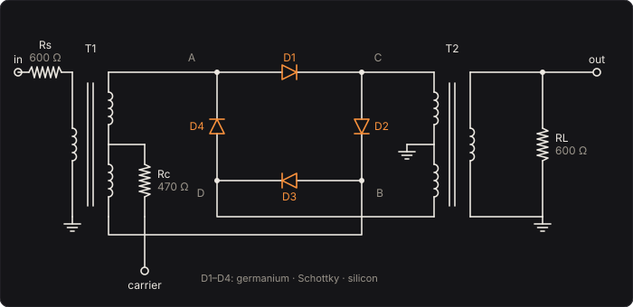

# Ring Modulator

The radio engineer's heterodyne, on a bass. Four diodes in a ring between two transformers are
switched back and forth by a carrier oscillator, so the bass comes out multiplied by the carrier's
sign. A product of two waves is their sum and their difference,

  cos(2πft) · cos(2πfct) = ½ cos(2π(f + fc)t) + ½ cos(2π(f − fc)t),

so every frequency f you play leaves at f + fc and |f − fc|, and neither f nor fc comes out at
all: play the A at 55 Hz into a 220 Hz carrier and you hear 165 Hz and 275 Hz. The same
arithmetic moves a radio station down to the intermediate frequency of every superheterodyne
receiver since Armstrong's, and stacked telephone calls on one pair of wires, each moved to its
own band, from the 1930s. Composers took it up: Stockhausen's *Mixtur* (1964) puts an orchestra
through four of them. Its tones are clangorous, bell-like, rarely in tune with the note, because
adding a fixed frequency to every partial breaks the harmonic series.

The Ring Modulator solves the ring as it plays: the four diodes by Shockley's equation, the
transformers' windings and their magnetising inductance, and the carrier through its resistor
into the input transformer's centre tap.

Part of [PhuzzBox](../README.md).

| Input | |
|---|---|
| Your audio interface | pick it in the source menu (then **In 1** or **In 2**) |
| `Z`…`/`, `A`…`;`, `Q`…`P`, `1`…`0` | the test bass's E, A, D and G strings, open to the ninth fret |
| `Space` | the footswitch |

## The circuit



The bass, from an input buffer, drives the primary of T1 through **Rs = 600 Ω**. T1's secondary is
two halves, each with the primary's turns, joined at a centre tap; its ends sit at vc + u and
vc − u, where u is the bass across one half and vc the centre tap's voltage. The carrier drives
that centre tap through **Rc = 470 Ω**. The ring: D1 from T1's top end (A) to T2's top end (C),
D2 from C to T1's bottom end (B), D3 from B to T2's bottom end (D), D4 from D back to A, each
pointing the same way round the loop. T2's primary has its ends at ±w and its centre tap
grounded; its secondary, with one half's turns, drives the **RL = 600 Ω** load with w. A
recovery amplifier with a gain of 2 follows.

The four diodes' voltages are

  x1 = vc + u − w,  x2 = w − vc + u,  x3 = vc − u + w,  x4 = −w − vc − u,

and each passes Shockley's current, i = Is (e^(x/nVT) − 1). Ampère's law on each core (the
ampere-turns balance, but for the magnetising current iL) and Kirchhoff's current law give three
equations in u, vc and w:

  (vin − u)/Rs = iL1 + (i1 + i2 − i3 − i4)    T1: the primary carries the halves' difference
  (vcar − vc)/Rc = i1 − i2 + i3 − i4          the carrier supplies their sum, through the centre tap
  i1 − i2 − i3 + i4 = iL2 + w/RL              T2: the halves' difference drives the load

with each magnetising inductance across the winding of one half's turns: L diL1/dt = u,
L diL2/dt = w.

## A switch

Drive the centre tap positive, well past the diodes' knee, and D1 and D3 conduct, each carrying
about half the carrier's current: 2.85 mA at the peak of a 3 V carrier, 10.24 mA at 10 V, through
470 Ω. A conducting diode is a small resistance, r = nVT/i, 14.4 Ω and 4.0 Ω. The bass's current
then flows from A through D1 to C and from D through D3 to B: T1 is connected straight across to
T2, and w ≈ u. Drive it negative and D2 and D4 conduct instead, connecting C to B and D to A, the
transformers the other way round: w ≈ −u. The carrier's own current divides equally between the two
halves of each winding, in opposite senses, so its ampere-turns cancel and it never reaches the
output. Nor does the bass, alone: what comes out is the bass times the carrier's sign.

Through the transformers' 600 Ω into their 600 Ω load the ring passes half, w = 0.4970 vin at
3 V of carrier and 0.4992 vin at 10 V (the switch's resistance, r/2 against 600 Ω, takes the
rest), and the recovery amplifier's gain of 2 makes it up. A square wave of ±½ has the Fourier
series (2/π)(sin θ + ⅓ sin 3θ + ⅕ sin 5θ + …), so the bass's frequency f leaves at fc ± f, each
with (2/π) of its amplitude, −3.9 dB, and at 3fc ± f, 5fc ± f, a third and a fifth as loud.

## A multiplier

With no load and stiff sources the ring's equations have an exact solution. Kirchhoff at T2's
ends, with matched ideal diodes and a = vc/nVT, b = u/nVT, c = w/nVT, says

  e^(a+b−c) − e^(−a+b+c) − e^(a−b+c) + e^(−a−b−c) = 0,

that is e^a sinh(b − c) = e^(−a) sinh(b + c), so

  tanh(w/nVT) = tanh(u/nVT) · tanh(vc/nVT).

In tanh's terms, the ring is a multiplier. For small voltages w = u·vc/nVT, the product itself;
for a carrier far past the knee tanh(vc/nVT) = ±1 and w = ±u, the switch. With germanium's
nVT = 41.1 mV, a 30 mV carrier is still in the product's range: f ± fc come out almost alone, the
3fc ± f lines 38.9 dB below them, and 23.7 dB quieter than from a 3 V carrier. In between, the
**switching function**, the change in w for a change in the bass at each instant of the carrier's
cycle, goes from a copy of the carrier to a square wave, and its Fourier coefficients are the
sidebands' amplitudes (**The sidebands** draws it).

When the bass is louder than the carrier, the roles turn round: the bass switches the diodes as
much as the carrier does, and the bass's own harmonics join the sidebands, 3f ± fc 30 dB louder
than under a strong carrier.

## Balance and leaks

Matched, the ring is balanced: w is odd in the carrier and odd in the bass, exactly (swap D1 with
D2 and D3 with D4 and the equations map onto themselves with vc and w negated), so neither the
bass nor the carrier reaches the output, more than 100 dB down in the tests. Real diodes differ by
millivolts. **Mismatch** makes D1 need that many more volts for the same current: its saturation
current is e^(−Δ/nVT) times the others'. The ring is no longer balanced and the carrier leaks
through. With a 3 V carrier, 2 mV lets 1.21 mV of it through, a quiet whistle at fc; 30 mV lets
18.0 mV through, fifteen times as much. Matched diodes keep it down.

The leak is not the ring's static answer: a winding can hold no DC voltage, so each transformer's
magnetising inductance carries the constant current that keeps u's and w's averages zero, which
almost doubles the leak at fc against the same ring without transformers.

## The transformers

Each transformer's magnetising inductance sits across its winding. The ring's input resistance,
RL + r/2, is about 600 Ω, in parallel with Rs's 600 Ω: R ≈ 300 Ω. Below R/(2πL) the inductance
shunts the bass before it reaches the ring: 3 H puts that at 16 Hz, below the low B, and 0.3 H at
160 Hz, thinning the bass. T2 does the same to what comes out: a difference tone |f − fc| below
its corner leaves weaker.

## The carrier

A sine, a triangle, or a square from a comparator whose output slews at 0.5 V/µs: from −3 V to
+3 V in 12 µs, from −10 V to +10 V in 40 µs, a third of the time at 4 kHz. A carrier strong enough
switches the ring whatever its shape; near the knee, a square switches it hardest and the triangle,
which spends longest near zero, least.

## Solving it

Three unknowns, u, vc and w, and two states, the inductors' currents. Each step the inductors
become a conductance and a current source by the trapezoidal rule (i′ = i + (h/2L)(v + v′)), and
Newton's method solves the three equations, whose Jacobian is symmetric (the ring is a reciprocal
network), by Cramer's rule. A diode's forward step is limited to 4 nVT past where it was or past
its critical voltage, nVT ln(nVT/(√2 Is)), as SPICE limits its junctions, so the exponential can't
overshoot. A step under 20 µV ends the iteration, leaving an error under 10 nV. Starting from the
last two steps' line, a 3 V sine carrier takes 1.4 iterations a step on average. The circuit runs
at 4× the sample rate at high quality, 2× at medium and 1× at low, through the same oversampling
filters as the other pedals; the switching's harmonics above 20 kHz are filtered, not folded.

## The controls

- **Carrier**, **Carrier level**, **Carrier wave**, **Mix** and **Level** are on the face. An
  expression pedal (MIDI CC 1) sweeps the Carrier.
- **Diodes**, **Mismatch** and **Transformer inductance** are the parts, under *The ring*.

## The views

- **The ring**: the four diodes between the transformers, each lit by its current as you play,
  and w against u, the dots along w = +u while the carrier is positive and w = −u while negative.
- **The sidebands**: the switching function over two cycles of the carrier, with the carrier, and
  the lines it sends the note you play to, from its Fourier coefficients; the carrier's leak in grey.
- **Scope**: the input and the output in volts.
- **Spectrum**: the input's and the output's.

## What to listen for

- **Two octaves up: 220 Hz**: the A string's 55 Hz goes to 165 Hz and 275 Hz, its third and fifth
  harmonics: a carrier a whole number of times the note keeps it harmonic. Other notes go
  clangorous.
- **Bell** (311 Hz) and **High and metallic** (1400 Hz, triangle): carriers unrelated to the notes,
  every partial shifted by the same amount, the inharmonic spectrum of a bell.
- **Low carrier: 110 Hz**: a note above 55 Hz gets a difference tone below itself: the E an
  octave up, 82.4 Hz, gives 27.6 Hz and 192.4 Hz. The A at 55 Hz lands on itself and 165 Hz.
- **Square carrier** against the default: hardly different at 3 V, where the sine already switches.
- **Smooth multiplier**: 30 mV of carrier, the ring as a multiplier, only f ± fc.
- **Silicon, under-driven**: silicon's knee at 0.6 V half-switched by a 0.5 V carrier; at 0.3 V,
  silicon's sidebands are 17 times quieter than germanium's.
- **Upside-down tremolo**: a 6 Hz carrier, mixed half with the dry bass: the bass and its inverse
  alternating against the dry, a tremolo whose every other beat cancels.
- **Leaky ring**: one diode 30 mV off, the carrier whistling through.
- **Small transformers**: 0.3 H, the low cut at 160 Hz.

## What is simplified

- The transformers are ideal but for their magnetising inductance: no winding resistance, leakage
  inductance, interwinding capacitance or core saturation. Real ones also lose the top end.
- The diodes have no series resistance, junction capacitance or reverse breakdown; they share the
  Bandgap's families, typical of their kinds rather than measured parts. The mismatch is in one
  diode's saturation current only.
- The carrier is an ideal oscillator, the square's comparator a pure slew limit; the input buffer
  and the recovery amplifier are ideal. Nothing feels the temperature.

## Files

```
ringmod/index.html, style.css             page
ringmod/src/ringmod-params.js            parameters and presets
ringmod/src/ringmod-pedal.js             the descriptor: everything but the page
ringmod/src/ringmod-main.js              page wiring and views
ringmod/src/ringmod-worklet.js           its AudioWorklet module
ringmod/src/ringmod-tour.js              the guided tour
ringmod/src/ringmod-schematics.js        the circuit diagram
ringmod/wasm/ringmod.wasm                built from the C++
native/pedals/ringmod/                   the ring, its solver and the engine in C++
test/ringmod-circuit.mjs                 the ring solved independently, for the tests
test/ringmod-tests.mjs                   node test/ringmod-tests.mjs
```

## Prior art and references

* Keith, C. R. (1932). "Frequency translating system." US Patent 1,855,576 (filed 1929; Bell
  Telephone Laboratories). [Google Patents](https://patents.google.com/patent/US1855576A/en)
* Cowan, F. A. (1935). "Modulating system." US Patent 2,025,158 (filed 1934; American Telephone
  and Telegraph Co.): "four rectifiers connected together in a closed loop each with its best
  conductivity in the same direction around the loop", of the copper-oxide type or diode vacuum
  tubes. [Google Patents](https://patents.google.com/patent/US2025158A/en)
* Caruthers, R. S. (1939). "Copper oxide modulators in carrier telephone systems." *Bell System
  Technical Journal* 18(2), 315–337.
  [doi:10.1002/j.1538-7305.1939.tb03579.x](https://doi.org/10.1002/j.1538-7305.1939.tb03579.x)
* Armstrong, E. H. (1921). "A new system of short wave amplification." *Proceedings of the IRE*
  9(1), 3–11. [doi:10.1109/JRPROC.1921.220092](https://doi.org/10.1109/JRPROC.1921.220092)
* Shockley, W. (1949). "The theory of p-n junctions in semiconductors and p-n junction
  transistors." *Bell System Technical Journal* 28(3), 435–489.
  [doi:10.1002/j.1538-7305.1949.tb03645.x](https://doi.org/10.1002/j.1538-7305.1949.tb03645.x)
* Nagel, L. W. (1975). "SPICE2: A computer program to simulate semiconductor circuits."
  Memorandum UCB/ERL M520, University of California, Berkeley. Section 5.6: limiting a junction's
  Newton steps past its critical voltage, VT ln(VT/(√2 Is)).
  [report](https://www2.eecs.berkeley.edu/Pubs/TechRpts/1975/9602.html)
* Hoffmann-Burchardi, R. (2008). "Digital simulation of the diode ring modulator for musical
  applications." *Proc. 11th Int. Conf. on Digital Audio Effects (DAFx-08)*, Espoo.
  [paper](https://dafx.de/paper-archive/2008/papers/dafx08_29.pdf)
* Parker, J. (2011). "A simple digital model of the diode-based ring-modulator." *Proc. 14th Int.
  Conf. on Digital Audio Effects (DAFx-11)*, Paris, 163–166.
  [paper](https://dafx.de/paper-archive/2011/Papers/66_e.pdf)
* Stockhausen, K. *Mixtur* (1964), for orchestra, four sine-wave generators and four ring
  modulators. [the composer's note](https://www.karlheinzstockhausen.org/mixtur_2003_english.htm)
