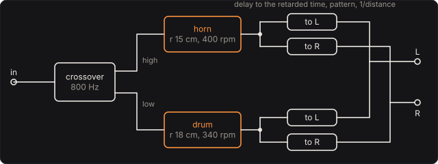

# Rotary Speaker

The organ speaker that spins: a horn for the highs and a drum for the lows, each turned by a
motor, heard by two microphones. Its swirl comes from simple physics. A sound sent from something
moving toward you arrives squeezed, higher, and from something moving away, stretched, lower:
the Doppler shift. A horn beams its high notes, so they come and go as it turns. The motors take
time to get up to speed. The Rotary Speaker is that physics, solved for every sample: where each
rotor was when it sent the sound each microphone hears now.

Part of [PhuzzBox](../README.md).

| Input | |
|---|---|
| Your audio interface | pick it in the source menu (then **In 1** or **In 2**) |
| `Z`…`/`, `A`…`;`, `Q`…`P`, `1`…`0` | the test bass's E, A, D and G strings, open to the ninth fret |
| `Space` | the footswitch |

## The cabinet

A crossover at 800 Hz sends the highs to the horn and the lows to the drum. It is second order, a
Linkwitz–Riley pair whose halves sum flat. The horn's mouth turns on a circle of 15 cm radius;
its twin on the other side is blocked, a counterweight. The drum's opening turns at 18 cm. Two
microphones stand in the plane they turn in, 1 m from the axis and 120° apart.

The speeds are a Leslie's: the horn at about 50 rpm slow (chorale) and 400 rpm fast (tremolo),
the drum at 40 and 340. The radii and openings are chosen to be typical. Each rotor's rate follows
the switch as a first-order lag:

  ω(t) = ω₂ + (ω₁ − ω₂) e^{−t/τ}

with τ = 0.35 s for the light horn and 1.7 s for the heavy drum. So switch to Fast and the horn is
95 % of the way there in about a second, the drum in about five, and for a while they beat against
each other. The tests find the engine's rates on those curves to better than 0.01 %.

## The retarded time

A microphone at M hears at time t what a rotor's mouth sent at the earlier time t_e when it was
|M − X(t_e)| away:

  t − t_e = |M − X(t_e)| / c,  c = 343 m/s

The engine solves this every sample, for each rotor and each microphone, by six steps of
fixed-point iteration. Each step multiplies the error by about v/c, under 3 %. Then it reads what
the rotor was sent at t_e out of a delay line, by cubic interpolation. Nothing else is needed for
the Doppler shift: it comes out exact. The pitch heard is

  f' = f / (1 + v_r/c)

for the mouth's speed v_r away from the microphone when it sent the sound. The horn's mouth moves
at 2π × 6.67 Hz × 0.15 m = 6.3 m/s on Fast, so a note swings ±31.6 cents in the tests (on Slow,
±4.0). Every harmonic moves by the same share, so in the spectrum the higher ones smear wider.
The level falls as 1/distance. With the microphones close, the horn's coming and going is a large
share of the distance: at 30 cm its level throbs 9.5 dB from near to far, at 3 m 0.87 dB. The
pitch swings the same at any distance.

The tests write the retarded time out again by bisection, and play a 3 kHz note through the horn.
Its phase at each microphone swings 16.5 radians as the horn turns, and follows the bisection's
retarded time to within 0.009 radians.

The flight from the axis to the microphones, distance/c, is taken out, as if the microphones were
placed by the rotors, except for the 25 cm of the longest rotor. That and half the patterns'
length below are the pedal's latency: 64 samples at 48 kHz, 1.3 ms.

## The patterns

Each mouth radiates as a rigid circular piston of radius a in a baffle, pointing out along its
rotor's radius. At an angle θ off its axis, a pitch f is sent with the amplitude

  D = 2 J1(x) / x,  x = k a sin θ,  k = 2πf / c

and behind it (θ past 90°) what it sends sideways. A wavelength much longer than the mouth spreads
out every way (x small, D near 1). A shorter one beams, so the high notes come and go as the horn
turns. The horn's mouth is 4 cm in radius, so behind it 4 kHz is 12.1 dB down, 2 kHz 2.5 dB, and 300 Hz within
0.1 dB. The drum's opening is 15 cm, but the drum gets only the lows, whose wavelengths are metres
long: a bass note's level hardly changes as the drum turns, and what the drum does to it is the
pitch swing.

In time, the pattern is the piston's impulse response off its axis. Each part of the disc's sound
arrives as much later as the part is further along the line to the microphone, so the response at
each delay is the disc's width there: a semicircle reaching a sin θ / c either side. Its Fourier
transform is exactly 2 J1(x)/x. The engine convolves each path with that semicircle, each tap the
semicircle's area over that sample, for 65 values of sin θ, interpolated between. The tests compute
J1 by its power series and find the engine's patterns within 0.3 dB of it to 8 kHz.

## The controls

* **Fast (tremolo)**: the two-speed switch, on the pedal's face.
* **Horn and drum**: the horn's level against the drum's.
* **Mic distance** and **Mic spread**: where the microphones are. At 180° they face each other
  across the cabinet, and as the horn comes toward one it goes away from the other: the pitch rises
  in one ear as it falls in the other.
* **Speeds**: each rotor's two speeds and spin-up time constant.
* **The cabinet**: the crossover, the rotors' radii and their mouths' sizes.

## The views

* **The cabinet**: the rotors from above as they turn, and the horn's paths to the microphones,
  red while its pitch is raised and blue while it is lowered.
* **The pitch**: each rotor's pitch shift at the microphones over the last four seconds.
* **The patterns**: the horn's and the drum's patterns at 200 Hz, 1 kHz and 4 kHz, as the
  engine plays them (`rotary_pattern`).
* **Spectrum** and **Scope**: the input and the left microphone as they play.

## What to listen for

* **Chorale** and **Tremolo**: the two speeds. Switch between them and listen to the horn arrive
  first and the drum catch up.
* **Mics up close**: 35 cm away and on opposite sides. The level throbs, and in headphones the
  pitch moves in opposite directions in each ear.
* **Drum only** and **Horn only**: each rotor alone.
* **Long horn, slow motor**: a 24 cm horn, which swings the pitch further, with heavy motors.

## What is simplified

* **A free field.** No cabinet walls, louvres or room: the sound goes straight from each mouth to
  each microphone. A real cabinet's reflections add their own swirl.
* **Pistons.** The horn's mouth and the drum's opening are rigid pistons in a baffle, with the
  sideways level behind. Smith, Serafin, Abel and Berners measured a real horn: with its diffuser
  it is closer to omnidirectional, and below about 12 Bark its turning mostly changes the level.
* **The amplifier and the drivers are flat.** A Leslie's tube amplifier, its horn driver and its
  15″ woofer are not here.
* **The motors are first-order lags**, with time constants chosen to match the usual description
  (about a second for the horn, several for the drum), not measured from a motor.
* **In the plane.** The microphones are in the plane the rotors turn in.

## Files

* `src/rotary-params.js`: the controls and presets (the C++ tables are generated from them).
* `src/rotary-main.js`: the page's views; `src/rotary-tour.js`: the tour;
  `src/rotary-schematics.js`: the diagram above.
* `native/pedals/rotary/rotary-model.h`, `rotary-model.cpp`: J1, the piston, its semicircle
  patterns, the retarded time.
* `native/pedals/rotary/rotary-engine.cpp`: the motors, the crossover, the paths;
  `rotary-web.cpp`: the page's model calls.
* `test/rotary-circuit.mjs`: the same physics written independently: J1 by its series, the retarded
  time by bisection.
* `test/rotary-tests.mjs`: the engine against those, and each hint.

## Prior art and references

* J. O. Smith, S. Serafin, J. Abel & D. Berners (2002). "Doppler simulation and the Leslie."
  *Proc. 5th Int. Conf. Digital Audio Effects (DAFx-02)*, Hamburg.
  [PDF](https://ccrma.stanford.edu/~jos/doppler/dafx02.pdf). A rotating horn simulated by
  interpolated delay lines from its geometry, and measurements of a real Leslie's horn at angles
  around it.
* "Leslie speaker." *Wikipedia*.
  [en.wikipedia.org/wiki/Leslie_speaker](https://en.wikipedia.org/wiki/Leslie_speaker). The horn's
  speeds of about 50 and 400 rpm and the drum's 40 and 340, the 800 Hz crossover, and the blocked
  twin horn.
