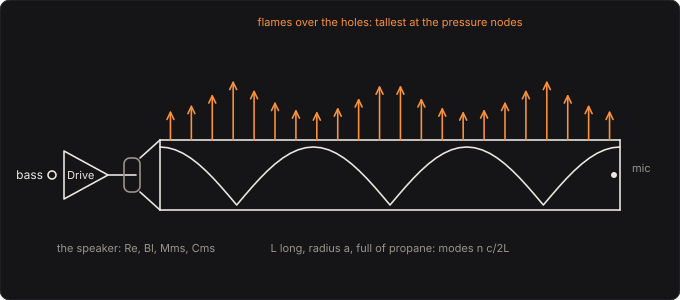

# Rubens' Tube

Your bass through a loudspeaker into a closed pipe of propane, and back out through a microphone
inside it. In 1905 Heinrich Rubens and Otto Krigar-Menzel drilled a row of holes along the top of a
pipe, filled it with gas, lit the gas, and sounded a note into one end: the flames rose and fell in
the pattern of the standing wave inside. This pedal is the pipe, its gas and the speaker that drives
it, as Gardner, Gee and Dix measured them in 2009: the pipe's resonances, a whole number of half
wavelengths along it, lift the notes and harmonics that fall on them and let the rest through thin,
and the flames show you where the sound is.

Part of [PhuzzBox](../README.md).

| Input | |
|---|---|
| Your audio interface | pick it in the source menu (then **In 1** or **In 2**) |
| `Z`…`/`, `A`…`;`, `Q`…`P`, `1`…`0` | the test bass's E, A, D and G strings, open to the ninth fret |
| `Space` | the footswitch |



## The pipe

A pipe L long and of radius a, St = π a² across, closed by the speaker's cone at x = 0 and by a cap at
x = L. Below its first cross mode, 1.84 c/(2π a), only plane waves travel along it (2779 Hz for the
stock 5.2 cm bore of propane), and its pressure is a sum of modes,

  p(x, t) = p0(t) + Σ qn(t) cos(nπ x/L),

each a whole number of half wavelengths along it, at n c/2L. In the stock pipe, Gardner, Gee and
Dix's 1.524 m, sound travels at 246.59 m/s in propane, NIST's speed at 20 °C and one atmosphere, so the
modes are 80.9 Hz apart, and 34 of them lie under the cutoff. The uniform one, p0, is the gas
squeezed by the cone, ρc² Sd ξ/(L St) for a displacement ξ; the others are driven by the cone's
volume velocity U = Sd ξ':

  qn'' + 2σn qn' + (ωn² + σn²) qn = (2ρc²/(L St)) U'.

They lose their energy to the walls, in the thin layers of gas there where the viscosity drags and
the heat flows into the metal. Kirchhoff worked it out: the wave's number is k = ω/c + (1 + i) α,

  α = (1/(a c)) √(π f μ/ρ) (1 + (γ − 1)/√Pr),

per metre, μ the viscosity, γ the ratio of the specific heats and Pr the Prandtl number, μ Cp/k
(propane's γ 1.139 and Pr 0.748, from NIST's numbers). So the nth mode dies away at σn = c αn and
rings σn/2π below n c/2L. The walls alone would let the first mode ring with a quality factor of
172, the second 244.

## The speaker

Gardner, Gee and Dix's driver, from their Table I: a voice coil of 5.42 Ω, a motor of 6.59 T·m, a
cone of 9.66 g on a suspension of 482.8 µm/N, resonant alone at 73.7 Hz with a mechanical Q of
3.03, driven by an amplifier, V = Drive × your bass:

  Mms ξ'' = Bl (V − Bl ξ')/Re − Rms ξ' − ξ/Cms − Sd p(0, t),

Rms = 2π Fs Mms/Qms, and the cone a piston filling the bore, Sd = St. The pipe pushes back on the
cone, and the cone on the pipe: its back EMF, Bl²/Re, is a damper the gas drives through it. That is
what Gardner, Gee and Dix found: "the speaker alters the resonance frequencies and greatly decreases
the quality factor of the lowest several modes". In the pedal the first five peaks' Q is 14, 42, 87,
154 and 200, where the walls alone would give 172 and 244 to the first two: low down the cone moves
with the gas and soaks up its energy; higher up the cone is too heavy to move, and the peaks are the
pipe's own, within 1 % of its modes. At the first peak, 80.9 Hz, the cap feels 528 Pa for each volt
on the speaker. A wider bore, 10.2 cm, loads the speaker harder still: Q 3, 13, 35, 67 and 118, and
plane waves only to 1.4 kHz.

A pipe 3.5 m long rings first at 34.5 Hz, under your bass's open E, 41.2 Hz, with 78 modes to its
cutoff; one 0.6 m long at 208 Hz.

## The microphone

It hears the pressure at its place, xm along the pipe, p0 + Σ qn cos(nπ xm/L), at 1 mV/Pa, times the
Level. At the cap it hears every mode. In the middle it sits on the odd modes' pressure nodes, where
cos(nπ/2) = 0: the first and third modes come 47 dB and 42 dB under what the cap hears, and the pipe
sounds an octave up. Anywhere else it hears each mode in proportion to cos(nπ xm/L), and the
response's peaks and dips move as it slides.

## The gases

| at 20 °C, 101.325 kPa | c | ρ | μ | γ | Pr |
|---|---|---|---|---|---|
| propane | 246.59 m/s | 1.865 kg/m³ | 7.99 µPa·s | 1.139 | 0.748 |
| methane | 445.01 m/s | 0.668 kg/m³ | 10.9 µPa·s | 1.308 | 0.728 |

NIST's numbers, from the reference equations of state (Lemmon, McLinden and Wagner's for propane,
Setzmann and Wagner's for methane); γ is Cp/Cv and Pr μ Cp/k from its Cp, Cv and thermal
conductivity. Methane, natural gas, carries sound at 445 m/s, so the same pipe's first peak moves
from 80.9 Hz to 147 Hz, and its lighter gas loses more to the walls: the tail rings 1.5 s where the
propane's rings 4.7 s.

## The flames

The gas leaves each hole at a speed that goes, by Bernoulli, as √(P + p), P the gas's pressure over
the air's and p the sound's. Over a cycle of p = A sin ωt its mean is √P times ⟨√(1 + (A/P) sin ωt)⟩,
which falls as the sound swings harder: where the pressure swings most, at the antinodes, less gas
leaves on average, and the flames are shortest; at the nodes, where it doesn't swing, they stand
tallest. That is Ficken and Stephenson's explanation (1979). In the view the flames stand as that mean
says, the gas stopping when the sound pulls the pressure under the air's. The flames shrink most where
the swing is 1.55 times the gas's pressure, to 84 % of their still height; past 4.3 times it, the gas
rushing out on each push outweighs the gas held back on each pull, and the flames over the antinodes
stand taller than over the nodes. The stock pipe, playing E2 at 0.3 V from the bass, swings 1410 Pa
at the cap against the gas's 500 Pa. Ficken and Stephenson saw the pattern turn over when the gas
pressure was low or the sound loud; Gardner, Gee and Dix say that "this phenomenon has not been fully
explained", and this view's turning over is the simple model's, not a claim that it is the cause.

The gas's pressure, a few hundred pascals over the air's, changes the gas's properties by well under
1 %: it moves the flames, and not the sound.

## Playing it

Your bass goes through the amplifier's 5 Hz coupling and the Drive to the voice coil. The cone and
the pipe's modes are integrated together by the trapezoidal rule, which keeps a passive system
passive: each sample is linear in the cone's new velocity, which one division finds. Each mode's
frequency is prewarped, so that it rings where it should. The pressure at the microphone is the
output, mono, on both sides. The Drive and the Level glide over 20 ms and the microphone's place
glides with them, so that turning them mid-note doesn't click. The pipe is linear: it makes no new
frequencies, only lifts the ones that fall on its resonances.

## The controls

- **Length** (m): the pipe's.
- **Gas**: propane or methane.
- **Drive** (V/V): the amplifier's gain, from your bass to the speaker.
- **Microphone** (%): where the microphone listens, from the speaker to the cap; an expression pedal
  moves it.
- **Level** (dB): the output, the microphone's 1 mV/Pa times this.
- **Diameter** (cm): the pipe's bore, and the speaker's cone, which fills it.
- **Gas pressure** (Pa): the gas's, over the air's; the flames only.

## The views

- **The response**: the pressure at the microphone for each volt on the speaker, in dB of a pascal, up
  to the cutoff, with ticks where the modes would ring with rigid ends and only the walls to damp them.
- **The flames**: the pipe from the side, the standing wave the note you play sets up in it, and the
  flames over it.
- **Scope**: the input and the output in volts.
- **Spectrum**: the input's and the output's.

## What to listen for

- **Gardner's tube**: every E rings out, the notes between the modes come through thin and quick.
- **Natural gas**: the modes almost twice as far apart, and a shorter ring.
- **Mid-tube microphone**: the odd modes gone, the pipe an octave up.
- **Long tube**: the modes close together, a resonance near every note.
- **Wide bore**: the low modes damped by the speaker into broad, soft humps.
- **Short tube**: a few widely spaced peaks, a hollow, vocal ring.
- Sweep the **Microphone** with an expression pedal: the peaks come and go as it passes the nodes.

## What is simplified

- The holes are not in the model, and the pipe is closed at both ends. Gardner, Gee and Dix found that
  "the holes are a primary cause of the shift in resonance frequencies": their small-hole tube rang
  at 71, 142 and 242 Hz where this pedal rings at 80.9, 162.7 and 243.5 Hz.
- The speaker radiates straight into the bore, a piston as wide as it. Theirs was a 10.5 cm driver in
  a sealed box, coupled to the pipe through a short, wide cavity; neither the box nor the cavity is
  modelled, nor the voice coil's inductance.
- The losses are Kirchhoff's to the walls and the speaker's, nothing radiated; the walls are rigid.
- The gas is at 20 °C and one atmosphere, unburnt and unmixed with air, and the sound small enough to
  be linear.
- The flames are the time-averaged Bernoulli flow from each hole, drawn at the note's fundamental:
  no combustion, no flicker but a drawn one, and no effect of the flames on the sound.

## Files

```
rubens/index.html, style.css             page
rubens/src/rubens-params.js              parameters and presets
rubens/src/rubens-pedal.js               the descriptor: everything but the page
rubens/src/rubens-main.js                page wiring and views
rubens/src/rubens-worklet.js             its AudioWorklet module
rubens/src/rubens-tour.js                the guided tour
rubens/src/rubens-schematics.js          the tube's drawing
rubens/wasm/rubens.wasm                  built from the C++
native/pedals/rubens/                    the pipe, the gas, the speaker and the engine in C++
test/rubens-circuit.mjs                  the pipe worked out independently, for the tests
test/rubens-tests.mjs                    node test/rubens-tests.mjs
```

## Prior art and references

* Rubens, H. & Krigar-Menzel, O. (1905). "Flammenröhre für akustische Beobachtungen." *Annalen der
  Physik* (4) 17, 149–164: the flame tube.
  [doi:10.1002/andp.19053220608](https://doi.org/10.1002/andp.19053220608)
* Ficken, G. W. & Stephenson, F. C. (1979). "Rubens flame-tube demonstration." *The Physics Teacher*
  17(5), 306–310: the flames' pattern by Bernoulli, and its reversal.
  [doi:10.1119/1.2340232](https://doi.org/10.1119/1.2340232)
* Gardner, M. D., Gee, K. L. & Dix, G. (2009). "An investigation of Rubens flame tube resonances."
  *J. Acoust. Soc. Am.* 125(3), 1285–1292: the tube's dimensions, the driver's parameters (Table I),
  the speaker's damping of the lowest modes and the holes' shift of them.
  [doi:10.1121/1.3075608](https://doi.org/10.1121/1.3075608)
* Rienstra, S. W. & Hirschberg, A. *An Introduction to Acoustics*. Eindhoven University of
  Technology: eq. (2.13), the attenuation of a pipe's plane waves by its walls' boundary layers, and
  eq. (4.80), the result of Kirchhoff.
  [win.tue.nl](https://www.win.tue.nl/~sjoerdr/papers/boek.pdf)
* Lemmon, E. W., Bell, I. H., Huber, M. L. & McLinden, M. O. "Thermophysical Properties of Fluid
  Systems." In *NIST Chemistry WebBook*, NIST Standard Reference Database 69, eds. Linstrom, P. J. &
  Mallard, W. G. Gaithersburg: NIST: the gases' sound speeds, densities, viscosities, heat
  capacities and conductivities. [doi:10.18434/T4D303](https://doi.org/10.18434/T4D303)
* Lemmon, E. W., McLinden, M. O. & Wagner, W. (2009). "Thermodynamic properties of propane. III. A
  reference equation of state for temperatures from the melting line to 650 K and pressures up to
  1000 MPa." *J. Chem. Eng. Data* 54(12), 3141–3180.
  [doi:10.1021/je900217v](https://doi.org/10.1021/je900217v)
* Setzmann, U. & Wagner, W. (1991). "A new equation of state and tables of thermodynamic properties
  for methane covering the range from the melting line to 625 K at pressures up to 1000 MPa."
  *J. Phys. Chem. Ref. Data* 20(6), 1061–1155. [doi:10.1063/1.555898](https://doi.org/10.1063/1.555898)
