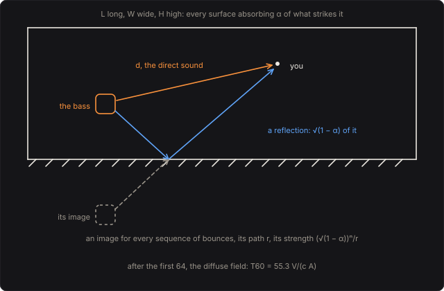

# Sabine's Room

Your bass in a room you build. In 1895 Harvard asked a young physicist, Wallace Sabine, why no one
could follow a lecture in the Fogg Art Museum's new lecture room, and over the next five years,
with an organ pipe, a chronograph and his own ears, he found the law of reverberation: the time a
sound takes to die away goes as the room's volume over its absorption. This pedal is a shoebox
room: the direct sound and the room's first 64 reflections, found by Allen and Berkley's image
method, and after them the reverberation, dying away in each octave in the time Sabine's law, in
Eyring's form, gives it, from the room's size, its walls, its floor, its audience and its air.

Part of [PhuzzBox](../README.md).

| Input | |
|---|---|
| Your audio interface | pick it in the source menu (then **In 1** or **In 2**) |
| `Z`…`/`, `A`…`;`, `Q`…`P`, `1`…`0` | the test bass's E, A, D and G strings, open to the ninth fret |
| `Space` | the footswitch |



## The room

A box L long, W wide and H high. Its walls and ceiling are of one material, its floor of another,
and an audience covers as much of the floor as the Audience says. Each surface absorbs a fraction α
of the sound that strikes it, in six octaves from 125 Hz to 4 kHz, as Hall's Table 15.1 gives:

| α | 125 | 250 | 500 | 1k | 2k | 4k Hz |
|---|---|---|---|---|---|---|
| poured concrete | .01 | .01 | .02 | .02 | .02 | .03 |
| painted block | .10 | .05 | .06 | .07 | .10 | .10 |
| plaster on lath | .20 | .15 | .10 | .05 | .04 | .05 |
| plate glass | .20 | .06 | .04 | .03 | .02 | .02 |
| medium velour drapes | .07 | .30 | .50 | .70 | .70 | .60 |
| wooden floor | .40 | .30 | .20 | .20 | .15 | .10 |
| heavy carpet on concrete | .02 | .06 | .15 | .40 | .60 | .60 |
| audience, seated | .40 | .60 | .80 | .90 | .90 | .90 |

The air absorbs too, by ISO 9613-1 at 20 °C and the Humidity, as an intensity attenuation m per
metre (its absorption in dB/m over 10 log10 e). The bass stands a fifth of the way along the room
and a little off its middle, 1.2 m up (or half the height in a lower room); you stand the Distance
away, along the room and a little across it, at the same height, kept half a metre from the walls.

## Sabine's law and Eyring's

A sound in a room strikes its walls c S/4V times a second, S the room's surface. Sabine found by
experiment that the reverberation time, the time the sound takes to die away by 60 dB, is

  T = 55.3 V/(c A),   A = Σ S α + 4 m V,

A the absorption area, every surface's area times its α, and the air's. 55.3 is 24 ln 10, and over
the speed of sound, 343.2 m/s at 20 °C, it is 0.161 s/m: T = 0.161 V/A, in metres. (Sabine's own
metric constant was 0.164.) Sabine's law treats absorption as a steady drain. Eyring saw in 1930
that a sound loses its share at each reflection, 1 − ᾱ of it surviving, ᾱ the surfaces' average α:

  T = 55.3 V/(c (−S ln(1 − ᾱ) + 4 m V)),

which is Sabine's when ᾱ is small and shorter when it is not. The pedal plays Eyring's. The stock
room, 18 by 12 by 6 m, plaster walls on a wooden floor, rings 2.6 s at 1 kHz but 0.9 s at 125 Hz,
where the plaster and the floor absorb the most. A full house takes 1 kHz down to 0.8 s. Drapes and
a carpet in a room 7 by 5 by 3 m take it to 0.12 s by Eyring and 0.19 s by Sabine, but at 125 Hz,
which drapes and carpet barely touch, the room still rings 2.0 s.

In a big room the air takes the treble. In the Cathedral preset, 60 by 25 by 20 m, the air does
61 % of the absorbing at 4 kHz, and the treble dies in 3.5 s while 250 Hz rings 16 s; in dry air,
10 % humidity, 4 kHz rings 1.3 s, and at 90 %, 4.3 s.

## The early sound: images

Allen and Berkley's image method: a wall reflects the bass as a mirror would, so a reflection seems
to come from the bass's image beyond it. Mirror the images in the walls again and every image is a
path a reflection takes, as long as the image is far: with i reflections from surface k, its pressure
at you, against the bass's a metre away, is

  p = Π (√(1 − αk))^(ik) e^(−m r/2)/r,

r the image's distance. In a box the images sit on a lattice, one to each room-sized cell of space
(within 60 m of you in the stock room, 4π r³/3V of them). The pedal plays the direct sound and the
64 nearest images, each at its own delay after the direct sound, (r − d)/c, between samples, and
with its own strength in each octave. In the stock room, with you 6 m from the bass, the floor's
reflection comes 1.3 ms after the direct sound, and the late sound takes over 62 ms after it.

## The late sound: the diffuse field

Past the early reflections they come too thick to tell apart, 4π c³ t²/V of them a second t after
the bass sounds, each 1/(c t) strong: together a diffuse field of power 4π c/V of the bass's a
metre away, dying away in the room's reverberation time:

  P(t) = (4π c/V) e^(−13.8 t/T).

From the 64th reflection on, the pedal plays that field in each octave with a feedback delay
network of the kind Stautner and Puckette introduced: 16 delay lines, 11 to 41 ms long, their
outputs mixed by a Hadamard matrix (which loses nothing) and fed back, each line losing 60 dB per T
of the octave's. The bass reaches each octave's network through a twelfth-order Butterworth band,
so that each octave decays at its own rate (its neighbours are 36 to 39 dB down at its centre), and
its output is scaled so that its power is P(t). A unit impulse into the network spreads its energy
through the lines as e^(−13.8 t/T)/Σm in every place, Σm the lines' total length (that energy,
weighted by e^(−13.8 a/T) at its age a, is conserved), so the lines give out e^(−13.8 t/T) Σ e^(13.8 m/T)/Σm,
m in seconds.

Summed over its decay the diffuse field is 4π c T/(13.8 V) of the bass a metre off, which for
Sabine's T is 16π/A: the reverberation is as loud as the direct sound, 1/d², at the critical
distance √(A/16π). In the stock room at 1 kHz that is 1.2 m, 2.1 m with a full house: nearer, you
hear the bass; farther, the room. At 6 m the two together are 14 dB over the bass alone.

## Playing it

The bass is split into the six octaves by lowpasses at 177, 354, 707, 1414 and 2828 Hz, second-order
Butterworth, the bands taken as their differences, so that they sum back to the bass exactly: until
the first reflection comes, you hear the bass alone, 1/d of it (at 6 m, 16 dB under the bass a metre
away), with nothing added and no latency. The direct sound and the reflections are taps on those
bands, each band with its own gain. A change of the room fades from the old taps to the new ones
over 21 ms, and the late sound's gains glide over 50 ms, so that turning a knob mid-note doesn't
click. The output is mono, on both sides.

## The controls

- **Length**, **Width**, **Height** (m): the room's.
- **Walls**: the walls' and the ceiling's material.
- **Audience** (%): how much of the floor an audience covers.
- **Distance** (m): how far you stand from the bass; an expression pedal moves it.
- **Floor**: the floor's material, where there is no audience.
- **Humidity** (%): the air's, at 20 °C.
- **Level** (dB): the output. At 0 dB the direct sound is the bass's strength a metre away.

## The views

- **The decay**: each octave's reverberation time, Eyring's and Sabine's, with the room's volume, its
  absorption, its critical distance and Schroeder's frequency, 2000 √(T/V), above which the room's
  modes overlap so thickly that it sounds diffuse rather than resonant (89 Hz in the stock room).
- **The echogram**: the direct sound and the reflections at 1 kHz, each a stem, then the diffuse
  field's energy in each millisecond.
- **Scope**: the input and the output in volts.
- **Spectrum**: the input's and the output's.

## What to listen for

- **Empty hall**: a long, warm-topped tail, the bass's lowest octave shortest.
- **Full house**: the same room with the audience in: clear, the tail under a second.
- **Concrete bunker**: almost nothing absorbs, and the low notes ring on for many seconds.
- **Glass atrium** and **Cathedral**: huge rooms, the first reflections spread out, the treble dying
  first in the air.
- **Drawing room**: drapes and carpet, a dead room, except for a boom in its lowest octave.
- Sweep the **Distance**: from the bass in front of you to the room all around you.

## What is simplified

- The room is an empty box with flat walls: no furniture, no columns, no balconies, and every surface
  reflecting as a mirror, not scattering. A real room's reflections spread out and blur.
- Each surface's α is a typical value from a table, the same at every angle of incidence, and stands
  for its whole octave: the reverberation time steps from octave to octave rather than gliding.
- The late sound's power and decay are the diffuse field's, statistically; it doesn't have the
  room's own modes, which below Schroeder's frequency a real room's bass would have.
- The bass and you are points; the bass radiates equally every way.
- The direct sound and the reflections reach you once, mono: no two ears.

## Files

```
sabine/index.html, style.css             page
sabine/src/sabine-params.js              parameters and presets
sabine/src/sabine-pedal.js               the descriptor: everything but the page
sabine/src/sabine-main.js                page wiring and views
sabine/src/sabine-worklet.js             its AudioWorklet module
sabine/src/sabine-tour.js                the guided tour
sabine/src/sabine-schematics.js          the room's plan
sabine/wasm/sabine.wasm                  built from the C++
native/pedals/sabine/                    the room, the images, the networks and the engine in C++
test/sabine-circuit.mjs                  the room worked out independently, for the tests
test/sabine-tests.mjs                    node test/sabine-tests.mjs
```

## Prior art and references

* Sabine, W. C. (1900). "Reverberation." *The American Architect and The Engineering Record*;
  reprinted in his *Collected Papers on Acoustics* (1922), Cambridge: Harvard University Press:
  the law of reverberation, and its metric constant, 0.164.
  [archive.org](https://archive.org/details/collectedpaperso00sabiuoft)
* Eyring, C. F. (1930). "Reverberation time in 'dead' rooms." *J. Acoust. Soc. Am.* 1(2A),
  217–241. [doi:10.1121/1.1915175](https://doi.org/10.1121/1.1915175)
* Allen, J. B. & Berkley, D. A. (1979). "Image method for efficiently simulating small-room
  acoustics." *J. Acoust. Soc. Am.* 65(4), 943–950. [doi:10.1121/1.382599](https://doi.org/10.1121/1.382599)
* Vigran, T. E. (2008). *Building Acoustics*. London: Taylor & Francis: eq. (4.35), Sabine's
  T = 55.26 V/(c A); eqs. (4.36)–(4.37), Eyring's; eq. (4.42), the air's 4 m V; eq. (4.22),
  Schroeder's frequency. [doi:10.1201/9781482266016](https://doi.org/10.1201/9781482266016)
* Schroeder, M. R. (1962). "Frequency-correlation functions of frequency responses in rooms."
  *J. Acoust. Soc. Am.* 34(12), 1819–1823: rooms sound diffuse above 2000 (T/V)^½.
  [doi:10.1121/1.1909136](https://doi.org/10.1121/1.1909136)
* Hall, D. E. (1991). *Musical Acoustics*, 2nd ed. Pacific Grove: Brooks/Cole: Table 15.1, the
  absorption coefficients, as HyperPhysics gives them.
  [HyperPhysics](https://hyperphysics.gsu.edu/hbase/Acoustic/revmod.html)
* International Organization for Standardization (1993). *ISO 9613-1: Acoustics — Attenuation of
  sound during propagation outdoors — Part 1: Calculation of the absorption of sound by the
  atmosphere*. [iso.org](https://www.iso.org/standard/17426.html)
* Stautner, J. & Puckette, M. (1982). "Designing multi-channel reverberators." *Computer Music
  Journal* 6(1), 52. [doi:10.2307/3680358](https://doi.org/10.2307/3680358)
