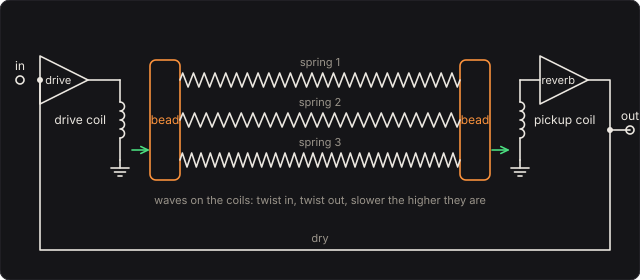

# Spring Reverb

The reverb tank of guitar and organ amplifiers: helical steel springs hung between two magnetic
beads. The drive coil twists one bead with your bass's signal, the twist runs along the springs,
and the coil at the far end hears the other bead turn. What comes back is not a smooth wash but a
string of echoes, every one a chirp, because waves on a helix of wire are strongly dispersive: up
to a transition frequency F_C, the higher a component, the slower it travels. Nothing here is a
recorded impulse response. The springs are the ones Parker and Bilbao measured, and every echo
comes from their coils and wire.

## The tank

Two tanks are offered, with the springs Parker and Bilbao measured (DAFx-09, Appendix A). All of
them are wound from 0.35 mm steel wire:

| | coil ⌀ | turns | wire L | T_D | F_C |
|---|---|---|---|---|---|
| Leem Pro KA-1210, spring 1 | 4.4 mm | 303 | 4.19 m | 41.8 ms | 4889 Hz |
| spring 2 | 4.5 mm | 280 | 3.96 m | 40.4 ms | 4675 Hz |
| spring 3 | 4.6 mm | 351 | 5.08 m | 52.9 ms | 4474 Hz |
| Olson X-82, spring 1 | 5.4 mm | 148 | 2.51 m | 30.7 ms | 3247 Hz |
| spring 2 | 6.1 mm | 133 | 2.55 m | 35.2 ms | 2544 Hz |

The wire's length is the helix unrolled, √((2πRN)² + H²) for a coil of radius R, N turns and
length H. The steel is E = 200 GPa and ρ = 7850 kg/m³, typical values, so √(E/ρ) = 5048 m/s.

## Waves on a coil

A coil of wire bends, stretches and twists at once. The spring-reverb papers use a reduced model of
it, the thin spring of Fletcher, Tarnopolskaya and de Hoog, and Bilbao and Parker: the coil as a
stack of rings at zero helix angle, moving in its plane, with u the wire's displacement toward the
axis and v its displacement along itself, ε = 1/R:

  ρA u_tt = −EI (∂ₛ² + ε²)² u + EA ε (∂ₛv − εu)
  ρA v_tt = EA ∂ₛ(∂ₛv − εu)

A wave e^{i(ωt − ks)} turns this into a 2 × 2 symmetric eigenproblem, with κ² = EI/ρA = r²E/4ρ
and γ² = E/ρ:

  ω² (U, V) = K (U, V),  K = [ κ²(k² − ε²)² + γ²ε²   γ²εk ;  γ²εk   γ²k² ]

Its upper root is the wire stretching, above 300 kHz. The lower root carries the sound:

  ω² = 2p / (s + √(s² − 4p)),  s = κ²(k² − ε²)² + γ²(ε² + k²),  p = κ²γ²k²(k² − ε²)²

It rises from zero, peaks at k = 0.530/R, falls to zero at k = 1/R (the whole coil sliding
sideways) and climbs again as a bending wave, ω ≈ κ(k² − ε²).

**The echo time.** At low frequency the lower root is ω = κεk: a wave of constant speed
c₀ = κ/R = (r/2R)√(E/ρ) along the wire, 200.8 m/s on the Leem's first spring. (The exact slope is
less by (r/2R)²/2, 0.08 %.) Parker and Bilbao define the echo time as two crossings at this speed:

  T_D = 2L/c₀ = 4LR/(r√(E/ρ))

**The transition frequency.** The peak of the lower root is where the chirps end. Parker and
Bilbao give, to first order,

  F_C ≈ 3r√(E/ρ) / (16√5 π R²)

which is 4871 Hz for the Leem's first spring. The model's exact peak is 0.37 % higher, 4889 Hz.
F_C goes as r/R²: thinner wire and wider coils bring it down.

**Chirps.** A component at frequency f crosses the spring in its group delay L/c_g(f), where
c_g = dω/dk, and comes back every 2L/c_g(f). On the slow branch below F_C, c_g falls toward zero
as f rises toward F_C. On the Leem's first spring the first arrival comes at 20.9 ms at 300 Hz,
21.6 ms at 1200 Hz, 24.0 ms at 2400 Hz and 31.0 ms at 3600 Hz. So every echo is a **rising
chirp**: the low frequencies arrive first and those near F_C later, and later again each time
round. Above F_C the bending wave's group velocity rises with frequency, so it makes faint
**falling chirps**, the high frequencies first.

## The beads

Each bead turns with the end of the wire. The wire's end section turns about the spring's axis by
ψ = ∂ₛu + εv, so a wave turns the beads by its share

  share = (R(kU + εV))² / (U² + V²)

which is 1 for the low-frequency rotation wave and 0 for the sideways slide at k = 1/R. The
standing waves of a spring whose ends are free to turn are k = nπ/L, n = 1, 2, …, and mode n
reaches the far bead with the sign (−1)ⁿ, which sends the first arrival after one length and the
echoes after three, five, …

The beads are magnets, 4 mm long and 1.5 mm across in the Leem (5 × 2.1 mm in the Olson). Each
is taken as a cylinder of alnico (7300 kg/m³), magnetised across it. Which way it lies is the
**Bead magnets** control: along the spring's axis it turns about its own axis, I_b = m a²/2 (a its
radius); across the axis it turns end over end, about a diameter through its middle,
I_b = m (a²/4 + l²/12) (l its length), five times as much in the Leem (5.24). Its inertia I_b loads each end of the spring. A wave of the rotation
line, whose impedance is Z = I′c₀, passes a bead as 1/|1 + iωI_b/Z|. Both beads together pass

  H(f) = 1 / (1 + (f/f_b)²),  f_b = f₀/(πμ),  μ = I_b / I_spring,  f₀ = 1/T_D

The Leem's beads, lying along the springs, are 0.095 % of its first spring's moment of inertia
about its axis, so f_b = 8.0 kHz. Lying across, f_b = 1.5 kHz, and the tank is darker (by about
15 dB near 4 kHz after a click). The Olson's heavier beads on lighter springs give 2.1 and 2.3 kHz
lying along, and it is darker.

Each mode n is a resonator with weight

  w_n = (2/T_D) · share · H(f_n) · (−1)ⁿ / (number of springs)

For a lossless uniform line this sums to a unit impulse at the first arrival. So with **Reverb**
at 100 %, a low note's first echo comes out as loud as the note went in, times its share and the
beads (0.99 at 150 Hz). The springs hang side by side between one pair of coils, and the tank
plays their average.

## Losses

Each mode decays at a rate σ (1/s), the sum of three losses, as in Forte's Spring Keyboard:

  σ = σ_oil + πfη + (ℓ ln10/20) · |c_g|/L

* **The mounts.** A wave loses ℓ dB each time it reaches a bead (0.4 dB by default). It reaches
  one |c_g|/L times a second, so the slow waves near F_C, which crawl, are the ones the mounts
  damp least.
* **The steel.** A loss factor η, the high frequencies first (2 × 10⁻⁴ by default).
* **Oil.** A viscous drag σ_oil, the same for every mode, like the oil Hammond hung his springs
  in.

On the Leem's first spring at the defaults, the tail near 500 Hz falls at σ = 2.51 /s: T₆₀ is
2.76 s.

## Solving it

The tank is modal. Every spring's standing waves from 20 Hz to 8 kHz are kept, except those the
beads barely turn (less than 0.3 % of the rotation wave's coupling). That leaves 2307 modes in
the three-spring tank, 989 of them on the slow branch below F_C. Each mode is a damped resonator,
the bead's angular velocity for a torque impulse:

  h(t) = w e^{−σt} (cos ω_d t − (σ/ω_d) sin ω_d t),  ω_d = √(ω² − σ²)

Sampled at each sample (the impulse invariant), that is the real part of a complex one-pole,
z ← p z + c x, with p = e^{(−σ + iω_d)T} and c = T w (1 + iσ/ω_d). It is exact in frequency and
decay. The bank runs eight modes at a time in single precision. A mode 200 dB below a volt is let
go, and a resting bank with nothing coming in costs nothing. The three-spring tank takes about 6 %
of a core in WebAssembly, with no latency. **Quality** keeps modes to 8, 6 or 4 kHz.

The tests check the engine against the model written again in JavaScript
(`test/spring-circuit.mjs`), which solves the 2 × 2 eigenproblem directly for its eigenvalue
and eigenvector:

* The modes' frequencies agree within 10⁻⁹, and their weights and decays within 10⁻⁶.
* A click through one nearly lossless spring arrives near 300, 1200, 2400 and 3600 Hz at
  L/c_g(f) within 3 %, found by complex demodulation of the output, and echoes 2L/c_g(f) later.
* The tail near 500 Hz decays at σ within 8 %.

## The controls

* **Tank**: the Leem's three springs, the Olson's two, or the Leem's first alone. One spring echoes
  crisply; three, cut differently, blur into a wash.
* **Wire diameter**: every spring's wire. Thinner wire carries slower waves (T_D goes as 1/r) and
  brings F_C down in proportion. At 0.25 mm the Leem's first spring echoes every 58.5 ms, with F_C
  at 3493 Hz.
* **Bead magnets**: along the springs or across them (above); across is darker.
* **Loss at the mounts**, **Steel loss factor** and **Oil damping**: the losses above.
* **Dry**, **Reverb** and **Level**: the mix. Reverb is the recovery amplifier's gain.

## The views

* **The springs**: the tank's springs in slow motion (1/10 to 1/1000 of real time), from the drive
  bead to the pickup bead: the last note played (until one is, a note of the test bass) sent into
  the drive coil from rest. The page plays the engine's own modes (`spring_modes`) a sample at a
  time, each a standing wave whose wire turns as (−1)ⁿ cos(nπs/L) along the spring, and sums them
  at 121 points along each: the line above each spring is how fast its wire turns there, and the
  coil's loops are drawn moved by it, so they bunch where it turns fastest. The low frequencies
  cross first, in T_D/2, and the highs crawl in behind them. The tests check that what this hears
  at the far end is what the engine's tank does (`spring_run`). Of a note played, the input's
  analyser holds about the first 0.13 s; after that the tank hears silence here.
* **The echoes**: what the pickup hears for 300 ms after a click into the tank, as set
  (`spring_echoes` runs the C++ bank and analyses it through a 1024-sample Hann window). The first
  spring's arrival times, (2j + 1)·L/c_g(f), are dotted over it (`spring_delays`).
* **Spectrum** and **Scope**: the input and output as they play.

## What to listen for

* **Spring under the bass**: a short halo behind each note, which drips when you stop.
* **Surf drip**: more of the tank, and less lossy mounts.
* **One spring, nearly lossless**: the echoes one by one, each a rising *pew* up to F_C.
* **Thin wire, slow chirps**: 0.22 mm wire, slower and lower chirps.
* **Oil bath**: shorter, and the same colour.

## What is simplified

* **Zero helix angle.** The thin-spring model treats the coil as a stack of rings. Forte's Spring
  Keyboard solves the full helical rod (Wittrick's twelve equations) and finds this reduced model
  within a third of a percent below 0.95 F_C, but off by a few percent where the coil's sway mixes
  in, between k = 1/R and 1.4/R.
* **Free ends, ideal beads.** The modes are those of ends free to turn, and the beads' inertia only
  filters them. A real bead's inertia would also move the modes a little. Which way the beads lie
  in these tanks is not known here, so it is a control (Bead magnets).
* **No sway, no tension.** The springs hang straight with no tension or sag, and the coil's
  sideways sway is neither driven nor heard.
* **Losses are three numbers.** The mounts' 0.4 dB, the steel's 2 × 10⁻⁴ and the oil are chosen
  for a tank's few seconds of reverb, not measured from these tanks.
* **Ideal coils.** The drive amplifier is a current source and the coils exert and sense exactly
  in proportion. Real reverb drivers (a 12AT7 into a transformer in some amplifiers) overdrive.
  That is not modelled.

## Files

* `src/spring-params.js`: the controls and presets (the C++ tables are generated from them).
* `src/spring-main.js`: the page's views; `src/spring-motion.js`: the slow motion's modes and the
  field along each spring; `src/spring-tour.js`: the tour;
  `src/spring-schematics.js`: the tank above.
* `native/pedals/spring/spring-model.h`, `spring-model.cpp`: the tanks, the thin spring's
  dispersion, the beads and the losses.
* `native/pedals/spring/spring-engine.cpp`: the mode bank; `spring-web.cpp`: the page's model calls.
* `test/spring-circuit.mjs`: the same physics written independently.
* `test/spring-tests.mjs`: the engine against it and against Parker and Bilbao's closed forms,
  its echoes' arrival times and decay, and each hint.

## Prior art and references

* J. Parker & S. Bilbao (2009). "Spring reverberation: a physical perspective." *Proc. 12th Int.
  Conf. Digital Audio Effects (DAFx-09)*, Como.
  [PDF](https://www.dafx.de/paper-archive/2009/papers/paper_84.pdf). The echo time T_D and the
  transition frequency F_C in terms of the spring's geometry, and the measured springs of the
  Olson X-82 and Leem Pro KA-1210 tanks used here.
* S. Bilbao & J. Parker (2010). "A virtual model of spring reverberation." *IEEE Trans. Audio
  Speech Lang. Process.* 18(4), 799–808.
  [doi:10.1109/TASL.2009.2031506](https://doi.org/10.1109/TASL.2009.2031506). Finite-difference
  simulation of the thin-spring model.
* N. H. Fletcher, T. Tarnopolskaya & F. R. de Hoog (2001). "Wave propagation on helices and
  hyperhelices: a fractal regression." *Proc. R. Soc. Lond. A* 457(2005), 33–43.
  [doi:10.1098/rspa.2000.0654](https://doi.org/10.1098/rspa.2000.0654). The zero-helix-angle
  curved-rod model whose dispersion relation the spring-reverb papers use.
* J. McQuillan & M. van Walstijn (2021). "Modal spring reverb based on discretisation of the thin
  helical spring model." *Proc. DAFx-20in21*, 191–198.
  [doi:10.23919/DAFx51585.2021.9768284](https://doi.org/10.23919/DAFx51585.2021.9768284). A
  modal spring reverb, as this one is.
* L. Hammond (1941). "Electrical musical instrument." US Patent 2,230,836.
  [USPTO scan](https://image-ppubs.uspto.gov/dirsearch-public/print/downloadPdf/2230836).
  Helical springs in oil-damped tubes between a drive transducer and a pickup.
* [Forte's Spring Keyboard](https://forte.jthaler.net/springs/): the same author's struck
  springs, from Wittrick's helical rod, whose loss model and bead filter this pedal follows.
