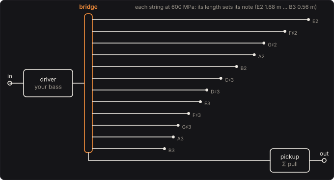

# Sympathetic Strings

The strings nobody plays: a sitar's taraf, a viola d'amore's second set, a piano's undamped strings.
They run across the same bridge as the strings that are played, and when a note shakes the bridge
at one of their own frequencies they ring along, a halo that stays after the note. Here the bass
is the played string: a driver moves a bridge with your signal, a frame of steel strings tuned to
a key runs from it, and a pickup under the bridge hears them pull. Play in the key and the strings
answer; play outside it and they hardly stir.

Part of [PhuzzBox](../README.md).

| Input | |
|---|---|
| Your audio interface | pick it in the source menu (then **In 1** or **In 2**) |
| `Z`…`/`, `A`…`;`, `Q`…`P`, `1`…`0` | the test bass's E, A, D and G strings, open to the ninth fret |
| `Space` | the footswitch |

## The frame

The strings are steel wire, 0.3 mm thick by default, each tensioned to the same stress, 600 MPa
(42.4 N at 0.3 mm). Waves on them all travel at √(σ/ρ) = 276 m/s, so a string's length sets its
note, as a harp's: E2 is 1.68 m, B3 0.56 m, E1 3.4 m. **Key**, **Scale** and **Lowest string**
choose the notes: twelve strings for a major or minor scale, eleven for a pentatonic, five for a
drone of root and fifth, twelve for every semitone.

## The strings

A steel string is stiff as well as tense. Pinned at the bridge and the nut it bends as

  μ ÿ = T y'' − EI y'''',

whose modes are sin(nπx/L) at Fletcher's frequencies

  f_n = n f₀ √(1 + B n²),  B = π³ E d⁴ / 64 T L².

The partials run sharp, more the higher they are. At the same stress B grows as the diameter
squared: 6.58 × 10⁻⁶ for the E2 string at 0.3 mm, 7.31 × 10⁻⁵ at 1 mm. Since B n² depends only on
the frequency here, every string's partials near the same frequency are stretched alike. In the
tests, with 1 mm wire the A1 string's 40th partial rings 43.9 cents above 40 f₀, where Fletcher puts
it. Each string is tuned so its first partial is its note exactly, stiffness and all. It plays its
partials up to 6 kHz, at most 64 of them: 505 partials for the default E major.

## The bridge

Move the bridge by u(t) and the string is u(1 − x/L), its shape with the bridge moved, plus its
modes q_n sin(k_n x), k_n = nπ/L, which the bridge's acceleration drives:

  q̈_n + 2a_n q̇_n + ω_n² q_n = −(2/nπ) ü

Each mode pulls on the bridge with (T k_n + EI k_n³) q_n, so for the bridge's velocity v

  F_n = −(2/L)(T + EI k_n²) · s / (s² + 2a_n s + ω_n²) · v

The pickup hears Σ F_n. The tests check the whole sum against something it must equal: for a
string without stiffness, the bridge's own −(T/L)u and every mode's pull add up to the string's
driving-point force −T k cot(kL) u, the closed form of a string as a transmission line. They agree to
1.3 × 10⁻⁵ from 30 Hz to 2.5 kHz.

The driver holds the bridge to your signal, an ideal velocity source: the strings ring along but
cannot push the bridge back.

## The losses

Each partial dies at Chaigne and Askenfelt's rate

  a = b₁ + b₃ ω²,

the air and the wire's friction (b₁), and losses that grow with frequency (b₃). **Sustain** is how
long a 100 Hz partial takes to die by 60 dB, **Highs ring** how long a 2 kHz one does; the two set
b₁ and b₃. At the defaults, 6 s and 1 s, b₁ = 1.14 per second. In the tests the A2 string's
fundamental dies at 1.170 per second (1.154 predicted) and its 19th partial at 7.490 (7.465).

## Solving it

Each partial is a damped resonator, sampled exactly by the impulse invariant of
K s/(s² + 2as + ω²): a complex one-pole read as z_r − (a/ω_d) z_i, as the Plate Reverb's modes,
eight at a time. Against every partial summed at 48 kHz in double precision the engine differs by
0.011 % RMS. The most it plays, twelve strings from C1 in every semitone, is 768 partials, about 2 %
of a core in the browser.

The pickup's gain is set for each tuning so that white noise in comes out at its own level with
Sustain at 6 s and Highs at 1 s. Partials of different strings that sit close (E2's second, E3's
first) add as amplitudes, so the gain counts them in pairs.

## How the halo follows the key

A note rings a string when one of its harmonics lands within a partial's bandwidth, a/π: 0.36 Hz
for a low partial at the defaults. In E, an open E (41.2 Hz) has harmonics on E2, B2, E3 and B3
(equal temperament's fifths are only 2 cents narrow), and rings the strings 13.6 dB more than an F
does. Its fifth harmonic, 206 Hz, misses G♯3 by 14 cents, 1.6 Hz: far outside the bandwidth. Chromatic tuning has a
string for every note, so an F in E rings it 10.8 dB more than the major scale.

## The controls

* **Sustain** and **Highs ring**: the losses, as above.
* **Strings** and **Dry**: the mix.
* **Key**, **Scale**, **Lowest string**: the tuning.
* **Wire diameter**: 0.2–1 mm; thicker is more inharmonic.
* **Level**: gain after the mix.

## The views

* **The strings**: each string drawn to its length, shaking as much as it rings.
* **The partials**: every partial of every string on a frequency scale, against your note's
  harmonics.
* **Spectrum** and **Scope**: the input and the output as they play.

## What to listen for

* **Halo in E**: play an E, then an F, and hear the strings answer one and not the other.
* **Drone on A**: five strings, root and fifth; open and long.
* **Glassy** and **Dark and short**: the two ends of Highs ring.
* **Strings alone**: the halo without the bass.
* **Thick wire**: 1 mm wire, its partials stretched sharp: listen to the top of the halo.

## What is simplified

* **The bridge does not move back.** The driver holds the bridge to the signal, so the strings do
  not pass energy to each other through it, and a string ringing does not change what the others
  hear. A real bridge has mass and give, and a ringing string drives its neighbours.
* **One plane.** Each string moves in one plane, without torsion, without the two polarisations a
  real string splits into.
* **No buzz.** A sitar's curved bridge (jawari) touches the string as it swings, a buzzing
  nonlinearity that is not here; this is the halo of plain, pinned strings.
* **Ideal pins and steel.** The strings are pinned at both ends, all steel at 600 MPa; real
  sympathetic strings are of mixed materials and tensions.
* **Losses of a fixed form**: b₁ + b₃ω², which Chaigne and Askenfelt call a fair approximation.
* **The partials stop at 6 kHz**, and at 64 per string.

## Files

* `src/sympathetic-params.js`: the controls, the scales and the presets (the C++ tables are
  generated from them).
* `src/sympathetic-main.js`: the page's views; `src/sympathetic-tour.js`: the tour;
  `src/sympathetic-schematics.js`: the diagram above.
* `native/pedals/sympathetic/sympathetic-model.h`, `sympathetic-model.cpp`: the strings and losses.
* `native/pedals/sympathetic/sympathetic-engine.cpp`: the partials, the bridge, the pickup's
  gain; `sympathetic-web.cpp`: the page's model calls.
* `test/sympathetic-circuit.mjs`: the same physics written independently: the strings tuned by
  bisection, Fletcher's partials, the driving-point closed form, every partial summed in double
  precision.
* `test/sympathetic-tests.mjs`: the engine against those, and each hint.

## Prior art and references

* H. Fletcher (1964). "Normal Vibration Frequencies of a Stiff Piano String." *J. Acoust. Soc.
  Am.* 36, 203–209. The stiff string's partials, f_n = n f₀ √(1 + Bn²).
* A. Chaigne & A. Askenfelt (1994). "Numerical simulations of piano strings. I. A physical model
  for a struck string using finite difference methods." *J. Acoust. Soc. Am.* 95(2), 1112–1118.
  The decay rate b₁ + b₃ω².
* Forte's piano, PhuzzBox's sibling: the same question for a piano's strings, which ring along
  through its bridge while their dampers are up.
