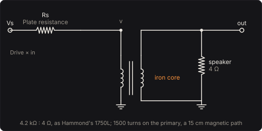

# Output Transformer

The iron at the end of a valve amplifier. Output valves want a load of thousands of ohms and a
speaker is a few, so between them sits a transformer, 4.2 kΩ on its primary for 4 Ω on its
secondary, wound on an iron core that carries the flux from one winding to the other. Iron
remembers: its flux density B follows the field H round a hysteresis loop, and flattens when it
saturates. Faraday's law makes the flux a note needs go as its voltage over its frequency, so the
low notes, a bass's whole register, find the loop's ends first. This pedal is that transformer and
nothing else, its core following Jiles and Atherton's theory of hysteresis.

Part of [PhuzzBox](../README.md).

| Input | |
|---|---|
| Your audio interface | pick it in the source menu (then **In 1** or **In 2**) |
| `Z`…`/`, `A`…`;`, `Q`…`P`, `1`…`0` | the test bass's E, A, D and G strings, open to the ninth fret |
| `Space` | the footswitch |



## The stage

The output valves are a source Vs = Drive × your bass behind their plate resistance Rs. The
speaker, 4 Ω on the secondary, appears on the primary as 4.2 kΩ, the impedances of Hammond's
1750L, its replacement for the 5F6-A Bassman's transformer. Seen from the core, the source and
the speaker make one source, Vth = Vs RL/(Rs + RL), behind Rp = Rs ∥ RL.

The primary has N = 1500 turns on a core of area A and a 15 cm magnetic path l. The current i
through it makes the field H = N i/l, the flux density is B = µ0 (H + M), with M the iron's
magnetisation, and Faraday's law gives the primary's voltage:

  v = N A dB/dt = Vth − Rp l H/N.

The speaker gets v divided by the turns ratio. The pedal's output is v over Drive × Vth/Vs, the
speaker's voltage scaled back to the input's, so that a perfect core would pass your bass
unchanged at a Level of 0 dB.

## The core

Jiles and Atherton's equation (1986), in the form Szewczyk and Plucinski et al. write it:

  dM/dH = δM (Man − M)/((1 + c)(δk − α(Man − M))) + c/(1 + c) dMan/dH,
  Man = Ms L((H + αM)/a),  L(x) = coth x − 1/x.

Man is the anhysteretic, the magnetisation the iron would settle to with no defects to pin its
domain walls: Langevin's function of the effective field H + αM, which includes the field the
magnetisation adds, α its share. Ms is the saturation magnetisation and a sets how quickly the
anhysteretic rises. The first term is the irreversible part, the walls tearing free of the defects
that pin them, against a pinning field k; δ is the sign of dH, and δM is zero when Man − M and δ
differ in sign, since the magnetisation never moves against the field. The second is the reversible
part, the walls bowing without letting go, c the share of it. Together they make the loop: wider
the larger k, its ends flattening at µ0 Ms.

The three cores are published fits:

| Material | Ms (A/m) | a (A/m) | α | k (A/m) | c | µ0 Ms | coercive field |
|---|---|---|---|---|---|---|---|
| Iron (Jiles and Atherton 1986) | 1.6 × 10⁶ | 1100 | 1.6 × 10⁻³ | 400 | 0.2 | 2.0 T | 390 A/m |
| 50 % nickel–iron, 30 °C (Plucinski et al. 2025) | 9.70 × 10⁵ | 4.040 | 6 × 10⁻⁶ | 4.200 | 4 × 10⁻⁵ | 1.2 T | 3.9 A/m |
| Fe–Ni permalloy (Szewczyk 2018) | 6.14 × 10⁵ | 1.010 | 2.988 × 10⁻⁶ | 0.588 | 4 × 10⁻⁵ | 0.77 T | 0.57 A/m |

The iron's are the parameters of Jiles and Atherton's 1986 paper as Holters and Zölzer give them
(their Table 1, where c = 0.17 in a different convention converts back to the 1986 form's 0.2).
The coercive fields are the model's, the loop's half width at B = 0 driven to three times k. The
saturation flux densities sit in the ranges Magnetics gives for its tape-wound cores: 1.10 to
1.40 T for its 48 Alloy, a 50 % nickel–iron, and 0.66 to 0.82 T for its Permalloy 80.

## The low notes

A sine of peak V across the primary swings the flux density by B = V/(2π f N A), which in rms is
the transformer equation, V = 4.44 f N A B. The flux needed halves each octave up. With the stock
parts, Drive 1000 V/V and a 2 kΩ source, a 0.3 V note puts 203 V across the primary, a swing of
0.52 T at the low E (41.2 Hz) and 0.22 T at the G (98 Hz) if the core took no current. Playing,
a 1 V low E takes the iron to 1.4 T and comes out with an 11 % third harmonic, while a 1 V G needs
0.7 T and keeps it to 3 %. Hammond specifies its small universal output transformers, the 125
series, from 150 Hz to 15 kHz at full rated power, and no lower.

The area sets it: at 30 cm² a 0.3 V low E comes out with a 4.7 % third harmonic, at 3 cm² with
18 %, and a 1 V low E saturates the small core outright, 10 dB down with a third harmonic half the
note. Softer iron is cleaner until it saturates, and saturates sooner: on a 5 cm² core permalloy
flattens a 0.3 V low E, with a 30 % third harmonic, where 50 % nickel stays clean.

## The source

The current that magnetises the core drops a voltage across Rp. With a stiff source the flux
follows the voltage whatever the iron does, and you hear the iron only when it saturates; with a
soft one the magnetising current, which the loop makes anything but sinusoidal, shapes the voltage
the speaker gets, and the primary's inductance carries the bass to ground. A 0.3 V low E comes out
0.7 dB down with a 2.4 % third harmonic at 500 Ω, and 15 dB down with 19 % at 20 kΩ.

At the smallest signals the walls only bow and the iron is an inductor: its susceptibility is the
reversible part's, χ0 = c/(1 + c) of the anhysteretic's slope Ms/3a, with the mean field it adds,
93 for the iron. The 10 cm² core is then 1.77 H, µ0 (1 + χ0) N² A/l, and with the stock 2 kΩ
source a highpass at 122 Hz: quiet notes lose their fundamentals, and the iron gets more permeable
as they grow, which is part of its grit. Hammond gives its 125 series primary inductances from
2.99 to 14.94 H.

## Solving it

The pedal runs at twice the host's rate (once at medium and low quality). Each step takes the flux
by the trapezoidal rule, N A (B − B0) = (h/2)(v + v0), one equation in the field H, which Newton's
method solves from the field extrapolated from the last two steps, kept inside a bracket.

The magnetisation is carried from the old field to the new in substeps that move the effective
field no more than a tenth of the anhysteretic's scale there (a near zero, more as |H + αM|
grows). In each the anhysteretic is taken as linear in the effective field and the equation, then
linear in Man − M, is solved exactly: the irreversible part relaxes toward the anhysteretic,
however long the substep. That keeps it stable when the field swings thousands of A/m a cycle
against a pinning field of 0.588 A/m, and the substeps are chosen from the state alone, so the
magnetisation is a continuous function of the new field and Newton has a root to find. On a loud
bass that is about three evaluations of the core a step, each one to three substeps.

## The controls

- **Drive** (V/V): how far the valves swing the primary per volt of your bass; the output is
  divided by it, so it works the iron without making the pedal louder. An expression pedal moves it.
- **Plate resistance** (Ω): the source's resistance, as the amplifier's feedback leaves it.
- **Core** (cm²): the iron's cross-section.
- **Level** (dB): the output.
- **Material**: iron, 50 % nickel or permalloy.

## The views

- **The core**: B against H, the loop the core makes driven to the edge of the view and back,
  saturation dashed, and the core as you play.
- **The flux**: the flux density a 0.3 V note needs at each frequency, B = V/(2π f N A), against
  saturation, with the open strings marked and the flux the core reached on the note you play.
- **Scope**: the input and the output in volts.
- **Spectrum**: the input's and the output's.

## What to listen for

- **Iron**: grit on every note, more on the low ones, and the low E thinner when played softly.
- **Big iron**, 30 cm²: fuller and cleaner. **Small iron**, 3 cm²: a firm low E saturates.
- **Stiff source**, 500 Ω: almost clean until the iron saturates. **Soft source**, 20 kΩ: thin and
  gritty, the iron's loop in every note.
- **50 % nickel** and **Permalloy**, 5 cm²: clean, until a low note hits the end of the loop; the
  permalloy hits it at a medium touch.

## What is simplified

- The core follows Jiles and Atherton's equation, which has no time in it: no eddy currents, so its
  loop doesn't widen with frequency. Its parameters are fitted to major loops; at the fields of a
  dying note the model extrapolates, and the nickel and permalloy fits' tiny c leaves them almost no
  reversible permeability (χ0 of 3.2 and 8.1), so their very quietest notes lose bass.
- A fit to silicon steel, Hussain et al.'s for non-oriented B35AV1900, is left out: its mean field
  is strong enough (α Ms/3a = 1.2, over 1) that in the model its minor loops creep without end, and
  the flux would drift.
- The windings have no resistance, leakage inductance or capacitance; the two halves of a
  push-pull primary are one winding, with no standing current.
- The valves are a linear source: no clipping, no sag, no crossover. The speaker is a resistor.
- The turns and the magnetic path are representative, not a particular transformer's; Hammond
  doesn't publish its windings.

## Files

```
transformer/index.html, style.css             page
transformer/src/transformer-params.js         parameters and presets
transformer/src/transformer-pedal.js          the descriptor: everything but the page
transformer/src/transformer-main.js           page wiring and views
transformer/src/transformer-worklet.js        its AudioWorklet module
transformer/src/transformer-tour.js           the guided tour
transformer/src/transformer-schematics.js     the circuit diagram
transformer/wasm/transformer.wasm             built from the C++
native/pedals/transformer/                    the core, the stage's solver and the engine in C++
test/transformer-circuit.mjs                  the stage worked out independently, for the tests
test/transformer-tests.mjs                    node test/transformer-tests.mjs
```

## Prior art and references

* Jiles, D. C. & Atherton, D. L. (1984). "Theory of ferromagnetic hysteresis (invited)." *Journal of
  Applied Physics* 55(6), 2115–2120. [doi:10.1063/1.333582](https://doi.org/10.1063/1.333582)
* Jiles, D. C. & Atherton, D. L. (1986). "Theory of ferromagnetic hysteresis." *Journal of
  Magnetism and Magnetic Materials* 61(1–2), 48–60.
  [doi:10.1016/0304-8853(86)90066-1](https://doi.org/10.1016/0304-8853(86)90066-1). Its
  parameters here as Holters and Zölzer quote them.
* Holters, M. & Zölzer, U. (2016). "Circuit Simulation with Inductors and Transformers Based on the
  Jiles-Atherton Model of Magnetization." *Proc. 19th Int. Conf. on Digital Audio Effects
  (DAFx-16)*, Brno, 55–60: the model, in their convention for c (eqs. 1–13), and Table 1,
  Jiles and Atherton's parameters with the conversion of c. [pdf](https://www.dafx.de/paper-archive/2016/dafxpapers/08-DAFx-16_paper_10-PN.pdf)
* Szewczyk, R. (2018). "The method of moments in Jiles–Atherton model based magnetostatic modelling
  of thin layers." *Archives of Electrical Engineering* 67(1), 27–35: eq. (3), the 1986 form, and
  Table 1, Fe–Ni permalloy. [doi:10.24425/118989](https://doi.org/10.24425/118989)
* Plucinski, W., Malecha, Z. & Tomczuk, K. (2025). "Evaluation of the influence of temperature on
  the parameters of the Jiles–Atherton model and magnetization curves of a 50% Fe–Ni type alloy."
  *Archives of Electrical Engineering* 74(1), 227–245: Table 1, at 30 °C.
  [doi:10.24425/aee.2025.153021](https://doi.org/10.24425/aee.2025.153021)
* Hussain, S., Benabou, A., Clénet, S. & Lowther, D. A. (2018). "Temperature Dependence in the
  Jiles–Atherton Model for Non-Oriented Electrical Steels: An Engineering Approach." *IEEE
  Transactions on Magnetics* 54(11): the B35AV1900 fit at 150 °C (Fig. 4), not used.
  [doi:10.1109/TMAG.2018.2837126](https://doi.org/10.1109/TMAG.2018.2837126)
* Magnetics Inc. (1983). *Shortcuts in Selection of Toroidal Tape Wound Cores for Magnetic
  Circuitry*, §III: E = 4.44 B Ac N f × 10⁻⁸, in gauss and cm².
  [scan](https://ftp.mirrorservice.org/sites/www.bitsavers.org/components/magneticsInc/113_3P_Shortcuts_in_Selection_of_Tape_Wound_Cores_for_Magnetic_Circuitry_1983.pdf)
* Magnetics Inc. Tape-wound cores: 48 Alloy, a 50 % nickel–iron, 1.10 to 1.40 T
  ([page](https://www.mag-inc.com/products/tape-wound-cores/48-alloy)); Permalloy 80, 0.66 to
  0.82 T ([page](https://www.mag-inc.com/products/tape-wound-cores/round-permalloy-80)).
* Hammond Mfg. *Tube Guitar Amplifier Output Transformers, 1750 Series*: the 1750L, 4,200 Ω C.T. to
  4 Ω, 60 W, for the 5F6 and 5F6A. [pdf](https://www.mouser.com/datasheet/2/177/1750-736917.pdf)
* Hammond Mfg. *125A–125E Universal Push-Pull Output Transformers*: 150 Hz to 15 kHz at full rated
  power, primary inductances 2.99 to 14.94 H. [pdf](https://www.hammfg.com/electronics/transformers/audio/125a-125e.pdf)
