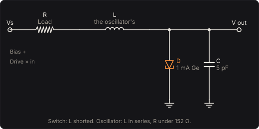

# Tunnel Diode

A diode whose current falls as its voltage rises. In 1958 Leo Esaki found that a germanium
junction doped heavily enough conducts less and less past a small forward voltage, because its
electrons tunnel through the junction rather than climbing over it. He shared the 1973 Nobel Prize in Physics for it. Between its peak and its valley the diode's
resistance is negative, and a negative resistance, given a load, either remembers or oscillates:
with a load resistor this pedal is a switch with memory that turns each note into a square wave,
and with an inductor a relaxation oscillator your bass plays.

Part of [PhuzzBox](../README.md).

| Input | |
|---|---|
| Your audio interface | pick it in the source menu (then **In 1** or **In 2**) |
| `Z`…`/`, `A`…`;`, `Q`…`P`, `1`…`0` | the test bass's E, A, D and G strings, open to the ninth fret |
| `Space` | the footswitch |



## The circuit

A source Vs = Bias + Drive × your bass drives the diode through the load R; in the oscillator an
inductor L is in series with it. Across the diode is its own capacitance, C = 5 pF. With i the
current through the load:

  L di/dt = Vs − R i − V,   C dV/dt = i − I(V),

and in the switch, with no inductor, i = (Vs − V)/R. The output is the diode's voltage V, through
a 5 Hz coupling high-pass.

## The diode

The current is Sze's sum of three:

  I(V) = Ip (V/Vp) e^(1 − V/Vp) + Jx e^(C4 (V − Vv)) + I0 (e^(V/VT) − 1).

The first is tunnelling, which Sze gives as an empirical formula that fits it "quite well": it
rises from nothing to its peak Ip at Vp and dies away past it, as the bands on either side of the
junction stop lining up. The second is the excess current, through states in the gap, which keeps
the valley from going to nothing. The third is the ordinary diffusion current of a junction, with
VT = kT/q, 25.7 mV at 25 °C; Sze writes it without an ideality factor, and so does this.

The numbers are the General Electric Tunnel Diode Manual's for a typical 1 mA germanium diode
(its Fig. 2.5 and p. 12): the peak, 1 mA at 55 mV; the valley, 0.1 mA at 350 mV; and the forward
point, where the current is back to the peak's, at 500 mV. GPD's 1N3712, a 1 mA germanium diode,
gives 65 mV, 0.12 mA and 350 mV. The three unknowns are fitted to GE's points: the excess current
puts the valley at 350 mV and 0.1 mA, its slope zero there (Jx = 67.7 µA, C4 = 5.33 /V), and
diffusion brings the current back to 1 mA at 500 mV (I0 = 2.99 pA). The excess current lifts the
peak 1.4 %, to 1.014 mA at 55.2 mV. The peak-to-valley ratio is 10, where Sze gives 8 for
germanium and GE requires at least 8 of its 1N2939. The steepest negative slope, at 110 mV, is
−6.6 mS, −152 Ω, inside the 0.006 to 0.010 mho GE gives for a 1 mA germanium diode. The diode's
capacitance is GE's typical 5 pF.

Sze's formula is fitted to the forward curve. In reverse the tunnelling term grows fast, as a
tunnel diode's reverse current does; the pedal takes it at its word there.

## The switch

The load line, the current the source can push through the load at each voltage of the diode,
I = (Vs − V)/R, is straight. Where it crosses the curve the circuit can rest. Steeper than the
diode's steepest negative slope, R > 1/|g| = 152 Ω, it can cross three times: the middle crossing,
on the falling part, is unstable, and the diode rests at one of the outer two, the low branch or
the high one. This is the GE manual's bistable circuit (its Fig. 5.1), which needs exactly that,
a load over |1/g|.

The diode stays on its branch until the branch ends, where the load line is tangent to the curve,
and then jumps to the other one in nanoseconds (RC with 5 pF). Going up, Vs = V + R I(V) at its
local maximum; coming down, at its local minimum. With 1 kΩ the switch jumps up when the source
passes 1071 mV and down when it falls under 412 mV. Between the two is its memory: 0.1 V wide at
330 Ω, 0.66 V at 1 kΩ, 1.7 V at 2.2 kΩ. Under 152 Ω there is none: the load line crosses once
wherever it is, and the voltage runs steeply but smoothly through the falling part.

Played, the switch is a Schmitt trigger. Centred at 760 mV with 2 V/V of drive, a note has to
peak over 0.155 V to flip the diode up and 0.174 V to flip it back. A note that does comes out a
square wave: at 0.3 V, 0.65 V from trough to crest (the jump between the branches, plus what each
branch passes of the note), its third harmonic 30 % of it and its even harmonics under 3 %. A
note that doesn't stays on its branch, which passes a twentieth of it, so a dying note stops
switching rather than fading. Biased off centre, at 900 mV, a note flips the switch up at
0.085 V but back only at 0.244 V: the square is lopsided, with a 26 % second harmonic. With the
narrow memory, 330 Ω centred at 346 mV, a note of 25 mV flips it.

## The oscillator

Put an inductor in series and a load under 152 Ω, and bias the load line so it crosses only on
the falling part. Nothing is stable there. The current ramps through the inductor along one
branch until the branch ends, at the peak or the valley; the voltage jumps across at that current
in nanoseconds; and the current ramps back along the other branch. This is the GE manual's
relaxation oscillator (its Fig. 5.9), whose "DC load line must intersect the tunnel diode
characteristic in the negative resistance region". With 20 Ω that is a source between 76 and
352 mV, the peak's and the valley's voltages plus 20 Ω times their currents.

With the capacitance too small to matter, the current climbs the low branch from the valley's
current to the peak's, and falls back down the high one, so the period is

  T = L ∫ di/(Vs − R i − Vlow(i)) + L ∫ di/(R i + Vhigh(i) − Vs), both from Iv to Ip,

and goes as L: at 20 Ω and 200 mV, 2.32 kHz at 0.05 H, 232 Hz at 0.5 H, 23.2 Hz at 5 H. The
bias moves it too: with 0.5 H, 125 Hz at 100 mV, 246 Hz at 250 mV, 235 Hz at 300 mV. Your bass
moves the bias, so it plays the oscillator's pitch; driven harder, its crests carry the source
out of the window, where the oscillator stops on a branch until the note swings back. Rested at
50 mV, under the 76 mV where it starts, the oscillator is silent until a note pushes it in.

## Solving it

The circuit runs at four times the host's rate (twice at medium quality, once at low), by
backward Euler: each step solves one equation for the diode's voltage,

  (L i/h + Vs − V)/(L/h + R) − I(V) − (C/h)(V − V0) = 0,

which has up to three roots near the switch's thresholds. The one the circuit takes is the first
root in the direction the voltage is moving, so the solver marches from where the voltage was
toward it, a Newton step at first and then doubling, never more than 5 mV at a time, until the
equation changes sign, then finishes with Newton kept inside that bracket, to a nanovolt. On a
branch that is about three evaluations of the diode a step; across a jump the march takes the
voltage the whole way.

## The controls

- **Drive** (V/V): how much of the bass reaches the source.
- **Bias** (mV): the source with nothing playing; an expression pedal moves it.
- **Load** (Ω): the resistor between the source and the diode; over 152 Ω, memory.
- **Inductor** (H): the oscillator's; its pitch goes as 1/L.
- **Level** (dB): the output.
- **Circuit**: the switch, or the oscillator.

## The views

- **The diode**: the diode's current against its voltage, the load line at the bias and where the
  bass has it now, and where the diode is as you play.
- **The switch**: the diode's voltage against the source's, its two branches and the jumps between
  them, and where it is as you play; and two periods of the note you play, the source and the diode.
- **Scope**: the input and the output in volts.
- **Spectrum**: the input's and the output's.

## What to listen for

- **A switch with memory**: every note a square wave of the same height, and a note's tail cut off
  where it stops reaching the threshold, a gate.
- **Narrow memory** keeps switching far into a note's decay; **Wide memory**, with five times the
  drive, needs a firm note.
- **Lopsided**: the square's duty off half, and a hollower, reedier tone from its even harmonics.
- **No memory**: no jumps, the voltage running through the falling part: a steep, smooth clipper.
- **Relaxation oscillator**: a buzz at 232 Hz that your bass bends; **Low drone**, the same at
  23 Hz, a sputter; **Gated buzz**, silence until each note's crests push it into the window.

## What is simplified

- The diode is a fit of Sze's empirical formula to GE's typical points, not a measured part, and
  it does not change with temperature (GE gives the peak voltage +60 µV/°C and the valley's
  −1.0 mV/°C).
- The source is ideal and the load a pure resistance; the inductor has no resistance of its own
  beyond the load and no capacitance.
- The diode's series resistance (GE's 1.5 Ω) and its package's inductance are left out.
- Backward Euler, in steps of 5.2 µs at 48 kHz and high quality, puts each jump at a step rather
  than where its branch ends, so the oscillator runs a little fast at its highest pitches: about
  1 % at 2.3 kHz.

## Files

```
tunnel/index.html, style.css             page
tunnel/src/tunnel-params.js              parameters and presets
tunnel/src/tunnel-pedal.js               the descriptor: everything but the page
tunnel/src/tunnel-main.js                page wiring and views
tunnel/src/tunnel-worklet.js             its AudioWorklet module
tunnel/src/tunnel-tour.js                the guided tour
tunnel/src/tunnel-schematics.js          the circuit diagram
tunnel/wasm/tunnel.wasm                  built from the C++
native/pedals/tunnel/                    the diode, the circuit's solver and the engine in C++
test/tunnel-circuit.mjs                  the circuit worked out independently, for the tests
test/tunnel-tests.mjs                    node test/tunnel-tests.mjs
```

## Prior art and references

* Esaki, L. (1958). "New Phenomenon in Narrow Germanium p–n Junctions." *Physical Review* 109(2),
  603–604. [doi:10.1103/PhysRev.109.603](https://doi.org/10.1103/PhysRev.109.603)
* The Nobel Prize in Physics 1973: Leo Esaki and Ivar Giaever "for their experimental discoveries
  regarding tunneling phenomena in semiconductors and superconductors, respectively", and Brian
  Josephson. [nobelprize.org](https://www.nobelprize.org/prizes/physics/1973/summary/)
* Sze, S. M. & Ng, K. K. (2007). *Physics of Semiconductor Devices*, 3rd ed. Hoboken: Wiley.
  Ch. 8, "Tunnel Devices": eq. (16), the tunnelling current Ip (V/Vp) e^(1 − V/Vp), empirical; eqs.
  (27)–(29), the excess and diffusion currents and their sum; peak-to-valley ratios, 8 for
  germanium. [doi:10.1002/9780470068328.ch8](https://doi.org/10.1002/9780470068328.ch8)
* General Electric (1961). *Tunnel Diode Manual*, 1st ed. Liverpool, New York: GE Semiconductor
  Products Department. p. 12, germanium's peak, valley and forward-point voltages, 55, 350 and
  500 mV, and the negative conductance of a 1 mA diode, 0.006 to 0.010 mho; Fig. 2.4, the 1N2939's
  peak-to-valley ratio, at least 8, and the voltages' temperature coefficients; Fig. 2.5, a typical
  1 mA diode, 0.1 mA valley, 1.5 Ω and 5 pF; Fig. 5.1, the bistable circuit; Fig. 5.9, the
  relaxation oscillator. [scan](https://archive.org/details/GeTunnelDiodeManual)
* Germanium Power Devices Corp. (1985). *1N3712–20 / 1N3713–21 Tunnel Diodes Specifications*:
  the 1N3712, 1.0 mA at 65 mV, 0.12 mA at 350 mV, 500 mV forward point, 5 pF.
  [datasheet](https://w140.com/tekwiki/images/3/3d/1N3718-GPD_Optoelectronic_Devices.pdf)
