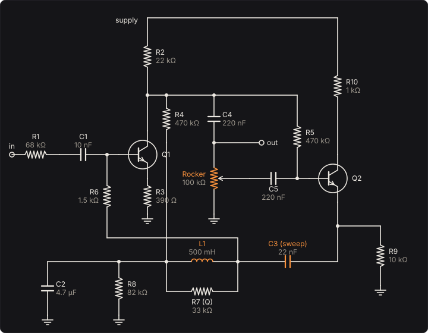

# Wah

An inductor wah, the kind from the late 1960s that every rocker pedal since has copied: two
transistors, a coil of half a henry, and a pot under your foot. The coil and a capacitor make a
resonance, the transistors make a loop that pushes back on it, and the pot sets how hard. Heel
down, the loop pushes hardest, so the capacitor looks many times larger than it is and the peak sits
low and sharp. Toe down, the loop is nearly open and the peak rises to where the coil and
capacitor alone put it, broader. The Wah solves that circuit, every resistor, capacitor and both
transistors, sample by sample. Its sweep is set for bass: a 22 nF sweep capacitor in place of the
original's 10 nF moves the whole range down from a guitar's 430 Hz–2.2 kHz to about 290 Hz–1.5 kHz.

Rock it with the **Rocker** knob, or with an expression pedal: an FC-300's second expression pedal
(MIDI CC 1) moves it from the start (see [Playing it with your feet](#playing-it-with-your-feet)).

Part of [PhuzzBox](../README.md).

| Input | |
|---|---|
| Your audio interface | pick it in the source menu (then **In 1** or **In 2**) |
| A MIDI foot controller | **Connect MIDI** in the MIDI pedals card: CC 1 the rocker, CC 7 the volume, CC 65 the footswitch |
| `Z`…`/`, `A`…`;`, `Q`…`P`, `1`…`0` | the test bass's E, A, D and G strings, open to the ninth fret |
| `Space` | the footswitch |

## The physics

The circuit, with the parts Holters and Zölzer list for the pedal they measured (DAFx 2011), the
nodes numbered as theirs:

| part | value | between | part | value | between |
|---|---|---|---|---|---|
| R1 | 68 kΩ | input, 2 | C1 | 10 nF | 2, Q1's base |
| R2 | 22 kΩ | Q1's collector, supply | C2 | 4.7 µF | 6, ground |
| R3 | 390 Ω | Q1's emitter, ground | C3 | **sweep**, 22 nF | 7, Q2's emitter |
| R4 | 470 kΩ | Q1's collector, 6 | C4 | 220 nF | Q1's collector, output |
| R5 | 470 kΩ | Q1's collector, Q2's base | C5 | 220 nF | wiper, Q2's base |
| R6 | 1.5 kΩ | Q1's base, 7 | L1 | 500 mH | 6, 7 |
| R7 | **Q**, 33 kΩ | 6, 7 (across the coil) | VR1 | 100 kΩ | output, wiper, ground |
| R8 | 82 kΩ | 6, ground | Q1, Q2 | NPN | Iₛ = 20.3 fA, β_F = 1430, β_R = 4 |
| R9 | 10 kΩ | Q2's emitter, ground | supply | 8.15 V | after the polarity diode |
| R10 | 1 kΩ | Q2's collector, supply | | | |



Q1 is a common-emitter stage, its gain a few tens; its collector drives the pot, and the output
is the top of the pot. The wiper passes a share of that swing to Q2, an emitter follower, which
drives the top of the coil through the sweep capacitor C3; the coil's current returns to Q1's base
through R6. A capacitor whose far end is driven by an amplified copy of its near end looks, from
the near end, like a capacitor (1 + A) times larger (the Miller effect), so the loop's gain A sets
the resonance:

  f ≈ 1 / (2π √(L₁ C₃ (1 + A)))

Toe down, the wiper sits near the bottom of the pot, A ≈ 0, and f is the coil and C3 alone:
1/(2π√(0.5 H · 10 nF)) = 2.25 kHz for the original, which a real one measures at about 2.22 kHz.
Heel down the loop gain is about 27 (the square of the two peaks' ratio, less one) and the peak
falls past 400 Hz (433 Hz measured), sharpening
as it goes, because the same loop that grows the capacitance cancels the damping. R7, across the
coil, is the damping that is left: more of it, a taller and narrower peak.

The pot does not reach its ends: the wiper's travel runs from 0.8 % to 99.9 % of the track, as in
the paper. Through that travel a linear pot crowds the sweep's top octave into its last tenth;
**Pot taper** offers an audio (log) taper instead, the lower part of the track (81^t − 1)/80 of
it at travel t from the toe, which puts mid-travel about halfway up the sweep in octaves.

**Solving it.** Every resistor, capacitor and inductor is linear; the transistors are Ebers–Moll
(Ebers and Moll 1954), two exponential junctions each, with the paper's parameters. The circuit is
solved by the nodal DK method (Yeh, Abel and Smith 2010), in `native/core/include/phuzzbox/dk.h`:
each capacitor and inductor becomes its trapezoidal companion, a conductance and a current that
carries its state (which is exactly the bilinear transform); modified nodal analysis of what is
then a resistive network gives every node's voltage as a matrix times the states, the input and
the junctions' currents; and each sample is a Newton iteration on just the four junction voltages
(usually two steps, with SPICE's junction limiting), then the states' update. When the pot moves,
the nodal matrix is inverted again (Holters and Zölzer's subject, which they make cheaper with the
Woodbury identity; at 11 unknowns the plain inverse every 32 samples costs little). The DC operating
point comes first, by Newton with the supply stepped up from zero, and the states start there, so
the pedal opens without a thump.

The rocker glides to where it is told over about 10 ms (32-sample steps): a MIDI expression pedal
reports 128 positions, and the sweep would otherwise step audibly between them. A real rocker's
gear and mass smooth it the same way.

**Volts in.** Q1's base sees a small share of the input (R1's 68 kΩ against the low impedance at
the base), so the junctions stay nearly linear for a gentle note: 0.01 % distortion at 10 mV. A passive bass dug in
hard reaches 1 V, and the exponential shows, about 1 % at 110 Hz near the heel, and four times that
on a 5 V supply. That is what **Full scale** on the page is for.

The controls:

- **Rocker**: the pot's position, heel (0 %) to toe (100 %); **Pot taper** its taper.
- **Range** (the sweep capacitor C3): 10 nF the original, 22 nF the bass default, up to 100 nF.
  The sweep moves as 1/√C. A page set for a guitar (the Rig's **Instrument**) starts at 10 nF.
- **Q** (R7): the damping across the coil.
- **Inductor** (L1): the sweep moves as 1/√L; the peak rises a little with it.
- **Supply**: the transistors' rail.
- **Clean blend**: a blend pot between the dry signal and the wah, as bass wahs have, because the
  circuit leaves 100 Hz about 11 dB down, wherever the rocker is.
- **Level**: gain after it all. The peak is 18–27 dB above the input, as the real pedal's is; turn
  this down if engaging it jumps.
- **Reversed**, in **Plugged in backwards**: your bass into the output jack and the input jack to
  the amp (see [Plugged in backwards](#plugged-in-backwards)). It brings in the bass's pickup, the
  cables and the amp's input, as the Phuzz has them.

## Plugged in backwards

Swap the cables on a wah, the bass into its output and its input to the amp, and it still makes a
sound, though not a wah's. Guitarists have known this since the 1960s: JAM Pedals' Seagull is
sold on the story that a roadie plugged David Gilmour's wah in backwards, and a player who did it
by accident to a Cry Baby describes an ear-piercing noise that the rocker and the guitar's volume
knob both played.

The footswitch is a true bypass, a switch that joins the two jacks with a wire, so bypassed the
pedal plays the same either way round. Engaged, the bass drives node 8, the top of the pot, where
Q1's collector meets the output. The signal can only go one way from there: through the wiper and
C5 to Q2, which drives the top of the coil through C3; the coil's current reaches Q1's base
through R6; and the base reaches the input jack through C1 and R1, into the cable and the amp. The
loop that makes the resonance has become the signal's path.

But Q1 still amplifies its base back onto node 8, and node 8 now has the bass on it. Plugged in
the right way round, node 8 drives the pot and the next input; backwards, the pickup's coil hangs
on it too, 10.5 kΩ and 3.6 H, whose inductance turns the phase of what Q1 sends round the loop. From
a passive bass, the loop comes back larger than it left at the frequency where its phase has come
round, and the circuit oscillates on its own. The tests find it two ways: the circuit's linearised
equations, written out independently and stepped by backward Euler, have a disturbance that grows
(e-fold in about 3 ms heel down, 358 per second, at 401 Hz), and the engine, from silence, squeals
within 40 ms, over exactly the same part of the rocker's travel.

The transistors' exponentials limit how far it grows, and the rocker plays it: about 880 Hz and
2 V heel down, rising to 1.16 kHz and quietening to 0.36 V at 60 %, and gone past about three
quarters of the travel, where the wiper passes Q2 too little for the loop to sustain itself. That
is the seagull: pitched by your foot, a few semitones of glide, buzzy with harmonics (the second
only a few decibels below the first). **Range** moves it as it moves the sweep, heel down 1.25 kHz
with the guitar wah's 10 nF and 553 Hz with 47 nF. A low note played into it does not make it
louder: it shakes it, spreading it into sidebands spaced by the note's frequency, more the harder
you play.

From an **active** bass it does not squeal: its preamp holds the jack with about 1 kΩ, and Q1
cannot swing it. What is left is a filter, the bass reaching the amp through the loop: heel down a
peak at 931 Hz, 11.2 dB above the input; at halfway 1.39 kHz, 6.4 dB below it; toe down 1.52 kHz,
42.5 dB below, where the wiper passes almost nothing.

The bass is the Buffer's pickup, a Norton source as the Phuzz has it: the current that, into what
your interface's recording saw (the coil, the cables' capacitance, the pots, the interface), makes
the voltage it recorded, put into the wah's output jack instead. The input jack drives the cable to
the amp through R1's 68 kΩ: 30 m of cable takes the squeal down by about 7 dB, and an input of
10 kΩ by about 18 dB. The cable from the bass hardly matters, since the circuit loads its jack so
heavily. In **Auto** the follower listens at the input jack, which backwards carries the squeal:
rocking up from the heel, the squeal pushes the rocker toward the toe until it holds itself at
the edge, steady and much quieter (about 0.14 V); rocking down from near the toe, it never starts.
**The sweep** shows the squeal's pitch while it squeals, since then there is no steady
response to draw, and the filter's response from an active bass, far lower than the wah's.

## Playing it with your feet

The page listens to MIDI foot controllers through Web MIDI (Chrome and Edge). For a Roland FC-300:
connect its MIDI OUT to a USB MIDI interface (a Roland UM-ONE mk2 with its switch on TAB needs no
driver on a Mac), put the FC-300 in Control Change mode, open the page and press **Connect MIDI**.
As it leaves the factory the FC-300 sends (owner's manual, pp. 21–22):

| FC-300 | sends | moves, by default |
|---|---|---|
| expression pedal 1 | CC 7, 0–127 | the volume, through a volume pedal's audio taper |
| expression pedal 2 | CC 1, 0–127 | the Rocker |
| number pedal 1 | CC 65, latching | the footswitch (127 engaged) |
| number pedal 2 | CC 66, latching | the tuner's mute |
| number pedals 3–10 | CC 67–74, latching | nothing yet: teach them |
| CTL 1–2 | CC 80–81, momentary | nothing yet: teach them (set the row to momentary) |

To teach a pedal another control, press **Learn** on a row (or **+ Add a pedal**) and move the
pedal; pick the control it moves from the row's menu. **reverse** turns an expression pedal round;
a footswitch row says whether it latches (127, then 0) or is momentary (127 while held). The map is
kept in your browser, one per pedal page. The plugins listen too: their MIDI input moves Rocker,
Volume pedal and Bypass by the same defaults.

## Auto: rocked by how hard you play

**Rocked by** on Auto hands the rocker to an envelope follower, which is how an auto-wah plays
without a foot. The follower is a capacitor C charged from the full-wave rectified input through an
attack resistor R_a, while the input is above it (an ideal diode), and always discharged through a
decay resistor R_d:

  C dv/dt = (|v_in| − v)/R_a · [|v_in| > v] − v/R_d,  τ_a = R_a C,  τ_d = R_d C

Its voltage moves the rocker from where it rests, the rocker on the pedal or your expression pedal, toward
the toe (Direction up) or the heel (down):

  up: x = x_rest + (1 − x_rest)·min(1, v/V_full),  down: x = x_rest·(1 − min(1, v/V_full))

V_full is **Full sweep at**. A steady note charges the capacitor with τ = τ_a τ_d/(τ_a + τ_d)
toward τ_d/(τ_a + τ_d) of its peak. With the defaults, 5 ms and 0.25 s, that is 98 %, so the
follower reads close to the note's peak. Let go, and it falls through R_d alone, as e^(−t/τ_d).

Each sample takes the exact step of those equations with the input held through it. The wiper
moves to the follower's rocker every 32 samples (0.7 ms) and the circuit is updated there. Auto has
no glide of its own, because the follower is its glide. The test bass's A through **Auto: funky
envelope** takes the peak to 1477 Hz in its first 150 ms and lets it fall to 473 Hz by 1.5 s.

## What to listen for

- **Sweep it slowly on a held low A**: the peak walks up through the harmonics, each ringing out in
  turn; heel down, the second and third harmonics honk.
- **Guitar wah as built (10 nF)**: thinner and higher; on bass most of the sweep is above the
  fundamental.
- **Bass wah, bottom kept**: the blend keeps the note's weight under the vowel.
- **Q at 100 kΩ**: nasal and vocal; at 15 kΩ a gentle tone control.
- **Auto: funky envelope**: each pluck says *wow*, harder ones longer. **Auto: downward** turns
  it round, the pluck dark and the note opening up as it fades.
- **Plugged in backwards**: the seagull. Rock it slowly from the heel: the squeal climbs and fades,
  and stops past three quarters. Dig into a low note and hear it shake the squeal.

## What is simplified

- The coil is an ideal inductor. A real one has a few tens of ohms of winding resistance, an
  inductance that changes with frequency (real ones measure 440–650 mH at 1 kHz and up to 30 % more
  at 100 Hz, in the forum's measurements), and a core that saturates on big signals.
- The pot is two resistors; a worn track's taper and its contact noise are not here.
- The pedal's input loads the pickup (68 kΩ plus a little, much less than an amplifier's 1 MΩ),
  which on a real passive bass dulls the top before the wah does anything. The pedal here sees the
  signal as your interface recorded it. On the [Pedalboard](../board/README.md) its 68 kΩ loads the
  pedal before it, but it still takes the signal as recorded when it is first.
- The transistors are Ebers–Moll without their capacitances, the Early effect or noise. Nothing in
  this circuit runs near their high-frequency limits.
- Nothing is oversampled. The junctions bend gently, and their harmonics of a bass note sit far
  below Nyquist.
- The rocker's glide is a first-order lag of 10 ms, not a model of a gear and a pedal's mass.
- In Auto the follower's voltage sets the wiper directly, as if a perfect motor turned the pot.
  Real auto-wahs drive a photocell or a transistor in the pot's place, each with a law and lag of
  its own. The follower's diode is ideal, and its rectifier has no offset or droop.
- Plugged in backwards: a real pickup's losses (eddy currents in its pole pieces and cover) damp
  it more than its wire's resistance alone does. The loop grows by hundreds per second, far past the
  edge, so they would not stop the squeal, but they would move where it gives out near three
  quarters of the travel. The squeal's harmonics are stronger than a note's and nothing is
  oversampled, but by 20 kHz they are 60 dB down, and at four times the rate it comes out the same
  within 2 dB harmonic by harmonic. The bass's volume pot is part of the one resistance to ground
  here, so the volume knob guitarists play the squeal with is not modelled. The Clean blend is not
  part of the circuit model, so backwards it is off.

## Files

```
wah/index.html, style.css                page
wah/src/wah-params.js                    parameters and presets
wah/src/wah-pedal.js                     the descriptor: everything but the page
wah/src/wah-main.js                      page wiring and views
wah/src/wah-worklet.js                   its AudioWorklet module
wah/wasm/wah.wasm                        built from the C++
native/pedals/wah/                       the circuit and the engine in C++ (plugins and WebAssembly)
native/core/include/phuzzbox/dk.h        the nodal DK solver
shared/midi.js, shared/midi-panel.js     the MIDI pedals card
test/wah-tests.mjs                       node test/wah-tests.mjs
```

## Prior art and references

* Holters, M. & Zölzer, U. (2011). "Physical modelling of a wah-wah effect pedal as a case study
  for application of the nodal DK method to circuits with variable parts." *Proc. 14th Int. Conf.
  on Digital Audio Effects (DAFx-11)*, Paris.
  [PDF](https://www.dafx.de/paper-archive/2011/Papers/21_e.pdf). The circuit, its parts (their
  Table 1), the transistors' parameters, the pot's travel, and the measured responses this model
  is built to.
* Yeh, D. T., Abel, J. S. & Smith, J. O. (2010). "Automated physical modeling of nonlinear audio
  circuits for real-time audio effects, Part I: Theoretical development." *IEEE Trans. Audio,
  Speech, and Language Processing* 18(3).
  [PDF](https://ccrma.stanford.edu/~dtyeh/papers/yeh10_taslp.pdf). The nodal DK method.
* Ebers, J. J. & Moll, J. L. (1954). "Large-signal behavior of junction transistors." *Proc. IRE*
  42(12), 1761–1772. [doi:10.1109/JRPROC.1954.274797](https://doi.org/10.1109/JRPROC.1954.274797).
* "A 'Vox wah' project: some circuit analysis and measuring results," Music Electronics Forum
  (thread).
  [link](https://music-electronics-forum.com/forum/effectification/guitar-effects/923600-a-%E2%80%9Evox-wah%E2%80%9C-project-some-circuit-analysis-and-measuring-results?p=923939).
  Measured peaks of real pedals (about 433 Hz heel down, 2.22 kHz toe down with 10 nF and a
  510 mH coil), the parts' roles, and their coils' inductance against frequency.
* JAM Pedals, The Seagull, at [Perfect Circuit](https://www.perfectcircuit.com/jam-pedals-the-seagull.html):
  a pedal that "recreates the classic reversed-wah effect", after the story that "a roadie plugged
  in David Gilmour's wah pedal backwards".
* "So I accidentally mixed up the instrument and amplifier cables on my Crybaby," Gibson forum
  (thread). [link](https://forum.gibson.com/topic/38360-so-i-accidentally-mixed-up-the-instrument-amplifier-cables-on-my-crybaby).
  "An ear-piercing noise", "controllable by both the wah pedal and volume knob on the guitar".
* Roland FC-300 MIDI Foot Controller Owner's Manual, "Control Change mode," pp. 21–22.
  [link](https://www.manualsdir.com/manuals/202040/roland-fc-300.html?page=21). The factory CC
  numbers the MIDI defaults follow.
